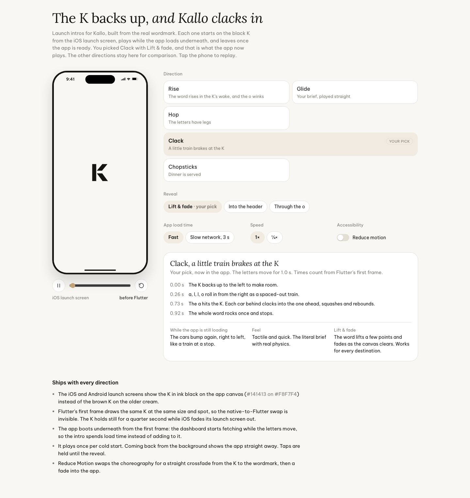

# Kallo Launch Intros

The board as rendered: [launch-intros.jpg](launch-intros.jpg). Its text and frames follow, in order. The live page is interactive: it plays each direction on a phone and lets you switch reveal, load time and speed. That page is in the full repository (https://github.com/VoMinhKhoii/motion-graphic-skill, same folder); this still shows the chosen direction, Clack.

---

## The K backs up, and Kallo clacks in

Launch intros for Kallo, built from the real wordmark. Each one starts on the black K from the iOS launch screen, plays while the app loads underneath, and leaves once the app is ready. You picked Clack with Lift & fade, and that is what the app now plays. The other directions stay here for comparison. Tap the phone to replay.

Direction

Rise The word rises in the K’s wake, and the o winks Glide Your brief, played straight Hop The letters have legs Clack YOUR PICK A little train brakes at the K Chopsticks Dinner is served

Th 6 25 Th 7 26 CN 27 Th 2 28 Th 3 29 Th 4 30 Th 5 1 Hôm nay 1.932 kcal còn lại đã ghi 0/1.932 ĐẠM 0g /145g CARB 0g /169g CHẤT BÉO 0g /75g Bữa ăn gần đây Đã ghi 0 Chưa ghi nhận bữa ăn nào hôm nay Những bữa ăn sẽ hiển thị ở đây 61.5 kg ↓ 1.0 9:41

iOS launch screen before Flutter

Reveal

Lift & fade · your pick Into the header Through the o

App load time

Fast Slow network, 3 s

Speed

1× ¼×

Accessibility

Reduce motion

Clack, a little train brakes at the K

Your pick, now in the app. The letters move for 1.0 s. Times count from Flutter's first frame.

0.00 s The K backs up to the left to make room. 0.26 s a, l, l, o roll in from the right as a spaced-out train. 0.73 s The a hits the K. Each car behind clacks into the one ahead, squashes and rebounds. 0.92 s The whole word rocks once and stops.

While the app is still loading The cars bump again, right to left, like a train at a stop.

Feel Tactile and quick. The literal brief with real physics.

Lift & fade The word lifts a few points and fades as the canvas clears. Works for every destination.

### Ships with every direction

- The iOS and Android launch screens show the K in ink black on the app canvas (#141413 on #F8F7F4) instead of the brown K on the older cream.

- Flutter's first frame draws the same K at the same size and spot, so the native-to-Flutter swap is invisible. The K holds still for a quarter second while iOS fades its launch screen out.

- The app boots underneath from the first frame: the dashboard starts fetching while the letters move, so the intro spends load time instead of adding to it.

- It plays once per cold start. Coming back from the background shows the app straight away. Taps are held until the reveal.

- Reduce Motion swaps the choreography for a straight crossfade from the K to the wordmark, then a fade into the app.
