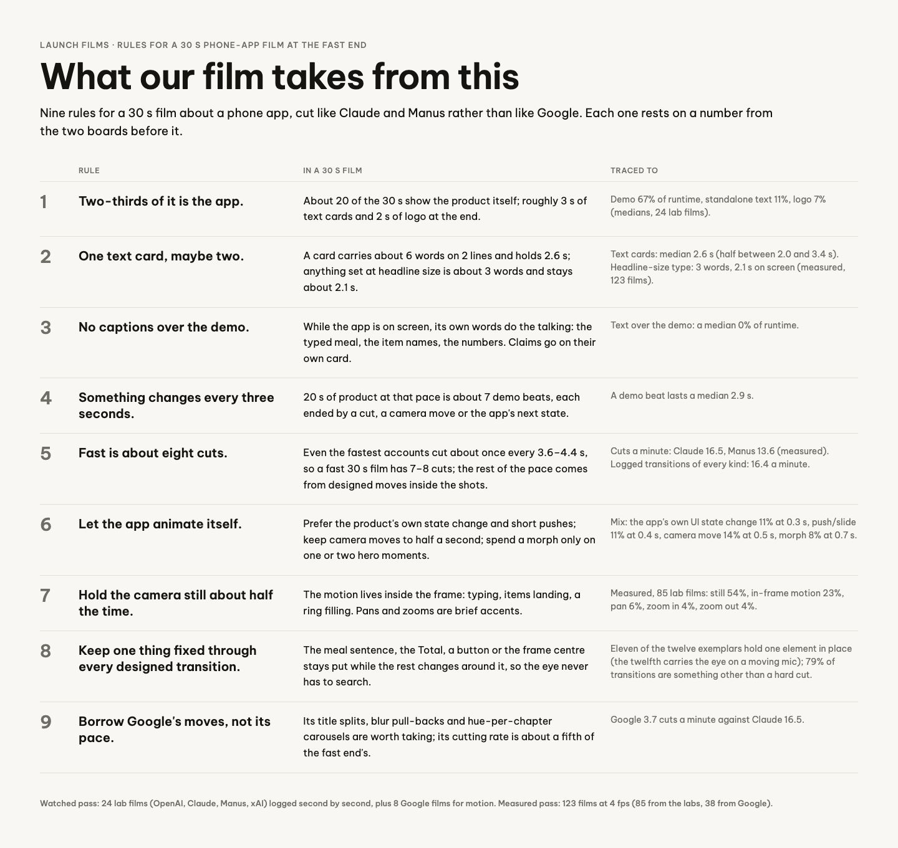

# Launch films · What our film takes from this

The board as rendered: [DistRules.jpg](DistRules.jpg). Its text and frames follow, in order.

---

LAUNCH FILMS · RULES FOR A 30 S PHONE-APP FILM AT THE FAST END

## What our film takes from this

Nine rules for a 30 s film about a phone app, cut like Claude and Manus rather than like Google. Each one rests on a number from the two boards before it.

RULE

IN A 30 S FILM

TRACED TO

1

Two-thirds of it is the app.

About 20 of the 30 s show the product itself; roughly 3 s of text cards and 2 s of logo at the end.

Demo 67% of runtime, standalone text 11%, logo 7% (medians, 24 lab films).

2

One text card, maybe two.

A card carries about 6 words on 2 lines and holds 2.6 s; anything set at headline size is about 3 words and stays about 2.1 s.

Text cards: median 2.6 s (half between 2.0 and 3.4 s). Headline-size type: 3 words, 2.1 s on screen (measured, 123 films).

3

No captions over the demo.

While the app is on screen, its own words do the talking: the typed meal, the item names, the numbers. Claims go on their own card.

Text over the demo: a median 0% of runtime.

4

Something changes every three seconds.

20 s of product at that pace is about 7 demo beats, each ended by a cut, a camera move or the app's next state.

A demo beat lasts a median 2.9 s.

5

Fast is about eight cuts.

Even the fastest accounts cut about once every 3.6–4.4 s, so a fast 30 s film has 7–8 cuts; the rest of the pace comes from designed moves inside the shots.

Cuts a minute: Claude 16.5, Manus 13.6 (measured). Logged transitions of every kind: 16.4 a minute.

6

Let the app animate itself.

Prefer the product's own state change and short pushes; keep camera moves to half a second; spend a morph only on one or two hero moments.

Mix: the app's own UI state change 11% at 0.3 s, push/slide 11% at 0.4 s, camera move 14% at 0.5 s, morph 8% at 0.7 s.

7

Hold the camera still about half the time.

The motion lives inside the frame: typing, items landing, a ring filling. Pans and zooms are brief accents.

Measured, 85 lab films: still 54%, in-frame motion 23%, pan 6%, zoom in 4%, zoom out 4%.

8

Keep one thing fixed through every designed transition.

The meal sentence, the Total, a button or the frame centre stays put while the rest changes around it, so the eye never has to search.

Eleven of the twelve exemplars hold one element in place (the twelfth carries the eye on a moving mic); 79% of transitions are something other than a hard cut.

9

Borrow Google's moves, not its pace.

Its title splits, blur pull-backs and hue-per-chapter carousels are worth taking; its cutting rate is about a fifth of the fast end's.

Google 3.7 cuts a minute against Claude 16.5.

Watched pass: 24 lab films (OpenAI, Claude, Manus, xAI) logged second by second, plus 8 Google films for motion. Measured pass: 123 films at 4 fps (85 from the labs, 38 from Google).
