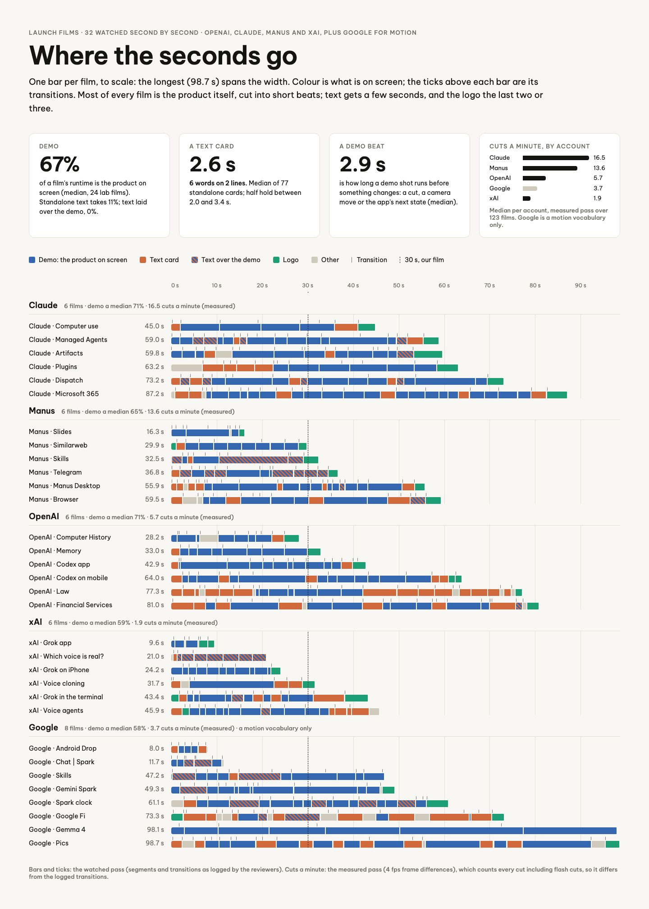

# Launch films · Where the seconds go

The board as rendered: [DistTimelines.jpg](DistTimelines.jpg). Its text and frames follow, in order.

---

LAUNCH FILMS · 32 WATCHED SECOND BY SECOND · OPENAI, CLAUDE, MANUS AND XAI, PLUS GOOGLE FOR MOTION

## Where the seconds go

One bar per film, to scale: the longest (98.7 s) spans the width. Colour is what is on screen; the ticks above each bar are its transitions. Most of every film is the product itself, cut into short beats; text gets a few seconds, and the logo the last two or three.

DEMO

67%

of a film's runtime is the product on screen (median, 24 lab films). Standalone text takes 11%; text laid over the demo, 0%.

A TEXT CARD

2.6 s

6 words on 2 lines. Median of 77 standalone cards; half hold between 2.0 and 3.4 s.

A DEMO BEAT

2.9 s

is how long a demo shot runs before something changes: a cut, a camera move or the app's next state (median).

CUTS A MINUTE, BY ACCOUNT

Claude 16.5

Manus 13.6

OpenAI 5.7

Google 3.7

xAI 1.9

Median per account, measured pass over 123 films. Google is a motion vocabulary only.

Demo: the product on screen Text card Text over the demo Logo Other Transition 30 s, our film

0 s 10 s 20 s 30 s 40 s 50 s 60 s 70 s 80 s 90 s

Claude 6 films · demo a median 71% · 16.5 cuts a minute (measured)

Claude · Computer use 45.0 s

Claude · Managed Agents 59.0 s

Claude · Artifacts 59.8 s

Claude · Plugins 63.2 s

Claude · Dispatch 73.2 s

Claude · Microsoft 365 87.2 s

Manus 6 films · demo a median 65% · 13.6 cuts a minute (measured)

Manus · Slides 16.3 s

Manus · Similarweb 29.9 s

Manus · Skills 32.5 s

Manus · Telegram 36.8 s

Manus · Manus Desktop 55.9 s

Manus · Browser 59.5 s

OpenAI 6 films · demo a median 71% · 5.7 cuts a minute (measured)

OpenAI · Computer History 28.2 s

OpenAI · Memory 33.0 s

OpenAI · Codex app 42.9 s

OpenAI · Codex on mobile 64.0 s

OpenAI · Law 77.3 s

OpenAI · Financial Services 81.0 s

xAI 6 films · demo a median 59% · 1.9 cuts a minute (measured)

xAI · Grok app 9.6 s

xAI · Which voice is real? 21.0 s

xAI · Grok on iPhone 24.2 s

xAI · Voice cloning 31.7 s

xAI · Grok in the terminal 43.4 s

xAI · Voice agents 45.9 s

Google 8 films · demo a median 58% · 3.7 cuts a minute (measured) · a motion vocabulary only

Google · Android Drop 8.0 s

Google · Chat | Spark 11.7 s

Google · Skills 47.2 s

Google · Gemini Spark 49.3 s

Google · Spark clock 61.1 s

Google · Google Fi 73.3 s

Google · Gemma 4 98.1 s

Google · Pics 98.7 s

Bars and ticks: the watched pass (segments and transitions as logged by the reviewers). Cuts a minute: the measured pass (4 fps frame differences), which counts every cut including flash cuts, so it differs from the logged transitions.
