# Launch films · How one shot becomes the next

The board as rendered: [DistTransitions.jpg](DistTransitions.jpg). Its text and frames follow, in order.

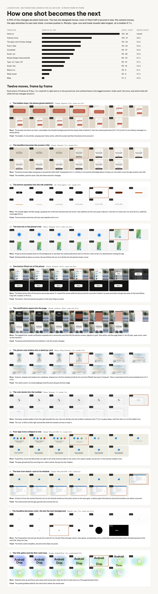

---

LAUNCH FILMS · 298 TRANSITIONS LOGGED IN THE 24 LAB FILMS · 12 MOVES FRAME BY FRAME

## How one shot becomes the next

A fifth of the changes are plain hard cuts. The rest are designed moves, most of them half a second or less: the camera moves, the app animates its own next state, a screen pushes in. Morphs, type-ons and mask reveals take longest, at a median 0.7 s.

TRANSITION SHARE OF ALL 298 SHARE · COUNT MEDIAN LENGTH

Hard cut 21% · 64 instant

Camera move 14% · 41 0.5 s

The app's own UI state change 11% · 32 0.3 s

Push / slide 11% · 32 0.4 s

Crossfade 9% · 27 0.4 s

Scale-out 9% · 26 0.4 s

Morph (shape A becomes B) 8% · 23 0.7 s

Type-on / type-off 6% · 19 0.7 s

Scale-into 6% · 18 0.4 s

Match cut 3% · 8 0.1 s

Mask reveal 2% · 6 0.7 s

Wipe 1% · 2 0.3 s

### Twelve moves, frame by frame

Each strip is 13 frames at 10 fps, 1.2 s, read left to right and on to the second row; the outlined frame is the logged moment. Under each: the move, and what holds still while the rest changes around it.

01

The bubble stays; the phone grows behind it

Claude · Dispatch · 8.9 s · scale-out, 0.5 s

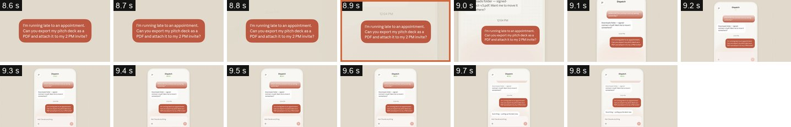

Move · The prompt sits alone as a hero-size bubble; the thread's background and time stamp fade in behind it, then the camera pulls back (9.0–9.4 s) until it is an ordinary message in a whole phone.

Fixed · The bubble. It only shrinks, staying near frame centre, while the screen and then the phone arrive around it.

02

The headline becomes the screen's title

Claude · Dispatch · 2.1 s · morph, 0.3 s

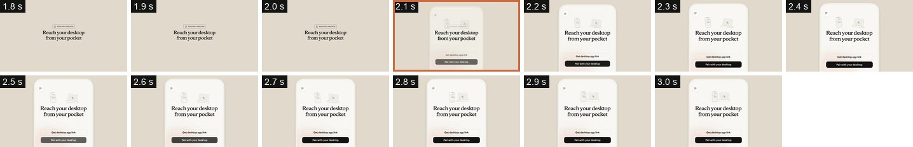

Move · The phone screen fades and grows in around the claim (half-transparent at 2.1 s, solid by 2.2 s) and the pill badge above it drops out; the claim is now the app screen's own title.

Fixed · The headline, pixel for pixel. Only the frame around it changes.

03

The button squashes into the tab underline

xAI · Voice agents · 7.4 s · morph, 0.5 s

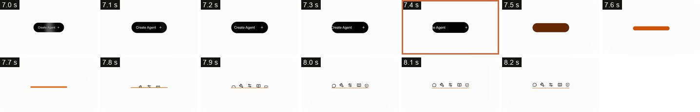

Move · The 'Create Agent' pill fills orange, squashes into a thin bar and becomes the active-tab underline as five icons pop in above it. One link of a chain: pill, iris circle (6.0 s), underline, card edge (9.6 s).

Fixed · The horizontal centre line: pill, bar and underline all sit on it.

04

The lone mic is the phone's mic

Manus · Telegram · 21.7 s · scale-out, 0.4 s

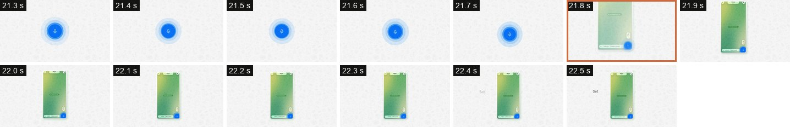

Move · A big mic button pulses alone on the background; in one beat the camera pulls back and it is the mic in the corner of a whole phone running the app.

Fixed · Nothing holds its place on screen: the eye follows the mic as it shrinks into the phone's lower corner.

05

One button lifted out of the phone

Claude · Artifacts · 44.4 s · scale-out, 0.4 s

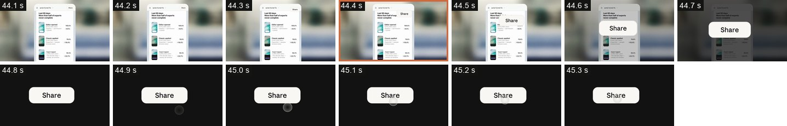

Move · The Share button lifts off the phone and scales about 3× toward the centre while the phone and the room dim to black; its press and state change then play at that size (Share, Copy link, Copied, to 46.5 s).

Fixed · The button. Once the phone has gone it is the only thing on screen.

06

The notification opens into the page

Claude · Artifacts · 38.8 s · scale-into, 0.5 s

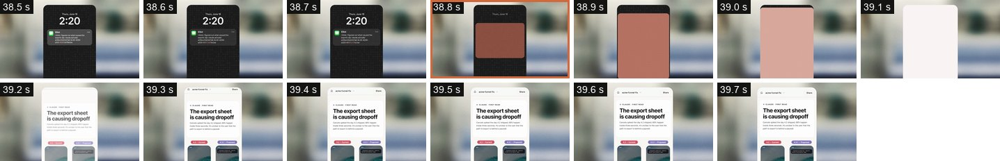

Move · The tapped lock-screen notification expands into a terracotta card that fills the phone's screen, lightens to pink, then white, and the page fades in: the OS app-open zoom, used as the transition.

Fixed · The phone and the blurred room behind it; only the screen changes.

07

The phone card widens into a desktop card

Manus · Manus Desktop · 1.3 s · morph, 0.5 s

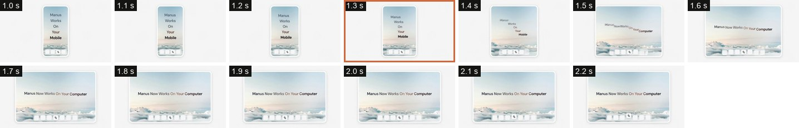

Move · A phone-shaped card widens into a desktop-shaped one; the five stacked words fly into one line ('Mobile' becomes 'Computer', 'Now' is inserted) and the dock spreads from 4 to 7 icons.

Fixed · The card's centre, its cloud wallpaper and the dock along its bottom edge.

08

The coin docks into the toolbar

Manus · Browser · 7 s · morph, 1.5 s

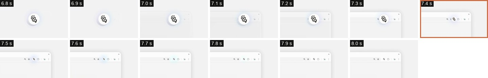

Move · A browser window slides in from the right beneath the coin; the coin shrinks onto the toolbar's extension slot (7.4 s), its glow fades, and from then on it is the toolbar icon.

Fixed · The coin. It drifts a little right and shrinks while the window arrives to meet it.

09

Four app icons collapse to one

Claude · Microsoft 365 · 4 s · morph, 0.4 s

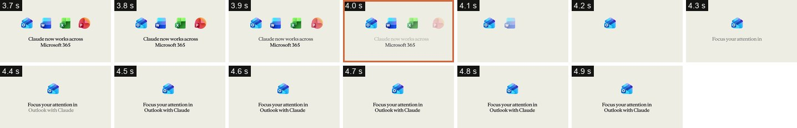

Move · PowerPoint, Excel and Word fade out right to left while Outlook slides to the centre; the caption swaps, line by line, to the Outlook chapter's line.

Fixed · The grey ground and the surviving icon, which carries the eye into the chapter.

10

The lone icon match-cuts to its window

Claude · Microsoft 365 · 7.75 s · match cut

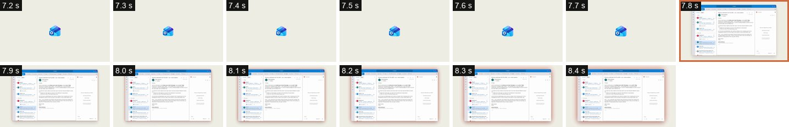

Move · A hard cut from the centred Outlook icon to the Outlook window at the same centre on the same grey; a salmon glow then blooms around the window over about a second.

Fixed · The centre point and the grey ground carry across the cut.

11

The headline becomes a dot, the dot the next background

OpenAI · Law · 7.3 s · scale-into, 0.3 s

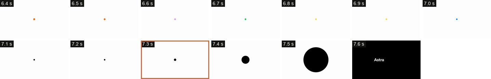

Move · The 'Powered by' line has just shrunk into a dot (6.2 s); the dot flicks through colours, then grows, accelerating, into a circle that covers the frame and is the black ground of the next title, 'Astra for Law'.

Fixed · The frame centre: headline, dot and circle share one point.

12

The title splits and the first card rises

Google · Android Drop · 1.6 s · mask reveal, 0.2 s

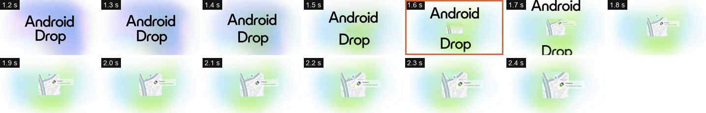

Move · 'Android' exits up and 'Drop' exits down with motion blur while the first UI card rises out of the gap between them.

Fixed · The pastel gradient behind; the card is born where the words were.
