# Hooks and composition

The board as rendered: [RefCollection1.jpg](RefCollection1.jpg). Its text and frames follow, in order.

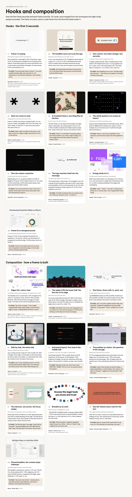

---

TECHNIQUE COLLECTION · 1 / 5

## Hooks and composition

How the first three seconds and each frame are built. 20 cards, each merged from the techniques the eight study passes recorded. The frame on every card is a real frame from the first film listed under it.

### Hooks · the first 3 seconds

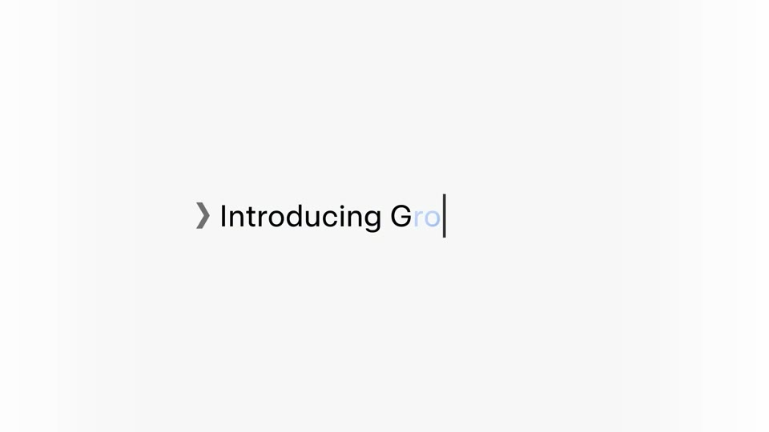

H1

Frame 1 is typing

Naming the product with its own gesture

One centred line, cap height 5–8% of the frame, types at 20–34 characters/s straight into its final layout (no reflow). Fresh letters land in an accent and settle to ink, or the product word flickers through 4–8 colours every 0.125 s and settles by 1.5 s.

For Kallo: The meal types itself on frame 1: “rice with a grilled chicken thigh, skin removed” at ~20 characters/s, food words landing tan, then settling to ink.

SpaceXAI · Grok 4.5 · 0:00.6 Also: Manus · Manus Browser Operator 0:01.6; OpenAI · Codex rate limits 0:00.4; OpenAI · Astra for Law 0:00.9; OpenAI · ChatGPT Work 0:04.9

H2

The headline turns out to be the app

Naming it and showing it in one beat, no cut

A two-line centred line (7.1% of height per line) holds on cream for 1.1 s. At 2.0–2.25 s a frameless phone slab (45% of width) rises from below around the words, which never move: they were the app’s screen all along.

For Kallo: The typed meal sits alone on the ground; at 2 s the iPhone slab rises around it and the words become Kallo’s input.

Claude · Dispatch · 0:02.2

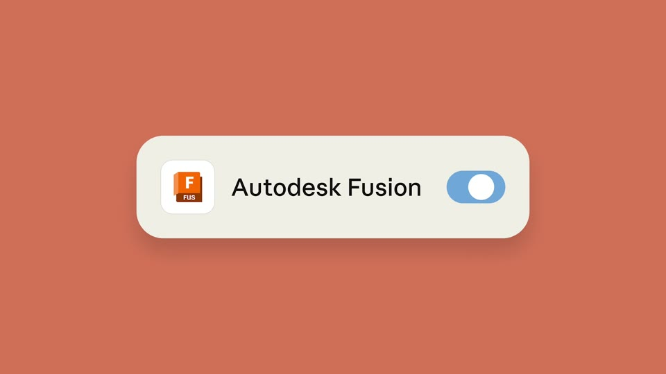

H3

One control, one state change, two seconds

A muted 2 s hook with a single interaction

A single component (49–59% of width) alone on off-white or full-bleed brand colour. A cursor glides in (0–0.4 s, ease-out) or the card pushes in 5%. The state flips in 2 frames at ~1.2 s; hold to 2.25 s; hard cut.

For Kallo: One ingredient row on tan: “Chicken thigh, skin removed · — kcal” flips to its number in 2 frames. That flip is the hook.

Claude · Connectors: Fusion · 0:01.2 Also: Claude · Claude Design 0:00.5; Claude · Claude connector for Blender 0:01.2; Manus · Manus Skills 0:01.9

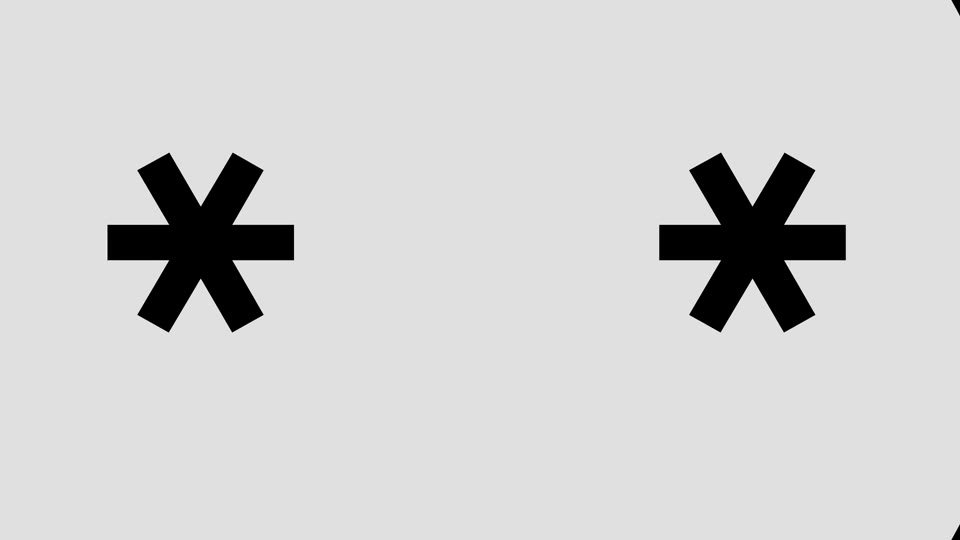

H4

Start too close to read

Stopping the scroll with abstraction first

Frame 1 is 100% one surface or shape (a disc, fur, the crop of a mark), unreadable. Pull out in 0.9 s ease-out until it reads, or hold 0.8–1.1 s per macro shot with a slow push, then cut.

For Kallo: Open inside one digit of the result, or the grain of the rice, edge to edge, then pull out in 0.9 s to the full line.

OpenAI · DevDay teaser · 0:00.1 Also: OpenAI · DevDay sting 0:01.2; SpaceXAI · Rename sting 0:02.5

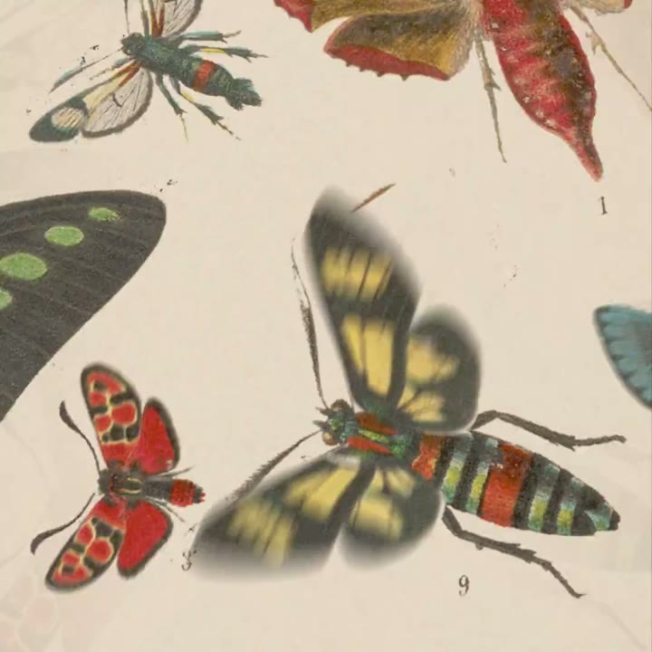

H5

A crowded frame 1; one thing flies at the lens

Scroll-stop in the first 3 frames

The first frame is a full-bleed archival plate crowded with 8+ specimens, zero empty space. One cut-out (~45% of width) is already mid-flight toward camera with ~20 px motion blur; the next cut lands at 0.125 s.

For Kallo: Frame 1 is a full table of everyday dishes from many kitchens, top-down, edge to edge; one lime wedge flies at the lens. Never one item on empty cream.

Claude · Claude Fable 5 · 0:00.1

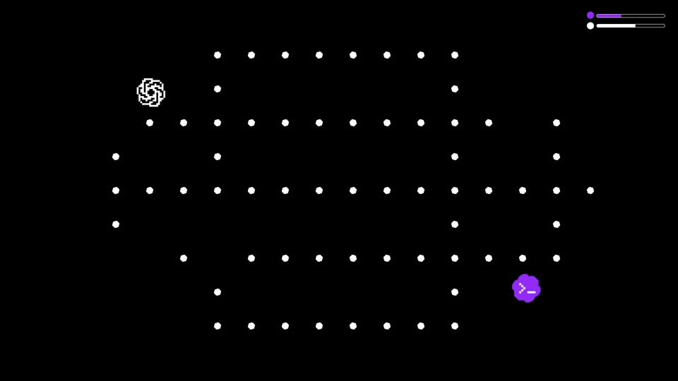

H6

The whole system is on screen at frame 1

Stating the rule before anything moves

A grid of dots already fills the frame (20 px dots, 96 px pitch at 1080p) with a HUD bar top-right; or 3 dots multiply into a 2×5 matrix by 0.5 s with the title split above and below it.

For Kallo: Frame 1: one dot per ingredient in the sentence; each dot later opens into that ingredient’s row.

OpenAI · Livestream teaser · 0:01.6 Also: OpenAI · Mathematical Advances 0:01.5

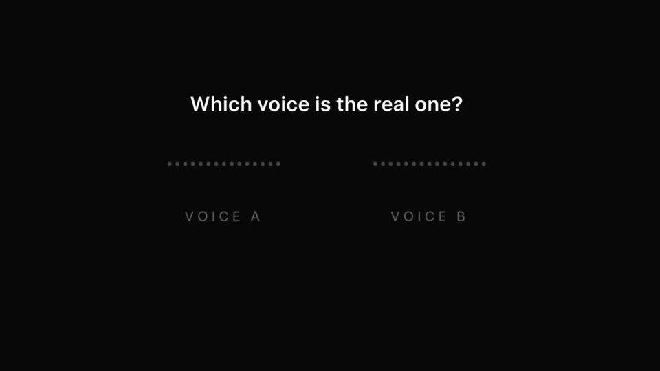

H7

Give the viewer a question

A task before the product appears

Digital silence 0–2 s. A question fades in at 39% of height (4.7% block, 47% of width), then at 1.3–1.8 s rises to 24% and shrinks to 84% while empty answer slots (grey dotted lines) fade in below.

For Kallo: “How much protein is in this?” rises into a header; three empty macro slots wait below; then the meal sentence types in.

SpaceXAI · Voice cloning quiz · 0:01.6

H8

The logo rewrites itself into the message

Turning a logo opener into a line in 2 s

The lockup holds 1 s (each logo ~4% of height). From 1.15 s words roll up from below one every 0.125 s, each rising one line height in 0.25 s as the logo rolls out. Or the mark assembles stroke by stroke in grey (0.12–0.75 s), then brightens over 0.5 s.

For Kallo: The Kallo wordmark rolls out word by word into “Kallo just read your lunch.” in under 2 s.

Manus · Similarweb upgrade · 0:01.4 Also: SpaceXAI · Rename sting 0:00.6

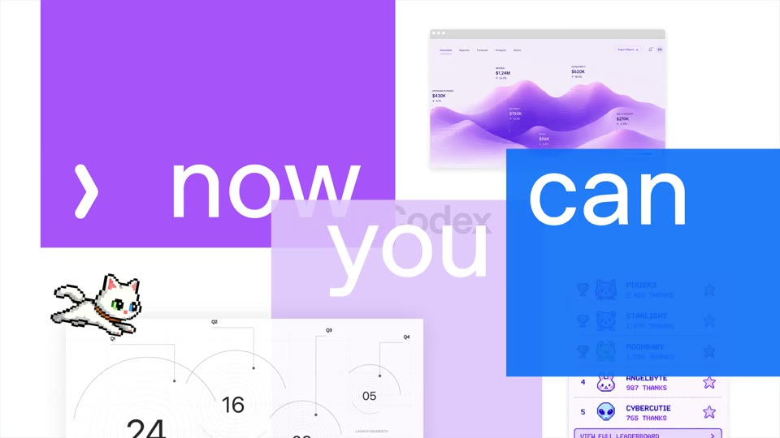

H9

Energy lands at 2 s

Turning a quiet typed opening into momentum

Solid colour blocks slam in on the beat at 2.3, 2.8 and 3.3 s, one word each (x-height 15% of the frame), hard cut-in with no easing, bleeding off the edges and overlapping.

For Kallo: “type” / “what” / “you ate” on three warm blocks at 2 s, one per beat, over cropped Kallo result cards.

OpenAI · Sites in Codex · 0:03.4

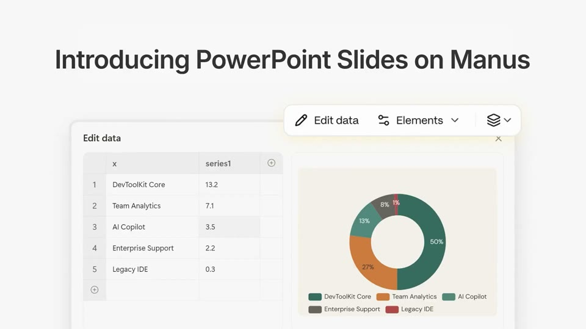

H10

Frame 0 is a designed poster

Controlling the paused preview on X and Threads

Frames 0–2 (0.1 s) are a separate thumbnail: the headline at ~7% cap top-centre over the product UI cropped by the bottom edge. The film proper starts on frame 3.

For Kallo: Frame 0: the typed meal over its result card, cropped by the bottom edge, so the muted preview already explains Kallo.

Manus · PowerPoint mode · 0:00.0

### Composition · how a frame is built

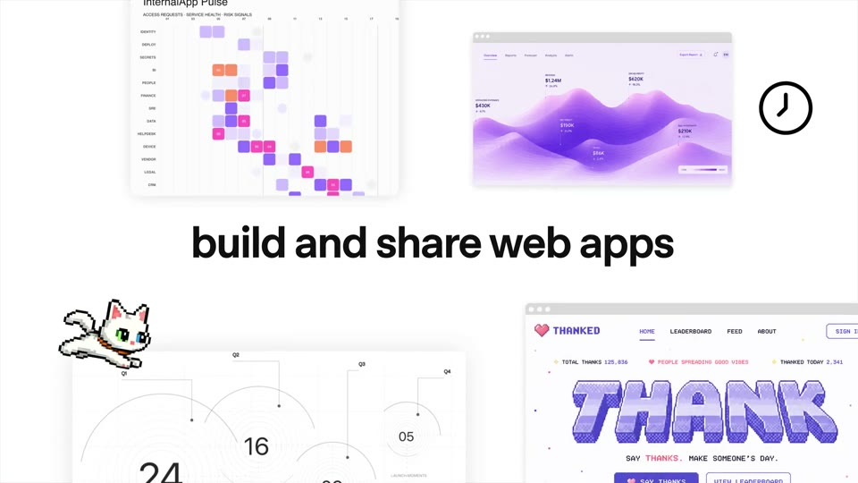

C1

Edges full, centre clear

A headline among many examples; the opposite of a void

The headline sits in a clear band ~22% of height at the centre. 4–8 product crops, each 35–45% of width, bleed 30–40% off the corners and edges at mixed scales. The frame is full; only the reading line has air.

For Kallo: “Any meal, counted.” in the middle; cropped Kallo result cards (ramen, a burrito bowl, eggs on toast, a salad) bleed off all four corners.

OpenAI · Sites in Codex · 0:05.2 Also: OpenAI · Astra for Law 1:14.1; OpenAI · ChatGPT for Financial Services 1:16.0; Manus · PowerPoint mode 0:15.3

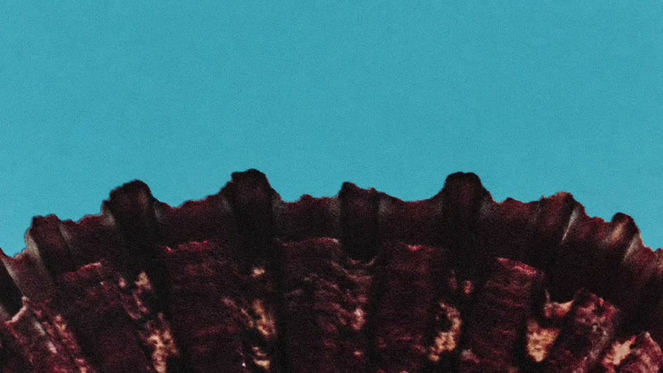

C2

The subject fills the lower half; the line sits on its edge

Mood and one claim per shot

A convex surface fills the lower 45–65% of the frame, apex at 45–55% of height, plain dark or single-colour space above. One line (7% cap) sits on or straddles the edge; blurs in over 0.5 s, holds ~1.8 s.

For Kallo: Use Kallo’s own curve, the ring gauge’s arc or a bowl’s rim, with one line resting on it. Borrow the framing, not the Opus 5.5 horizon montage.

Claude · Claude Opus 5.5 · 0:06.2 Also: OpenAI · dots 0:02.8; OpenAI · Daybreak expansion 0:02.0

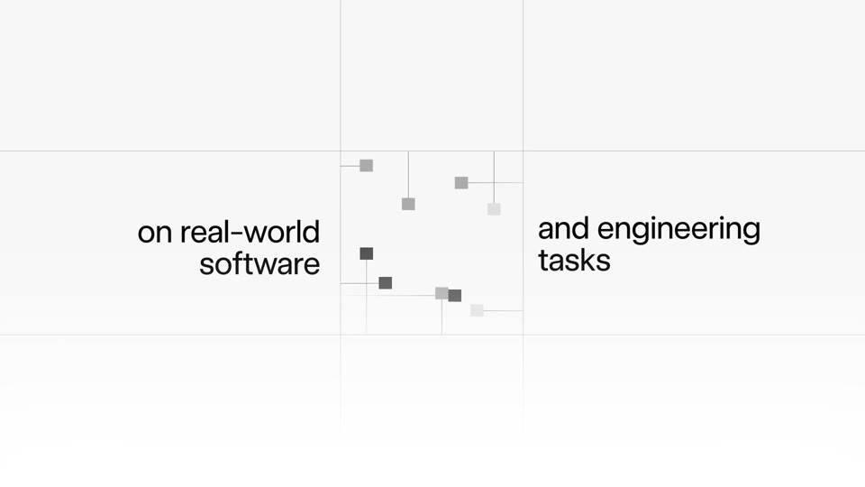

C3

One frame, three cells: in, work, out

A claim with an input and an output

1 px #D8D8D8 hairlines at 39% and 60% of width and 31% and 69% of height; the sentence splits across cells, flush to the hairlines; the bottom row fades to white.

For Kallo: Left “rice with a grilled chicken thigh, skin removed”, middle the ingredients resolving, right “548 kcal · 37 g protein”. Text in, numbers out, in one still.

SpaceXAI · Grok 4.5 · 0:06.5

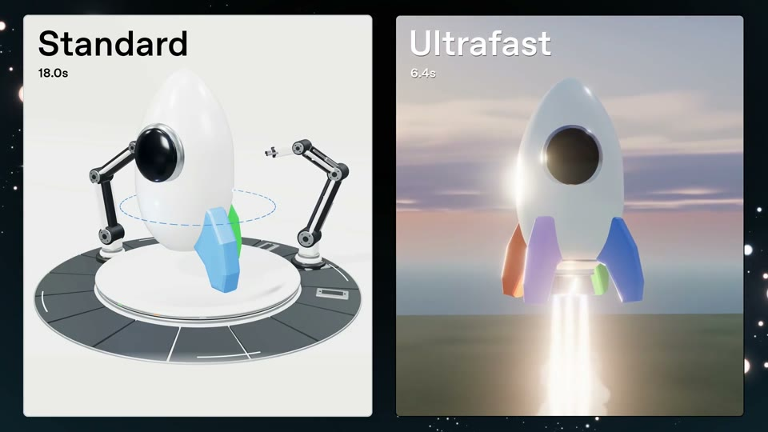

C4

Side by side, the same task

Speed or difference without a claim

Two or three portrait cards (31–47% of width, 93–96% of height, 16 px radius, 1 px border) run the same thing: live timers, idle vs live states, or a stat block each. Only the contents move; the layout never does.

For Kallo: Left: a food-database search, its timer running while fields fill. Right: Kallo, one sentence, the macros land, timer frozen. Real timings only.

OpenAI · Ultrafast · 0:20.0 Also: SpaceXAI · Voice cloning API 0:14.5; Manus · Branch 0:08.3; OpenAI · Sol and Luna cards 0:02.5

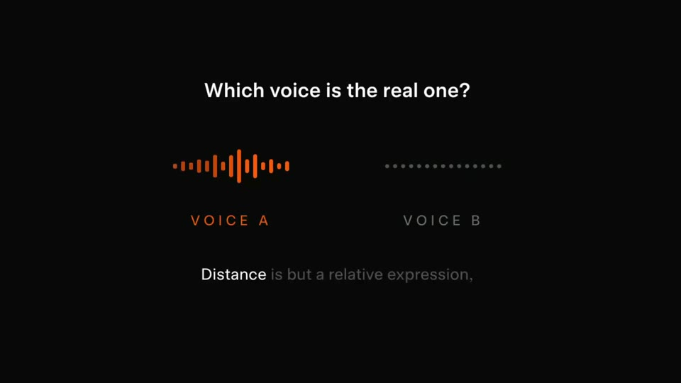

C5

Instrument layout: four rows in the middle half

A question, the slots, the caption; nothing else

Everything inside 25–75% of width. Rows at 23.5% (question), 43.3% (slots), 57.5% (labels), 71.9% (caption) of height; the top 21% and bottom 26% stay empty. Two symmetric columns; no logo, rule or border.

For Kallo: Question at the top, three macro slots (PROTEIN · CARBS · FAT) in a row, the typed meal as the caption.

SpaceXAI · Voice cloning quiz · 0:16.0

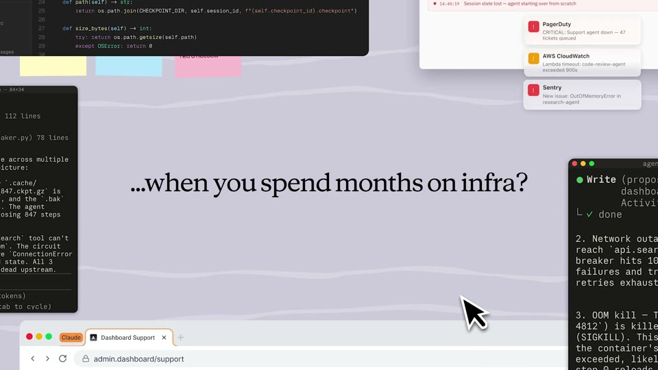

C6

The problem as clutter; the question in the one gap

Stating the pain before the product

12–16 overlapping windows and notes slide in from the edges over 13 s until they cover ~70% of the frame, leaving one horizontal gap ~25% of height where the question sits. Then everything scatters off-frame to one line.

For Kallo: A pile of the old way (a nutrition label, a gram spreadsheet, a scale readout, five calorie-site tabs); in the gap: “Logging one meal shouldn’t take five tabs.”

Claude · Claude Managed Agents · 0:08.5

C7

Two devices, one action, the focus swaps

One action on the phone, work on another screen

Phone slab 12.5% of width at x 6–19%; laptop silhouette from 39% of width bleeding off the right. The idle device is defocused (~6 px); focus jumps to whichever device is acting; a hand-drawn line joins them.

For Kallo: The iPhone types “two eggs, toast, half an avocado”; the web dashboard on the right fills the day’s rings. iOS and web in one frame, one account.

Claude · Dispatch · 0:12.5

C8

Breadth as an orbit

Many sources or integrations, no list

~34 tiles (9% of height) stream in along an ellipse (96% × 79% of the frame) around a centred headline, closing the ring in ~2 s; the ring turns for 3.5 s, then collapses into the centre.

For Kallo: “Real food data” ringed by ingredient chips (“brown rice, 150 g”, “olive oil, 1 tbsp”); they collapse into one result card.

OpenAI · Astra for Law · 0:47.0 Also: Manus · Cloud Computer 0:32.0

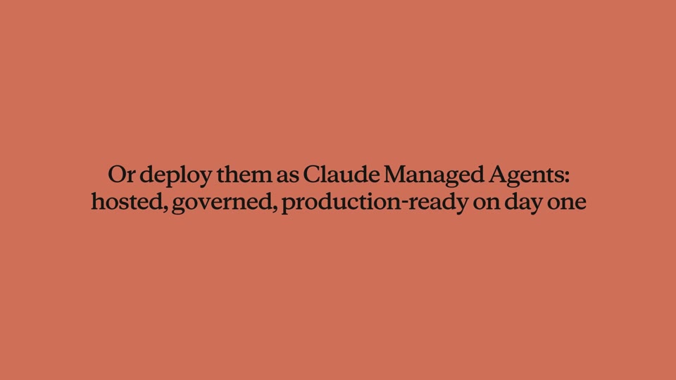

C9

One full-bleed colour card for the turn

The single line that reframes the argument

After 18 s on cream, a hard cut to full-bleed terracotta holding one two-line centred line (5.7% per line), words fading in one by one; 4 s, then back.

For Kallo: Stay on cream all film and switch to tan once, for “No scanning. No searching. Just say it.”

Claude · Financial agent templates · 0:19.5

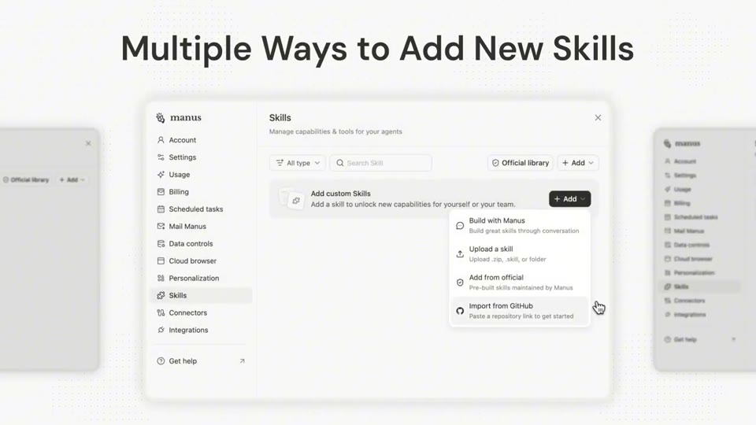

C10

Pinned headline; the content steps sideways

Several examples without new title cards

The headline is pinned top-centre (y ~11%, cap ~7%) for 13 s. Centre window 61% × 70%; neighbours at 0.75 scale and 50% opacity, cropped by the edges; steps sideways in ~0.6 s ease-in-out.

For Kallo: “Any meal. Any kitchen.” pinned; phone and web windows step sideways, each with a different meal typed and resolved.

Manus · Manus Skills · 0:16.0
