# Type and imagery

The board as rendered: [RefCollection2.jpg](RefCollection2.jpg). Its text and frames follow, in order.

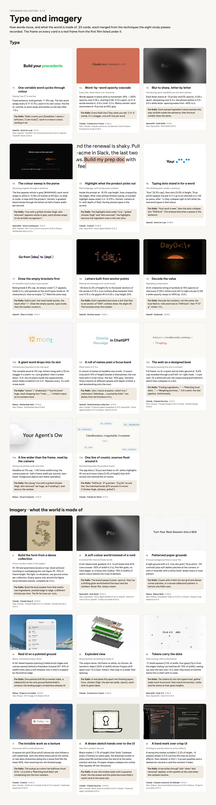

---

TECHNIQUE COLLECTION · 2 / 5

## Type and imagery

How words move, and what the world is made of. 23 cards, each merged from the techniques the eight study passes recorded. The frame on every card is a real frame from the first film listed under it.

### Type

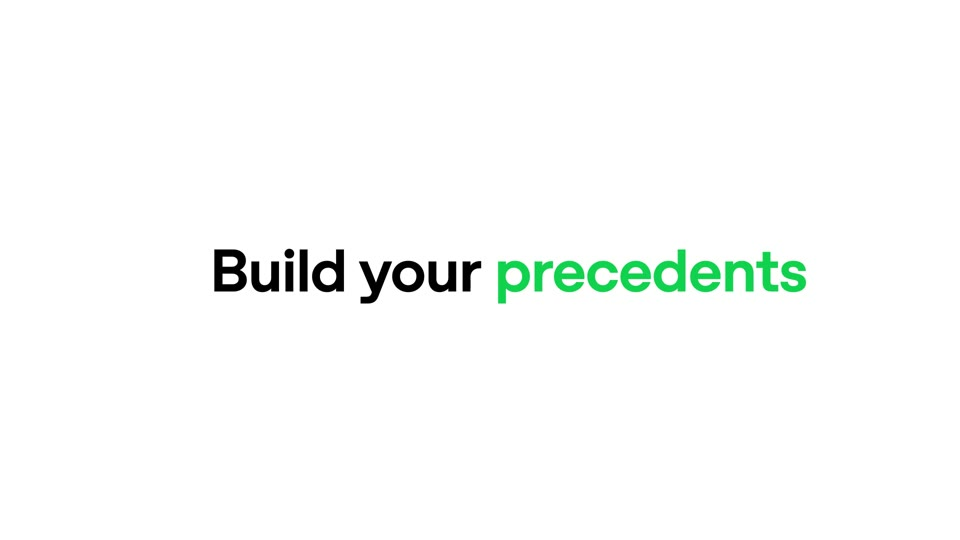

T1

One variable word cycles through colour

Saying “any X” in one line

Fixed sentence, bold grotesk ~7–8% cap. The last word swaps every 0.17–0.75 s, each in its own colour; the line re-centres on each swap and settles on the last after ~1.5 s.

For Kallo: “Kallo counts your [breakfast / ramen / leftovers / 2 am toast]”, each in a macro colour, landing in ink.

OpenAI · Astra for Law · 0:11.9 Also: OpenAI · ChatGPT for Financial Services 0:02.4; OpenAI · ChatGPT Work 0:04.9

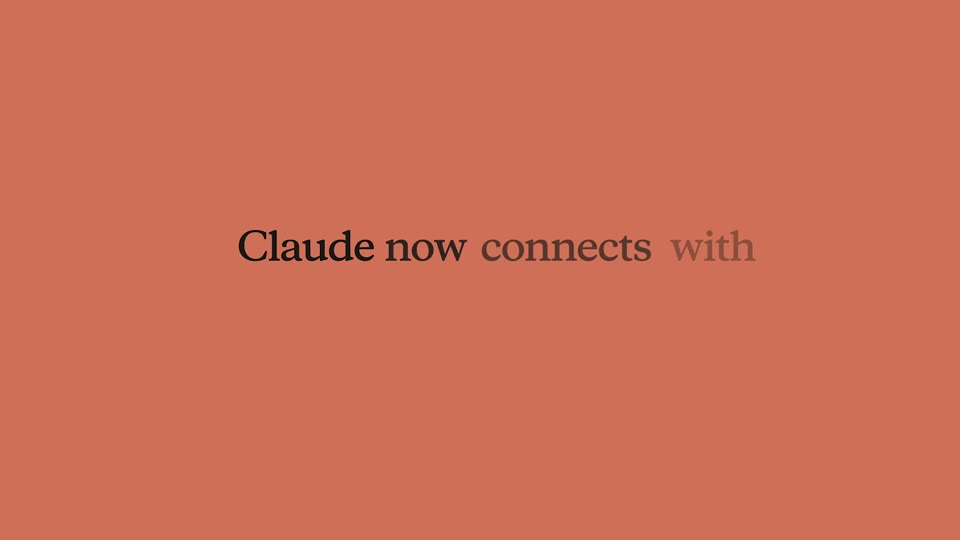

T2

Word-by-word opacity cascade

Every line, when there is no voiceover

Words appear in place with no movement: 35% → 100% opacity over 0.25 s, starting 0.08–0.12 s apart, so 5–6 words resolve in ~0.6 s; hold ~2.3 s. Manus variant: each word enters 6–8 px low at 60% grey.

For Kallo: Every Kallo line (“Say what you ate.”): 4–6 words, 0.1 s stagger, one soft tick per word.

Claude · Connectors: Fusion · 0:02.6 Also: Claude · Claude connector for Blender 0:02.8; Manus · PowerPoint mode 0:09.0

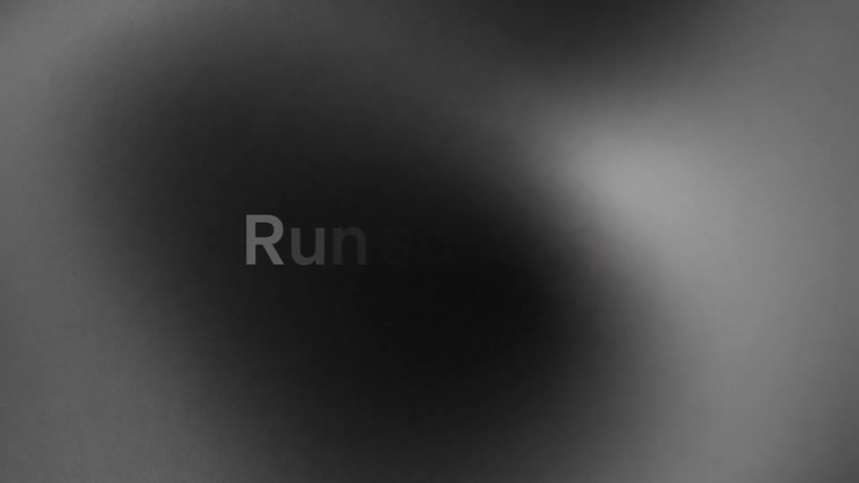

T3

Blur to sharp, letter by letter

Introducing each capability as one short phrase

Each letter starts at ~12 px blur and 0% opacity, 0.04 s apart, sharpening over 0.3 s; the phrase settles in 0.5–0.6 s while letter-spacing eases from +40% to 0.

For Kallo: Each parsed ingredient name resolves this way as Kallo reads the sentence; then the kcal number does the same.

SpaceXAI · Grok Build · 0:18.6 Also: SpaceXAI · Grok Build 0:00.2

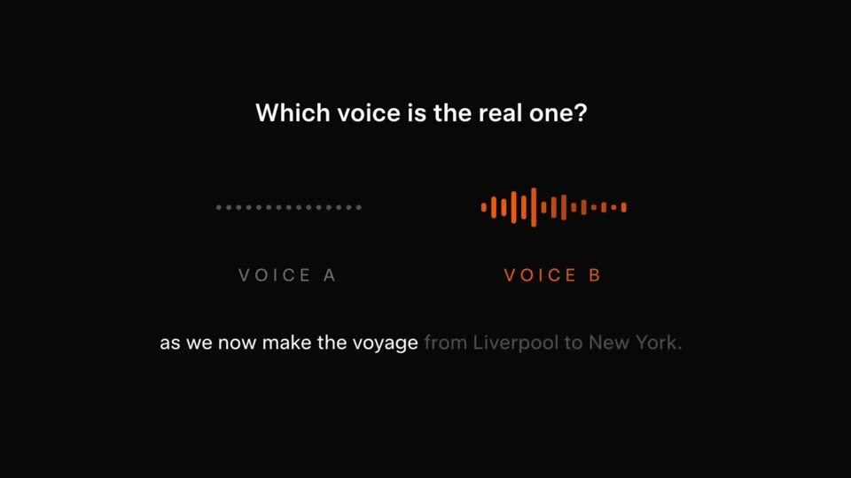

T4

The colour sweep is the parse

Showing progress through a sentence

The line appears whole in grey (#4A4A4A); each word snaps to white in ~0.08 s (5 frames at 60 fps), no slide or scale, in step with the product. Variant: a gradient band travels through the letters at half a frame width per second.

For Kallo: “rice with a grilled chicken thigh, skin removed” appears whole in grey; each phrase snaps to ink as Kallo recognises it.

SpaceXAI · Voice cloning quiz · 0:13.0 Also: OpenAI · GPT-5.6 Luna for everyone 0:06.9; Manus · Similarweb data 0:01.5

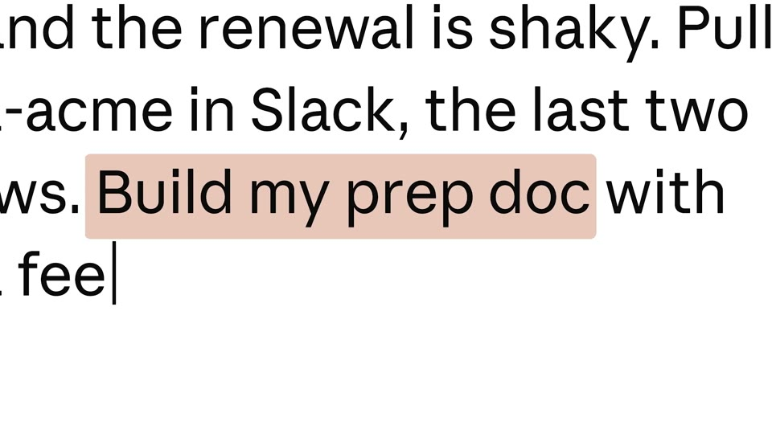

T5

Highlight what the product picks out

Plain language, with its key parts marked

Inside the prompt at ~10.5% cap height, lines cropped by the edges. After a key phrase finishes typing, a rounded highlight wipes under it in ~0.375 s. Variant: camera at 5× with depth of field; the key phrase types in the accent.

For Kallo: Tan highlights land under “rice”, “grilled chicken thigh” and “skin removed”; the highlights become the ingredient rows in the next shot.

Claude · Cowork · 0:06.5 Also: SpaceXAI · Voice Agent Builder 0:12.2

T6

Typing dots stand in for a word

The thinking beat, inside a sentence

“Your” (8.3% cap), then dots (4.8% of height, 74 px pitch) appear one per 0.17 s up to six and bob in a ±35 px wave; after ~1 s they collapse right to left while the real word types in their place.

For Kallo: “Your lunch is ●●●”, then the dots collapse into “548 kcal”. The analysis becomes a pause in the sentence.

OpenAI · Astra for Law · 0:58.6

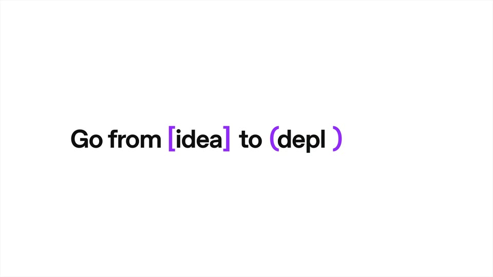

T7

Draw the empty brackets first

An ownable input/output type system

Bold grotesk 6.9% cap. An empty violet “[ ]” appears, holds 0.2 s, and spreads as the word types inside at ~15 characters/s; then an empty “( )” filled the same way.

For Kallo: Kallo’s pair: the meal inside quotes, the result after “=”. Draw the empty quotes, type inside, then the number counts in.

OpenAI · Sites in Codex · 0:13.3

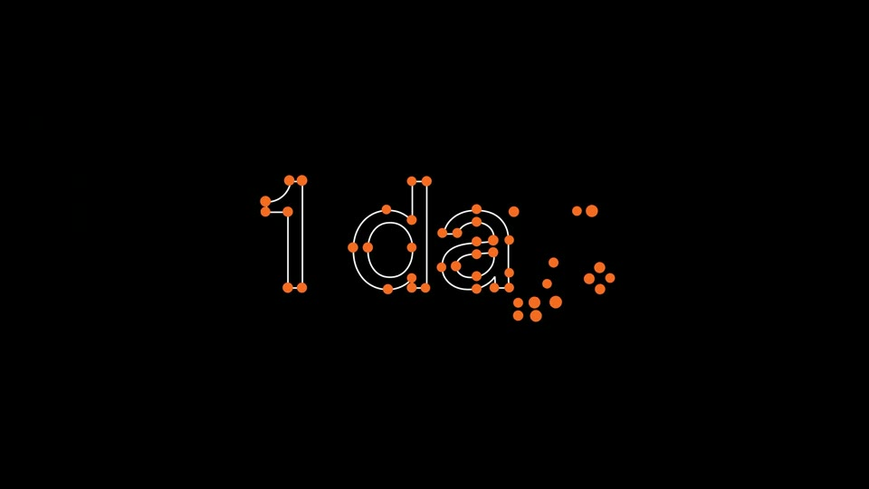

T8

Letters built from anchor points

Making the message look constructed

~30 dots (2.2% of height) fly to the bezier anchors of the words in 0.15 s; 4 px outlines draw between them over 0.15 s; the glyphs fill in 0.25 s. Cap height 23%.

For Kallo: Each ingredient becomes a dot that flies to an anchor of “548”; outlines draw; the digits fill. The food becomes the number.

OpenAI · DevDay teaser · 0:05.3

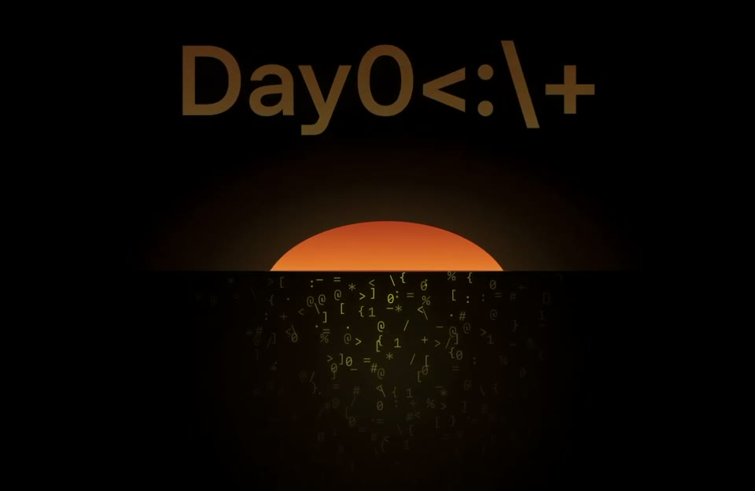

T9

Decode the value

Signalling computation

An 8-character string of symbols at 15% opacity re-rolls every 0.125 s; letters lock left to right one per 0.125 s while opacity ramps to 100% by ~0.8 s.

For Kallo: Decode the numbers, not the name: the kcal field re-rolls and locks to “548 kcal”, then “P 37 g”. Under 1.3 s.

OpenAI · Daybreak · 0:05.6

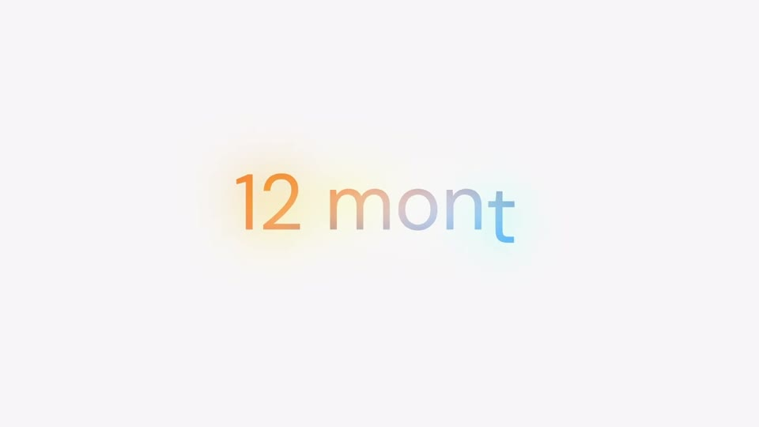

T10

A giant word drops into its slot

Connecting a big idea to the real input

The variable word at 11% cap, letters rising with a 70 ms stagger in a warm-to-cool gradient; then it scales down ~3.5× into its place inside the typed prompt, which fades in behind it at 2.2×. Repeats every ~5 s with a new word.

For Kallo: “ramen” / “shakshuka” / “burrito bowl” huge, each dropping into “I had ___” in Kallo’s input as its numbers land.

Manus · Similarweb data · 0:03.5 Also: Manus · Similarweb data 0:09.6

T11

A roll of names past a focus band

Many items in 3–5 s

A column of names at headline size scrolls ~2 rows/s (row pitch 13% of height) beside a fixed phrase; the row level with it is full colour, the rest ~55% grey. Variants: three columns at different speeds with depth of field; a reel decelerating onto the noun.

For Kallo: “pho / tacos al pastor / jollof rice / carbonara / bibimbap … counted by Kallo”: ten dishes from ten kitchens in 5 s.

OpenAI · Small business collection · 0:15.6 Also: Claude · Financial agent templates 0:12.5; SpaceXAI · Voice Agent Builder 0:37.0; Manus · Branch 0:01.5

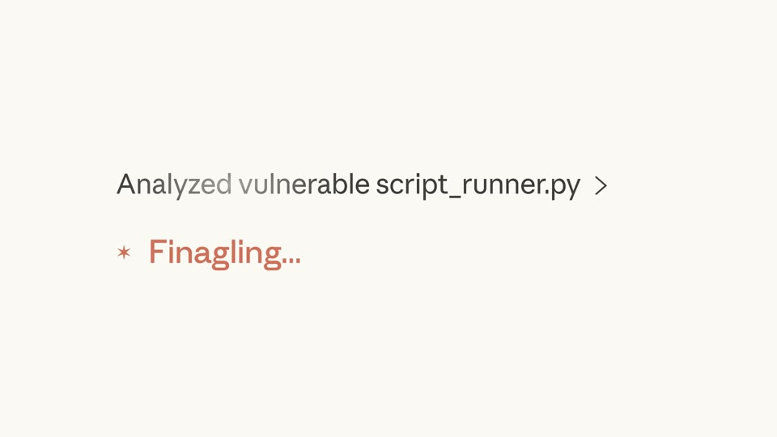

T12

The wait as a designed beat

Turning processing time into a moment

Full frame, no UI: a spark and an italic gerund at ~9.6% cap revealed through a soft left-to-right mask, ~1 s per verb. Or a white pill over the output being built behind it, which then collapses to a dot.

For Kallo: “Finding ingredients…” → “Matching food data…” → “Weighing portions…”, 0.6 s each: the real pipeline, told honestly.

Claude · Claude Security · 0:31.3 Also: Claude · Claude Design 0:18.0; Claude · Claude Design 0:09.0

T13

A line wider than the frame, read by the camera

Giving one phrase scale and time

Headline at 11% cap, ~1.45 frame widths long; the camera pans at ~half a frame width per second, near-linear; foreground objects exit faster (parallax).

For Kallo: Pan along “rice with a grilled chicken thigh, skin removed” set huge, as if reading it, and land on the number.

Manus · Cloud Computer · 0:02.6

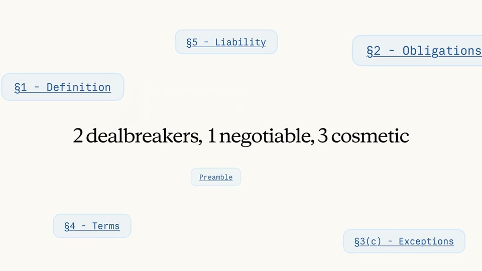

T14

One line of counts; sources float around it

Summarising what the product found

The app blurs (~10 px) and fades to off-white; highlights lift out as 6 mono chips (3.5% of height) that drift around one centred line of counts.

For Kallo: “548 kcal · 37 g protein · 13 g fat” as one line; the matched foods drift around it in mono (“chicken thigh, skinless, grilled”).

Claude · Claude for Word · 0:17.0

### Imagery · what the world is made of

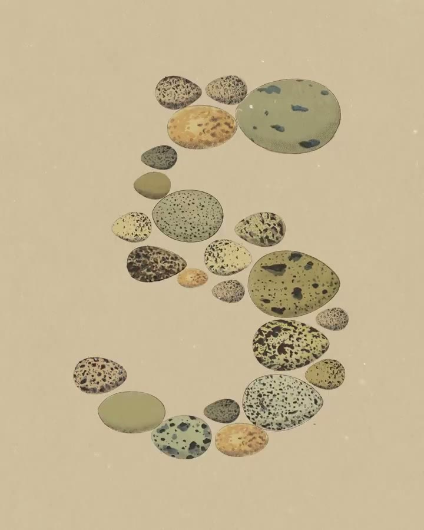

I1

Build the form from a dense collection

A hero number made of the subject

10–30 real specimens (scans or top-down photos) touching or overlapping into one figure 70–75% of frame height, flat light, no shadows, one ground colour per collection. Empty space only around the figure, never between pieces; complete by 2.4 s.

For Kallo: Build the kcal number from that meal’s own ingredients, packed edge to edge, a different kitchen per shot. The fix for lone cut-outs.

Claude · Claude Opus 5 · 0:04.5 Also: Claude · Claude Fable 5 0:11.2; Claude · Claude Sonnet 5 0:01.0

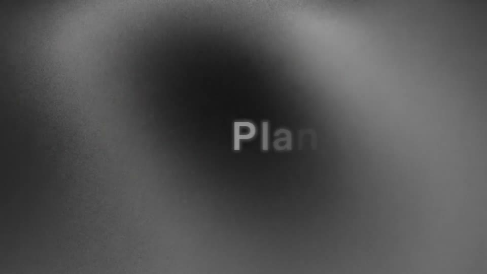

I2

A soft colour world instead of a void

A minimal film that still feels tactile

A full-bleed mesh gradient of 2–3 soft blobs that drift (one crosses ~30% of width in 2 s), fine film grain, no hard edges; or a heavy blur (radius ~10% of width) of warm colour behind one crisp UI element.

For Kallo: The brand sweep (cream, apricot, lilac) as a drifting grain world behind the input and the numbers. Never flat, empty cream.

SpaceXAI · Grok Build · 0:02.2 Also: SpaceXAI · Voice Agent Builder 0:30.3; OpenAI · Astra for Law 0:39.5; OpenAI · Codex on mobile 0:02.6

I3

Patterned paper grounds

A house background that is never flat

A light ground with a 2–3 px dot grid (~16 px pitch, ~3% contrast) plus soft darker patches at the corners; or mint or lavender with a white hand-drawn wave or loop pattern.

For Kallo: Cream with a faint tan dot grid and denser corner patches, or a woven tablecloth pattern: a texture only Kallo uses.

Manus · Manus Skills · 0:04.5 Also: Manus · Scheduled Tasks 2.0 0:01.2; Claude · Claude Code desktop 0:01.0

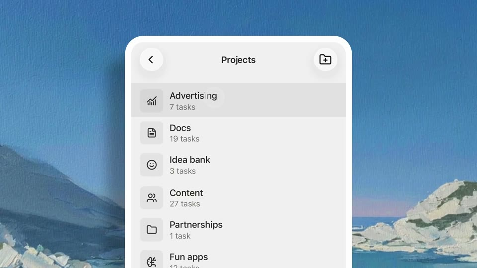

I4

Real UI on a painted ground

Warm, authored product shots

A full-bleed impasto painting (visible brush ridges and canvas weave) behind a frameless UI panel (47–61% of width) that casts a soft shadow onto it and is cropped by the bottom edge.

For Kallo: One painted still life (a market table, a tablecloth) as the only ground behind Kallo’s screens; the landing page’s oil sketches already fit.

Manus · Projects on mobile · 0:03.0 Also: Manus · GPT Image 2 in Slides 0:04.8

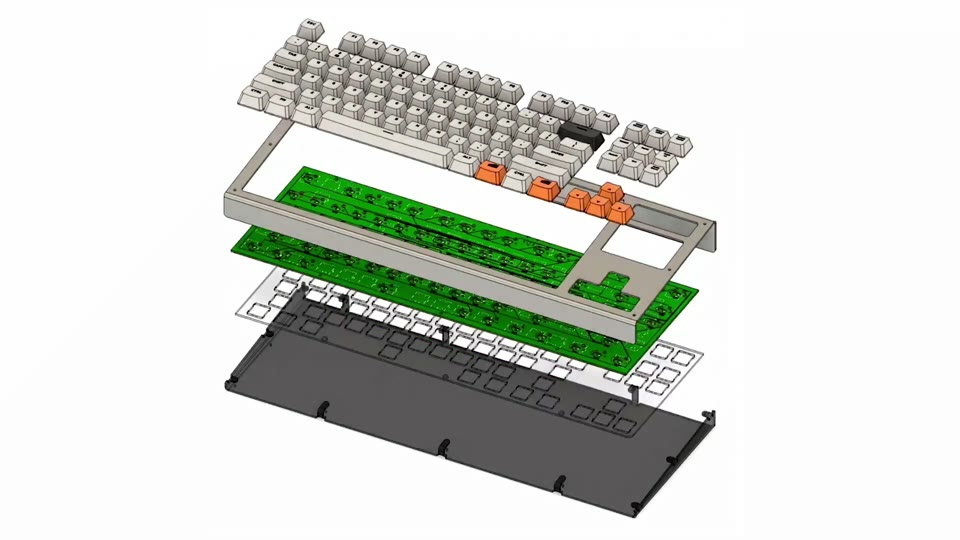

I5

Exploded view

Showing what something is made of

The output alone, full frame on white, no chrome. An isometric object (52% of width) whose 5 layers drift apart over 1.5 s (near-linear), then step to a wider final spacing.

For Kallo: A real plate lifts apart into floating layers (rice, chicken thigh, the skin set aside, sauce), each with its gram label.

Claude · Connectors: Fusion · 0:36.5

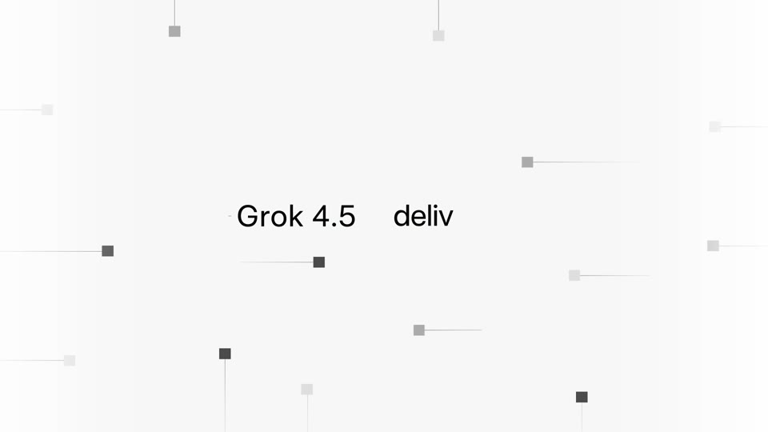

I6

Tokens carry the data

Data moving, with no illustration

~17 small squares (1.5% of width, four greys) fly in from the edges trailing 1 px hairlines (8–15% of width), easing out near the text over 1.5 s; later they stack on hairline stems into a chart with no axes.

For Kallo: Tan tokens fly into the typed meal, gather under each food word, then stack into protein, carbs and fat stems at their gram heights.

SpaceXAI · Grok 4.5 · 0:02.3 Also: SpaceXAI · Grok 4.5 0:10.5

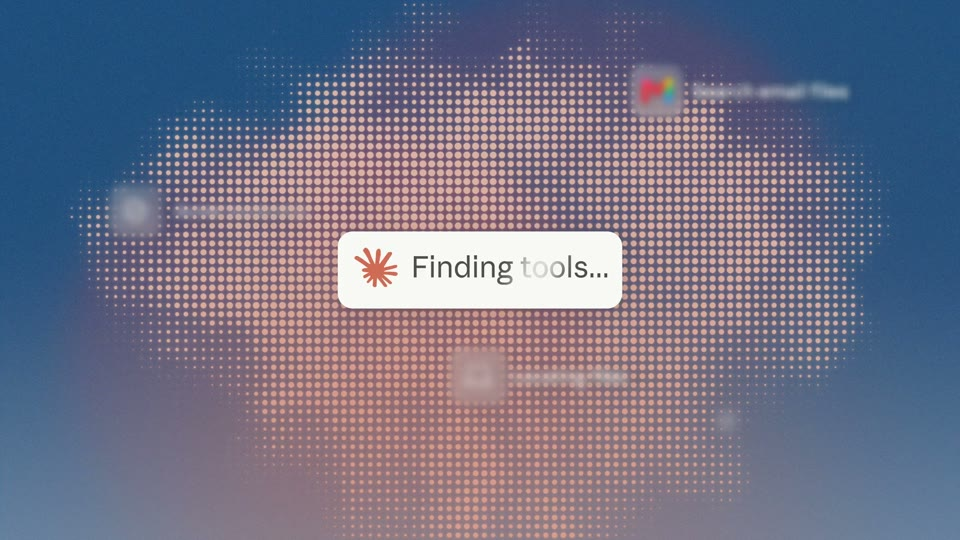

I7

The invisible work as a texture

A process with no natural picture

A square dot grid (18 px pitch) whose dot size follows a soft radial blob, with one white status pill at the centre; or raw data characters piling into a wave that fills the lower 60%, then resolving into the finished page.

For Kallo: The lookup as a short tan halftone cloud (0.8–1.2 s) with a “Matching food data” pill, condensing into the four numbers.

Claude · Cowork · 0:30.0 Also: Claude · Artifacts in Claude Code 0:12.0; OpenAI · Daybreak expansion 0:02.0

I8

A drawn sketch hands over to the UI

Idea first, product second

Black marker (~1.7% of height) that “boils” (redrawn every 2 frames) on warm grey; the drawing’s screen or plate area fills and becomes the real UI at the same position and size. Or paper shapes collapse into a blob that squares off into the phone.

For Kallo: A one-line marker plate with a question mark; the line erases and the plate becomes Kallo’s result card at the same size.

Claude · Claude Security · 0:04.8 Also: Claude · Work tools on mobile 0:03.9; Claude · Financial agent templates 0:01.5

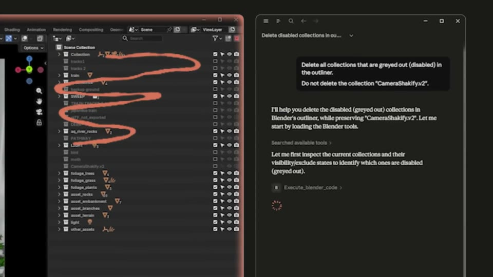

I9

A hand mark over crisp UI

Pointing at exactly what an action affects

A terracotta marker scribble (~2.2% of height, ~6 passes) drawn in 0.5 s across the rows an action affects, then cleared; or thin 1–2 px pen sparkles and a dashed arc around a card the moment it helps.

For Kallo: A tan strike through “skin” when “skin removed” applies; a thin sparkle at the card when the numbers resolve.

Claude · Claude connector for Blender · 0:43.2 Also: Manus · Recommended Connectors 0:01.8; Manus · Projects on mobile 0:07.0
