# Product

The board as rendered: [RefCollection3.jpg](RefCollection3.jpg). Its text and frames follow, in order.

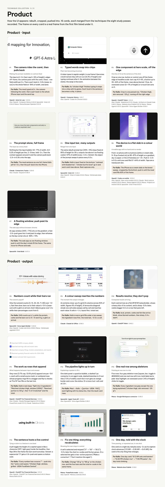

---

TECHNIQUE COLLECTION · 3 / 5

## Product

How the UI appears: rebuilt, cropped, pushed into. 16 cards, each merged from the techniques the eight study passes recorded. The frame on every card is a real frame from the first film listed under it.

### Product · input

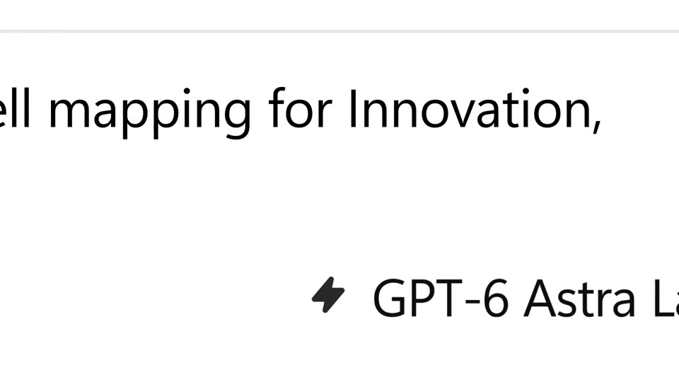

P1

The camera rides the caret, then pulls back

Making the prompt readable on a phone feed

The input at 2–5× (text cap 5–15% of height), edges off-frame; the camera pans with the caret, linear, ~one field width per 2 s. Then a pull-back in ~0.8 s (ease-in-out) to the whole field at ~84% of width, and send.

For Kallo: The meal typed at 5×, the camera following the caret, then a pull-back to the whole iPhone input and the send tap.

OpenAI · Astra for Law · 0:20.6 Also: OpenAI · Computer History 0:03.8; SpaceXAI · Grok 4.5 0:14.6; Manus · Manus Browser Operator 0:12.9

P2

Typed words snap into chips

Plain text becoming structure

A token types in regular weight; in one frame it becomes a bold named chip with an icon (6.3% of height) and typing continues after it. No animation between the states; the swap is the event.

For Kallo: As “chicken thigh” finishes typing it snaps into a chip with its grams. Each food in the sentence becomes a chip, in place.

OpenAI · Computer History · 0:01.7 Also: OpenAI · Codex for Chrome 0:05.0

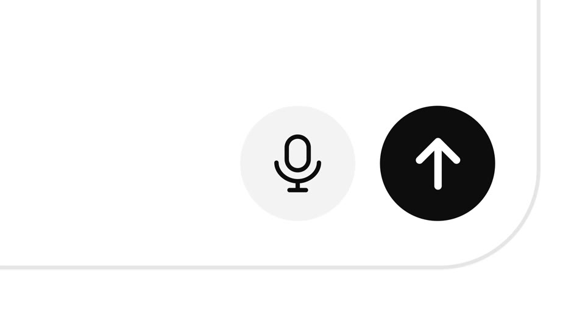

P3

One component at hero scale, off the edge

One line of UI as the sentence of the shot

Crop so one row, button or control runs off the frame edge at headline scale: text cap 4.5–6%, a button up to 35–44% of the frame, rows above blurred ~12 px. An oversized cursor (6–17% of height) or a touch dot acts on it.

For Kallo: Crop to one parsed row, “Chicken thigh, skin removed · 125 g”, running off the right edge.

OpenAI · ChatGPT Work · 0:14.0 Also: Claude · Salesforce 0:11.5; Claude · Artifacts in Claude Code 0:46.2; Manus · Website Auto Publish 0:07.6; Manus · Manus Agents 0:20.3; SpaceXAI · Voice Agent Builder 0:09.0

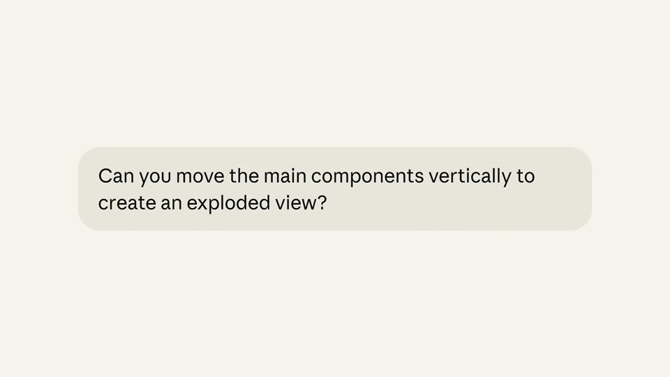

P4

The prompt alone, full frame

The input as a story beat

Nothing but the input bubble: 64–77% of width, 4.8–5.2% of height per line, 2–3 lines, held ~2 s. Then the context appears around it and the camera pulls back ~2.3× in 0.35 s into the app.

For Kallo: The meal sentence as one full-frame Kallo pill for 1.5 s, then the pull-back into the iPhone.

Claude · Connectors: Fusion · 0:24.5 Also: Claude · Dispatch 0:08.9

P5

One input bar, many outputs

Range from one input

The same rebuilt prompt bar (49% × 9%) stays fixed at 85% of height for 30 s; outputs rise above it as floating cards (~57% of width) every ~2.4 s. Variant: the object of the prompt swaps in place every 0.5 s.

For Kallo: Kallo’s input fixed at the bottom; “oatmeal with blueberries”, “chicken burrito bowl” go in and each card rises above. Real captures only.

SpaceXAI · Grok 4.5 · 0:25.5 Also: OpenAI · Sites in Codex 0:16.6; Manus · Similarweb data 0:04.0

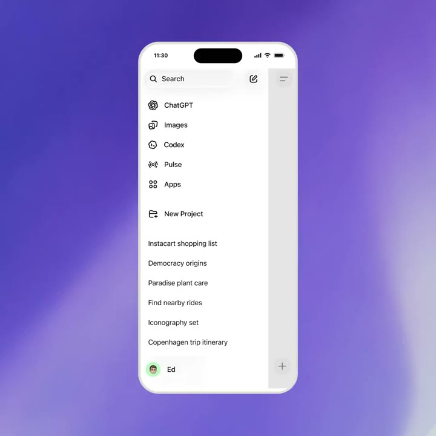

P6

The device is a flat slab in a colour world

A mobile app with no hand and no render

Front-on phone with no buttons (white or cream slab, 9–15 px frosted rim) at 80–87% of height on a gradient, sky or paper; or the UI frameless at ~1.9×. Push in ~2.3× in 0.5 s until one card fills 57–64% of width. Taps are a translucent dot.

For Kallo: The iPhone as a cream slab on the brand sweep, cropped by the bottom; push in until the meal card fills 60% of the frame.

OpenAI · Codex on mobile · 0:02.6 Also: OpenAI · New voice models 0:02.0; Claude · Work tools on mobile 0:20.0; Manus · Manus Agents 0:02.5; Manus · Projects on mobile 0:00.8; SpaceXAI · Grok 4 free 0:02.5

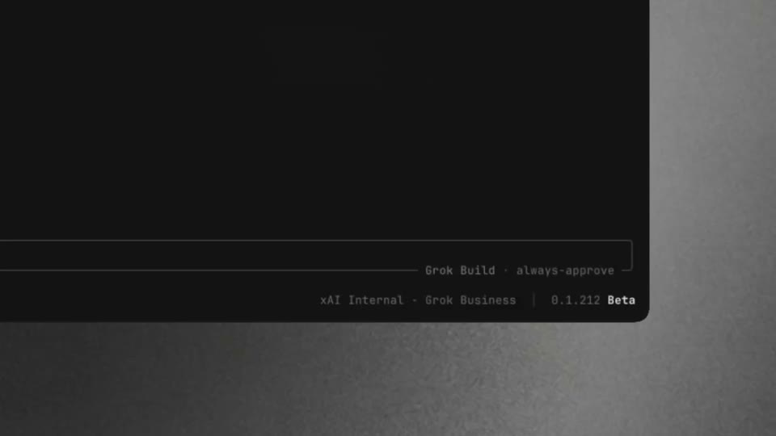

P7

A floating window; push past its edge

The web app without browser chrome

An app window (44% × 71%) sits on the gradient; a fast ~2.5× push goes into it and past its edge, then reframes so the key corner sits at ~80% × 73%.

For Kallo: The web app as one floating window; push in until the day’s totals fill the frame. The same move for iPhone and web.

SpaceXAI · Grok Build · 0:07.0

### Product · output

P8

Numbers count while their bars run

The numeric payoff

Only the numeral counts (3, 15, 34, 54, 71, 80) over ~1.0 s, fast then slow; bars run to their value in ~0.4 s (ease-out) with a glint on arrival; chart ribbons grow over 1.2 s while their percentages count from 0.

For Kallo: 548 counts up in 1 s while the protein, carbs and fat bars run to 37, 72 and 13 g; a glint on arrival.

SpaceXAI · Voice Agent Builder · 0:20.6 Also: OpenAI · Codex rate limits 0:08.8; Manus · Similarweb upgrade 0:13.0

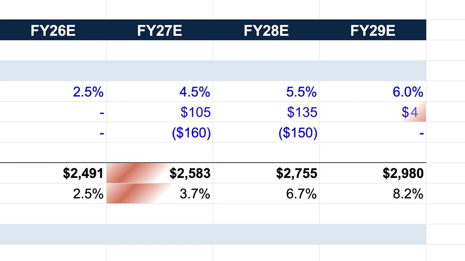

P9

A colour sweep rewrites the numbers

The moment the output changes

An extreme close-up of a grid (4 columns across 92% of width, figures 4% of height). A terracotta diagonal streak one cell wide sweeps cell by cell and rewrites each value: 8 cells in ~1.1 s, inputs first, totals last.

For Kallo: Kallo’s macro grid fills under a tan sweep: the ingredient rows first, the total last, ~0.12 s a cell.

Claude · Claude for Office · 0:56.5

P10

Results resolve; they don’t pop

Computed results arriving

Each card arrives as a flat #F2F2F2 placeholder, shows a heavy blur of its content, and is sharp ~0.8 s later; cards stagger 0.4 s in a row that pans left.

For Kallo: kcal, protein, carbs and fat tiles arrive blank, show blurred numbers, then sharp, 0.4 s apart.

OpenAI · ChatGPT Work · 0:46.2

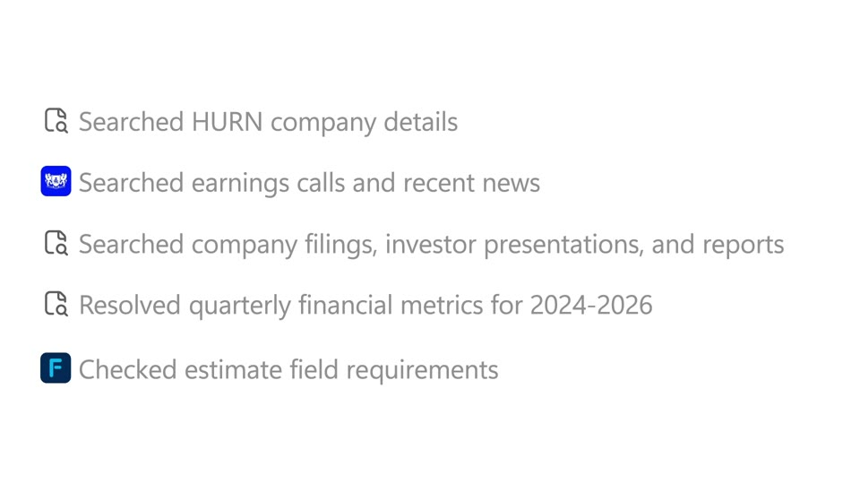

P11

The work as rows that append

What happens between input and answer

Grey rows (3.7% cap, 12.6% pitch) append one per ~0.6 s, each with a small source mark; or numbered rows whose progress rings fill in a stagger and flip to checks; an “N of N” bar fills on the last tick.

For Kallo: Kallo’s real steps: “Split into 3 ingredients”, “Matched chicken thigh, skinless (USDA)”, “Resolved portion to 125 g”, then “3 of 3 matched” and the total.

OpenAI · ChatGPT for Financial Services · 0:34.0 Also: Claude · Claude Managed Agents 0:31.0; Manus · PowerPoint mode 0:12.5; Claude · Salesforce 0:06.2

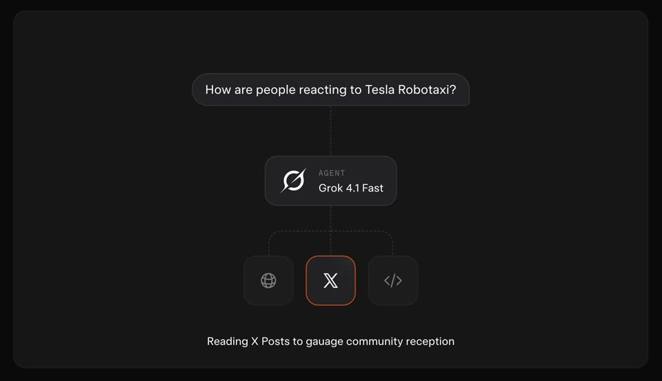

P12

The pipeline lights up in turn

Explaining a system in 10 s

One dark panel: a question bubble, a dashed 1 px connector to an agent node, dashed branches to 3 tool tiles (7.5% of width); each tile in turn gets an orange border and a one-line status. Or a mono tool-call card at 2.5×.

For Kallo: Meal → Kallo → [portion · USDA · FAO], each lighting with its status line, then the result card rises.

SpaceXAI · Agent Tools API · 0:06.0 Also: SpaceXAI · Voice Agent Builder 0:28.2

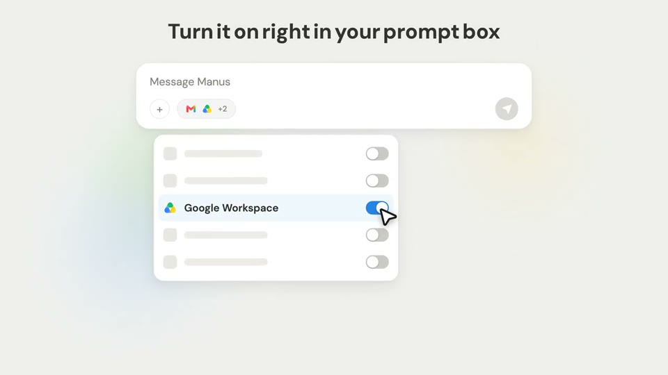

P13

One real row among skeletons

Pointing at one row in a list

Five rows: four grey skeleton rows (square, bar, toggle in #E6E6E6) and one real row with icon, bold label and a pale-blue highlight; an oversized cursor (~6% of height) clicks its toggle.

For Kallo: Every ingredient row grey except the one being explained (“chicken thigh, skin removed · 125 g”).

Manus · Google Workspace connector · 0:08.2

P14

The sentence hosts a live control

Tying a claim to a feature in one beat

A pill toggle the height of a capital types in like a character (OFF, light grey) inside the headline, then flips ON in the frame the next word turns blue. Variant: a superscript “3” gets a 1.6× push and opens a citation card.

For Kallo: “Every number has a source.³” – push into the ³ and a card opens: “Chicken thigh, skinless, grilled · USDA FoodData Central”.

OpenAI · ChatGPT for Financial Services · 0:12.3 Also: OpenAI · ChatGPT for Financial Services 0:45.5; Manus · Manus Skills 0:01.9

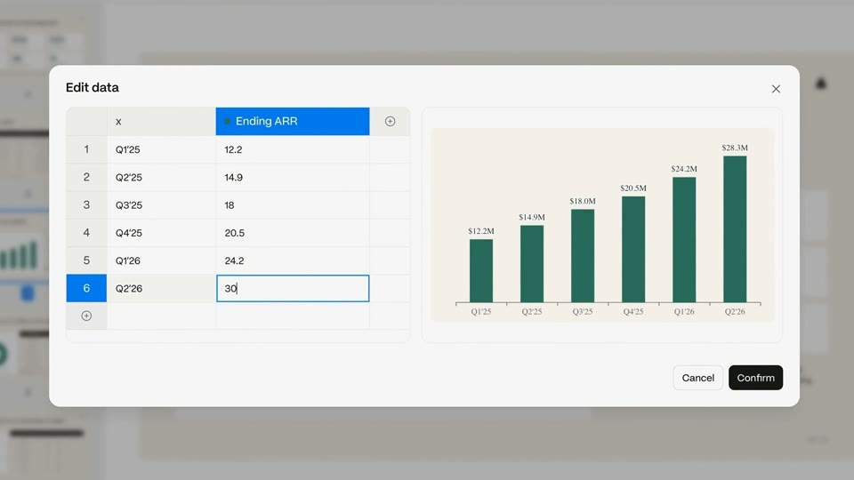

P15

Fix one thing; everything recalculates

Showing the user stays in control

A cell is selected and retyped (“3” → “30” → “30.2”); ~0.3 s later the chart re-scales and the bar grows. Or a selected line gets a two-action popover (“Make a correction” / “Don’t mention this again”).

For Kallo: Change “125 g” to “180 g” on the chicken row, and the four bars and the total re-scale in the same frame.

Manus · PowerPoint mode · 0:25.0 Also: OpenAI · Memory controls 0:18.5

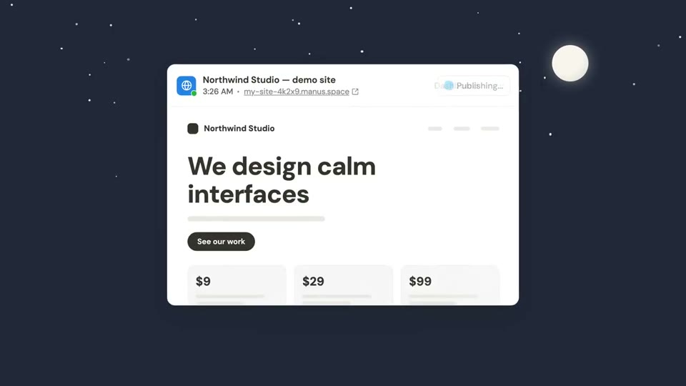

P16

One day, told with the clock

Time passing, or repeated use, in one shot

One card on a night sky restyles every ~2 s as its caption clock advances (1:12 AM → 3:26 AM → 5:41 AM); the card is the only thing that changes.

For Kallo: One day card: “8:12 AM oats and banana” → “12:40 PM chicken rice” → “7:05 PM pasta”, the day total climbing.

Manus · Website Auto Publish · 0:16.8
