# Transitions and rhythm

The board as rendered: [RefCollection4.jpg](RefCollection4.jpg). Its text and frames follow, in order.

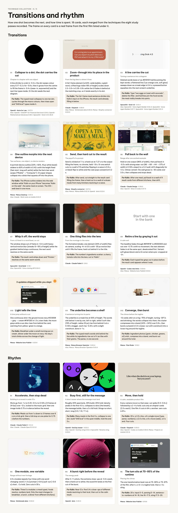

---

TECHNIQUE COLLECTION · 4 / 5

## Transitions and rhythm

How one shot becomes the next, and how time is spent. 18 cards, each merged from the techniques the eight study passes recorded. The frame on every card is a real frame from the first film listed under it.

### Transitions

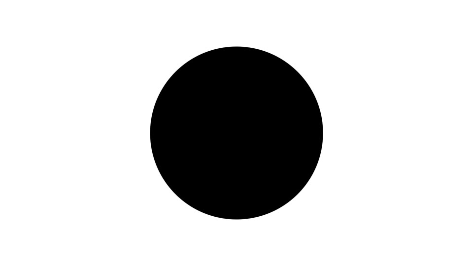

X1

Collapse to a dot; the dot carries the cut

Chapter to chapter with one object

A line shrinks to a dot in ~0.2 s; the dot swaps colour every 0.17–0.2 s for ~0.8 s; then it grows from the centre to fill the frame in ~0.4 s (ease-in, exponential) and the next line types inside. Or the dot seeds the next diagram.

For Kallo: The typed meal collapses to one tan dot, cycles through the macro colours, then irises open and “548 kcal” types inside it.

OpenAI · Astra for Law · 0:07.5 Also: OpenAI · ChatGPT for Financial Services 0:29.5; OpenAI · Mathematical Advances 0:08.1; SpaceXAI · Grok 4.5 0:36.8

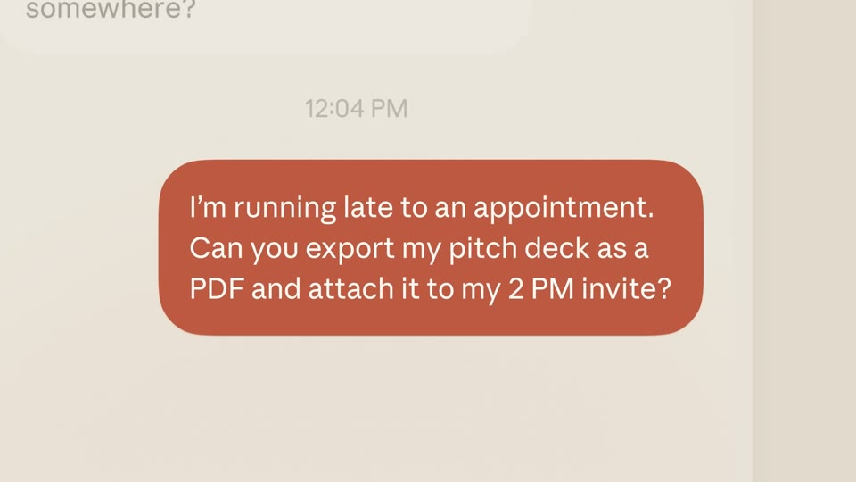

X2

Zoom-through into its place in the product

From the big idea to where it lives

A full-frame element (a 64%-wide bubble, a giant word, a lifted logo token 18% of height) scales down 2.3–3.5× in 0.35–0.8 s while the UI fades in behind at the matching crop, so it lands exactly in its slot.

For Kallo: The full-frame meal sentence shrinks into Kallo’s input on the iPhone, the result card already filling in below.

Claude · Dispatch · 0:08.9 Also: Manus · Similarweb data 0:09.6; Manus · Shopify connector 0:03.0

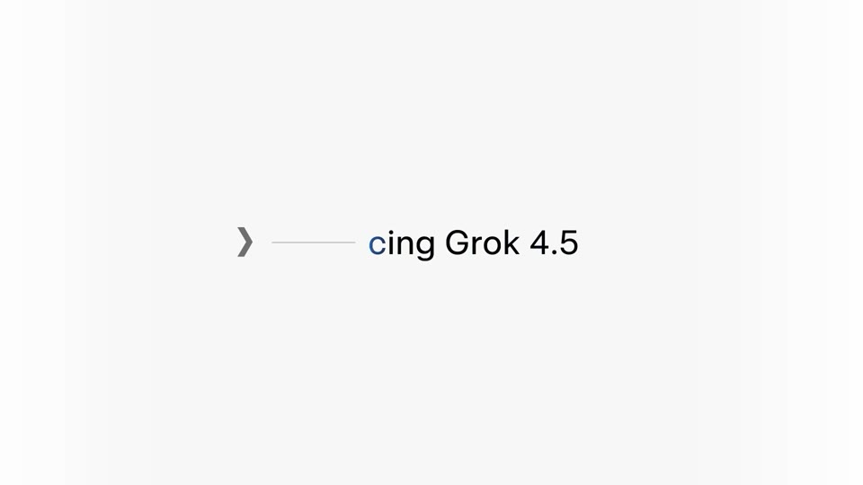

X3

A line carries the cut

Turning a sentence into a diagram

Deleted words leave a 1 px #D1D1D1 hairline joining the kept words; a flattened line (1 px orange core, soft glow) sweeps down as a mask edge in 0.4 s; a pressed button squashes into the next screen’s underline.

For Kallo: Type “two eggs on toast with avocado”, delete the filler, and hairlines join the food words: the meal visibly breaks into parts.

SpaceXAI · Grok 4.5 · 0:01.4 Also: SpaceXAI · Voice Agent Builder 0:02.4; SpaceXAI · Voice Agent Builder 0:07.7; SpaceXAI · Voice Agent Builder 0:01.3

X4

One outline morphs into the next device

Two surfaces, one object, no device renders

A portrait device outline (23% × 82%, 16 px white bezel) widens to 60% of width in 0.42 s with the height fixed (fast start, long soft settle) while the line’s last word swaps (“Mobile” → “Computer”). Or paper shapes collapse into a blob that squares off into the phone.

For Kallo: The iPhone outline widens into the web window while “Kallo on your iPhone” becomes “Kallo on the web”, the same meal on screen. The iOS + web beat in one move.

Manus · Manus Desktop · 0:01.5 Also: Claude · Work tools on mobile 0:03.9

X5

Send, then hard cut to the result

The payoff of a prompt

Send is clicked at 7.1 s; a hard cut at 7.27 s to the output filling the frame, no chrome, held ~1.8 s. Or one switch cuts to a wall of 15 switches flipping in a wave in 0.6 s; or black flips to white and the cast pops outward at 0.2 s.

For Kallo: After send, cut straight to the result card filling the frame; then a hard cut to a wall of a dozen meals from many kitchens resolving in a wave.

Manus · Shopify connector · 0:07.6 Also: Manus · Manus Skills 0:02.9; OpenAI · dots 0:22.6

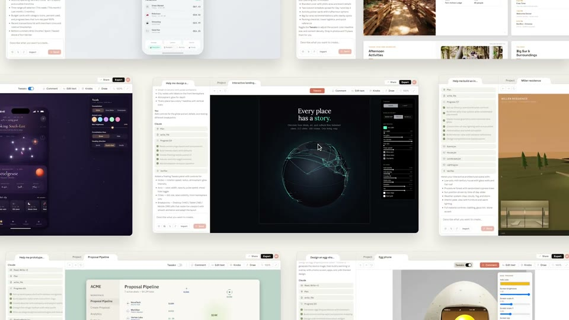

X6

Pull back to the wall

Range after one worked example

Hold on one output (86% of width), then pull back in ~0.5 s with strong ease-out (86 → 68 → 44 → 37% of width in 0.125 s steps) to a 3×3 wall; drift diagonally for 1.5 s. Climax variant: the wall grows to ~30 cards over 3.5 s, then collapses and stops dead.

For Kallo: After one meal, pull back to a wall of 9 result cards from different kitchens, then drift.

Claude · Claude Design · 0:28.0 Also: OpenAI · Sites in Codex 0:37.5

X7

Whip it off; the world stays

From a UI beat to a word beat, no cut

The window drops out of frame in ~0.4 s with heavy vertical motion blur (streaks 13–15% of height) while the gradient behind stays continuous; the next word resolves on the same world.

For Kallo: The result card whips down and “Protein.” resolves on the same warm world.

SpaceXAI · Grok Build · 0:18.1 Also: SpaceXAI · Voice cloning API 0:04.3

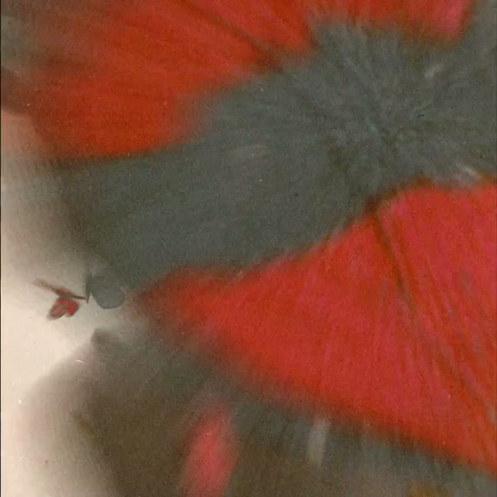

X8

One thing flies into the lens

From the montage to the name

The formation breaks; one element (25% of width) flies at camera, scaling ~4× in 0.5 s with ~30 px motion blur until it fills the frame; hard cut behind it to the title.

For Kallo: The number’s ingredients scatter; a cherry tomato rolls into the lens; cut to “Kallo”.

Claude · Claude Fable 5 · 0:16.1

X9

Retire a line by greying it out

A calm exit

The headline fades through #8F8F8F to #D0D0D0 and out over ~0.75 s with no movement; the next element fades in at the same spot, desaturated first. Variant: soft glows bloom and a UI corner enters pre-cropped at ~3×.

For Kallo: Each typed line greys out in place before the result card appears where it was.

OpenAI · Codex rate limits · 0:04.8 Also: Manus · Website Auto Publish 0:03.6

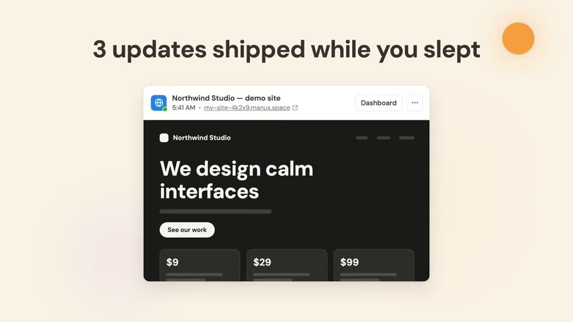

X10

Light tells the time

A time jump without a cut

One continuous shot: the ground moves navy #212838 → grey → cream #FAF2E5 in 1.3 s; stars fade; the moon greys while a sun disc rises from behind the card, warming from yellow-green to orange.

For Kallo: Breakfast under a small morning sun on cream, dinner under the moon on navy; the day’s total climbs across the change of light.

Manus · Website Auto Publish · 0:20.6

X11

The underline becomes a shelf

A sentence turning into its parts

The underline is a mask line at 55% of height. The words sink below it one by one, left to right, while 5 soft tiles (19% of height, radius 32 px) rise from behind it at a 0.125 s stagger, each rise ~0.25 s with a slight overshoot; done in ~1 s.

For Kallo: The typed meal’s words sink behind the line while its ingredients rise out of it as tiles with their grams. The parse, in one second.

Manus · Manus Browser Operator · 0:03.4 Also: Manus · Manus Browser Operator 0:01.6

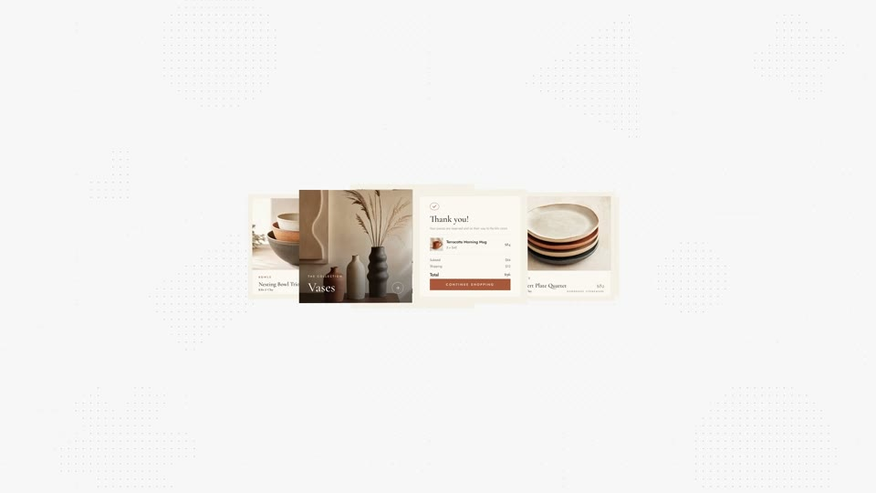

X12

Converge, then burst

The climax before the tagline

~12 cards orbit on a ring ~70% of height, turning ~30°/s and shrinking; the words collapse into them; the cluster compresses into a band (42% × 24%) over 0.8 s, then bursts outward in 0.4 s (ease-out with overshoot) into a loose ring around the tagline.

For Kallo: Ingredient photos (grain, chicken, greens, oil) orbit, compress into a band, and burst out around the total.

Manus · Plan Mode · 0:18.0

### Rhythm

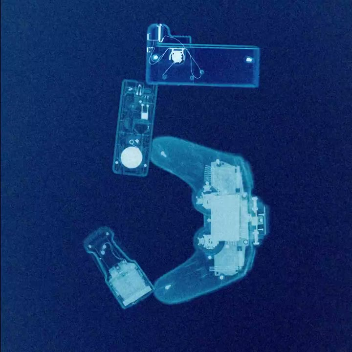

R1

Accelerate, then stop dead

Building to a reveal in under 15 s

Shots go from ~1 s to 0.25–0.5 s to 0.125 s (3 frames at 24 fps) over ~12 s, locked to the music grid; then one image holds 0.75 s in silence before the reveal.

For Kallo: Meals cut from 1 s down to 3 frames over 8 s on a tick grid, then a full stop on one plate for 0.75 s before the numbers.

Claude · Claude Fable 5 · 0:12.3 Also: Claude · Claude Opus 5.5 0:13.1

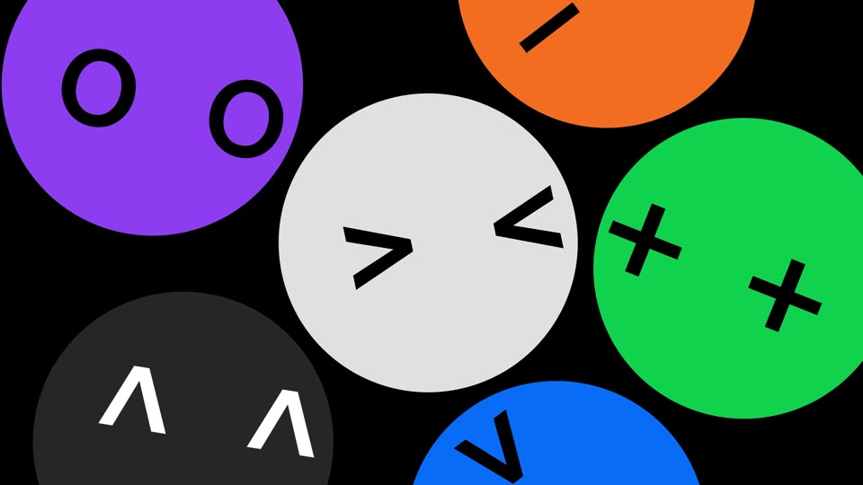

R2

Busy first, still for the message

A short teaser where the message must land

Roughly 40% spectacle, 35% build, 25% hold: density peaks in the first 4.5 s, collapses to dots (the breath), the message builds, then a 3 s full hold. Stings run short, short, long (2.0 / 1.8 / 7.1 s).

For Kallo: Many meals in the first 5 s, collapse to one dot, build “548 kcal” in the quiet middle, hold the end 3 s.

OpenAI · DevDay teaser · 0:03.5 Also: OpenAI · DevDay sting 0:02.3; SpaceXAI · Rename sting 0:09.0

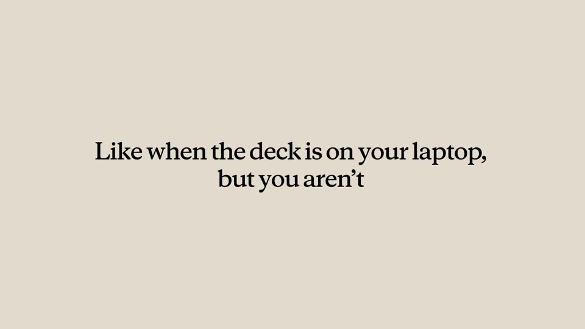

R3

Move, then hold

A calm, readable product film

Every camera move is a fast ease-out spike (0.3–0.6 s) followed by a 2–4 s hold; cuts only at chapter cards (2.5 s each). One film: 6 cuts in 64 s; another: zero cuts in 81 s.

For Kallo: 20 s: a 2.5 s line, a 6 s single move (type, parse, numbers), a 2.5 s line, a 6 s move (web), a 3 s end. Four cuts.

Claude · Dispatch · 0:05.0 Also: OpenAI · Codex on mobile 0:08.5; Manus · Projects on mobile 0:01.6

R4

One module, one variable

Range without new footage

A 5 s module repeats four times with one word changing: word (+1.3 s) prompt (+0.8 s) pull-out (+0.6 s) chart, ~2 s hold. Zero cuts in 30 s.

For Kallo: Three 5 s modules: a meal typed, foods resolve, numbers land. Only the meal changes (a breakfast, a lunch, a dinner from different kitchens).

Manus · Similarweb data · 0:04.0

R5

A burst right before the reveal

The energy peak

After 3–7 s shots, five extreme close-ups at ~0.4 s each, then a hard cut to white; the sound hit lands on the first cut of the burst.

For Kallo: Near 12 s: five 0.4 s close-ups of different meals resolving to their kcal, then cut to the calm result.

OpenAI · dots · 0:20.3

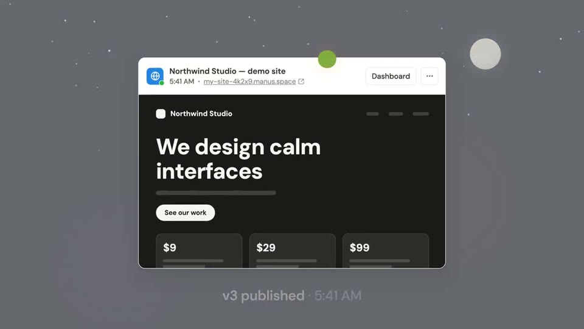

R6

The turn sits at 70–85% of the runtime

Placing the climax

The one transformation beat runs at 70–80% or 79–87% of the film; after it, a 1.5–2 s tagline hold, then a ~3 s sting.

For Kallo: 20 s: input 0–5, parsing 5–14, sentence-to-numbers at 14–16, line 16–17.5, sting 17.5–20.

Manus · Website Auto Publish · 0:19.6
