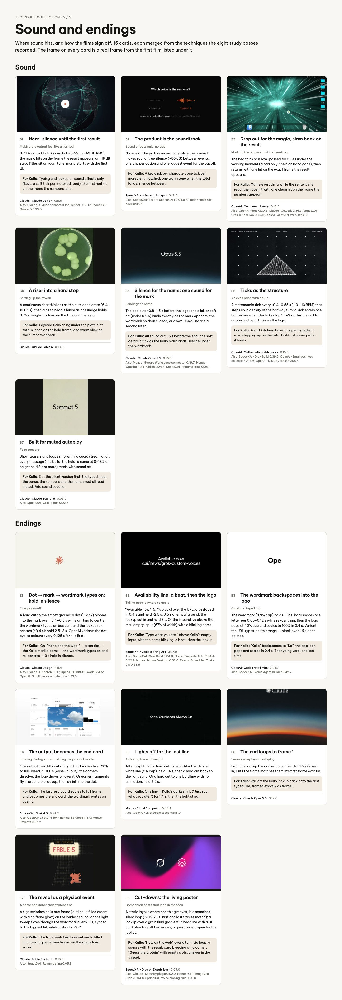
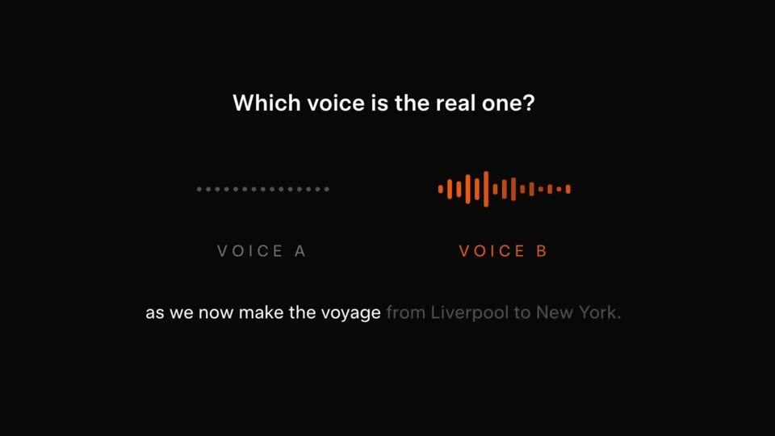
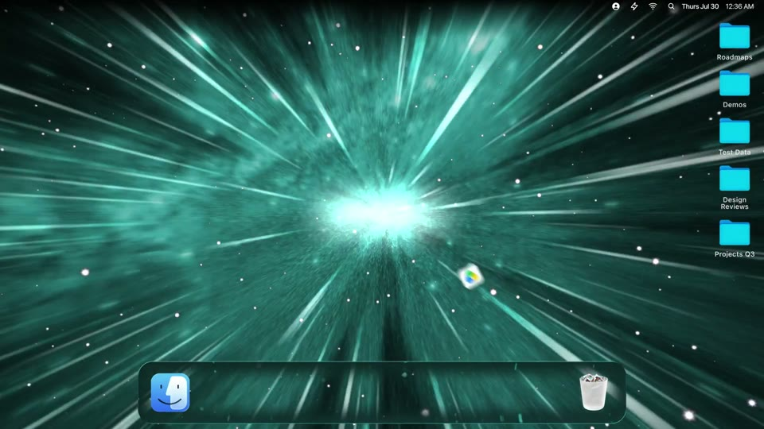
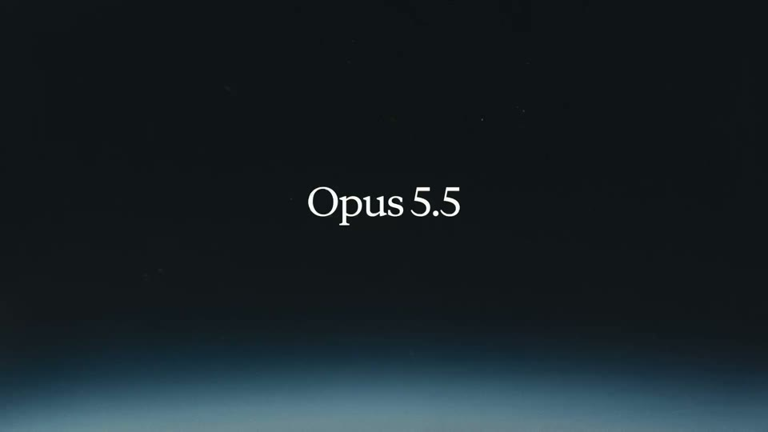
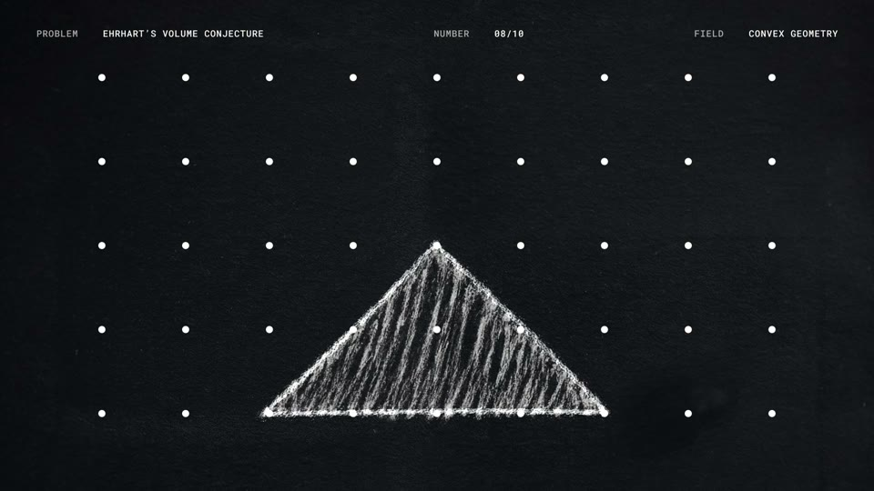
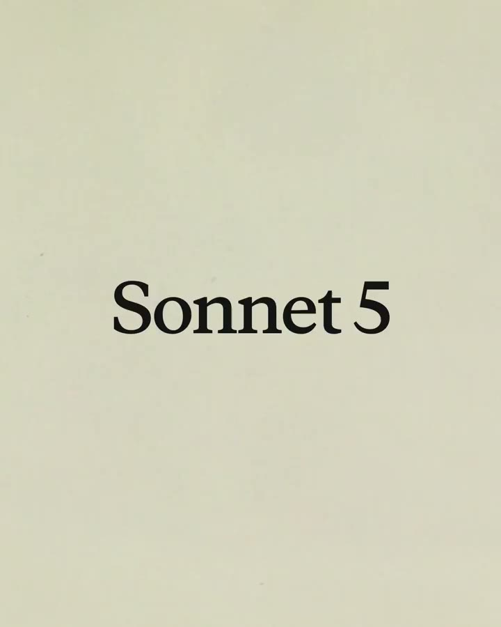
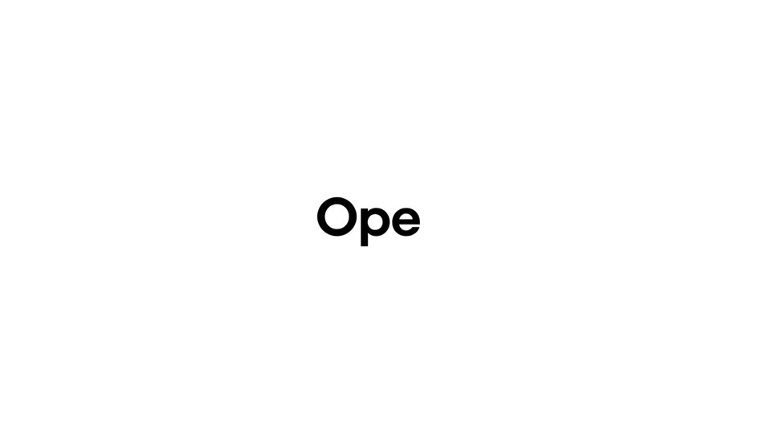
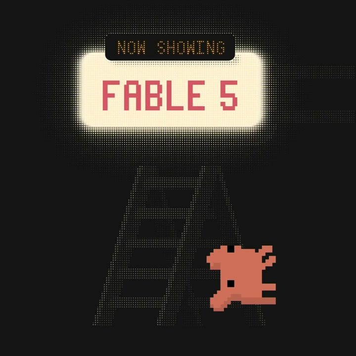

# Sound and endings

The board as rendered: [RefCollection5.jpg](RefCollection5.jpg). Its text and frames follow, in order.

---

TECHNIQUE COLLECTION · 5 / 5

## Sound and endings

Where sound hits, and how the films sign off. 15 cards, each merged from the techniques the eight study passes recorded. The frame on every card is a real frame from the first film listed under it.

### Sound

S1

Near-silence until the first result

Making the output feel like an arrival

0–11.4 s only UI clicks and ticks (−22 to −43 dB RMS); the music hits on the frame the result appears, an ~18 dB step. Titles sit on room tone; music starts with the first UI.

For Kallo: Typing and lookup on sound effects only (keys, a soft tick per matched food); the first real hit on the frame the numbers land.

Claude · Claude Design · 0:11.6 Also: Claude · Claude connector for Blender 0:08.0; SpaceXAI · Grok 4.5 0:33.0

S2

The product is the soundtrack

Sound effects only, no bed

No music. The picture moves only while the product makes sound; true silence (−80 dB) between events; one blip per action and one loudest event for the payoff.

For Kallo: A key click per character, one tick per ingredient matched, one warm tone when the total lands, silence between.

SpaceXAI · Voice cloning quiz · 0:13.0 Also: SpaceXAI · Text to Speech API 0:04.8; Claude · Fable 5 is back 0:05.5

S3

Drop out for the magic, slam back on the result

Marking the one moment that matters

The bed thins or is low-passed for 3–9 s under the working moment (a pad only, the high band gone), then returns with one hit on the exact frame the result appears.

For Kallo: Muffle everything while the sentence is read, then open it with one clean hit on the frame the numbers appear.

OpenAI · Computer History · 0:10.3 Also: OpenAI · dots 0:20.3; Claude · Cowork 0:36.3; SpaceXAI · Grok in X for iOS 0:18.3; OpenAI · ChatGPT Work 0:46.2

S4

A riser into a hard stop

Setting up the reveal

A continuous riser thickens as the cuts accelerate (6.4–13.05 s), then cuts to near-silence as one image holds 0.75 s; single hits land on the title and the logo.

For Kallo: Layered ticks rising under the plate cuts, total silence on the held frame, one warm click as the numbers appear.

Claude · Claude Fable 5 · 0:13.3

S5

Silence for the name; one sound for the mark

Landing the name

The bed cuts ~0.8–1.5 s before the logo; one click or soft hit (under 0.2 s) lands exactly as the mark appears; the wordmark holds in silence, or a swell rises under it a second later.

For Kallo: All sound out 1.5 s before the end; one soft ceramic tick as the Kallo mark lands; silence under the wordmark.

Claude · Claude Opus 5.5 · 0:16.5 Also: Manus · Google Workspace connector 0:19.7; Manus · Website Auto Publish 0:24.3; SpaceXAI · Rename sting 0:05.1

S6

Ticks as the structure

An even pace with a turn

A metronomic tick every ~0.4–0.55 s (110–113 BPM) that steps up in density at the halfway turn; a kick enters one bar before a list; the ticks stop 1.5–3 s after the call to action and a pad carries the logo.

For Kallo: A soft kitchen-timer tick per ingredient row, stepping up as the total builds, stopping when it lands.

OpenAI · Mathematical Advances · 0:15.5 Also: SpaceXAI · Grok Build 0:39.5; OpenAI · Small business collection 0:13.6; OpenAI · DevDay teaser 0:08.4

S7

Built for muted autoplay

Feed teasers

Short teasers and loops ship with no audio stream at all; every message (the build, the hold, a name at 8–13% of height held 3 s or more) reads with sound off.

For Kallo: Cut the silent version first: the typed meal, the parse, the numbers and the name must all read muted. Add sound second.

Claude · Claude Sonnet 5 · 0:09.0 Also: SpaceXAI · Grok 4 free 0:02.5

### Endings

E1

Dot → mark → wordmark types on; hold in silence

Every sign-off

A hard cut to the empty ground; a dot (~12 px) blooms into the mark over ~0.4–0.5 s while drifting to centre; the wordmark types on beside it and the lockup re-centres (~0.4 s); hold 2.5–3 s. OpenAI variant: the dot cycles colours every 0.125 s for ~1 s first.

For Kallo: “On iPhone and the web.” → a tan dot → the Kallo mark blooms → the wordmark types on and re-centres → 3 s hold in silence.

Claude · Claude Design · 1:16.4 Also: Claude · Dispatch 1:11.0; OpenAI · ChatGPT Work 1:34.5; OpenAI · Small business collection 0:23.0

E2

Availability line, a beat, then the logo

Telling people where to get it

“Available now” (5.7% block) over the URL, crossfaded in 0.4 s and held ~2.5 s; 0.5 s of empty ground; the lockup cut in and held 3 s. Or the imperative above the real, empty input (67% of width) with a blinking caret.

For Kallo: “Type what you ate.” above Kallo’s empty input with the caret blinking; a beat; then the lockup.

SpaceXAI · Voice cloning API · 0:27.0 Also: SpaceXAI · Grok Build 0:34.0; Manus · Website Auto Publish 0:22.9; Manus · Manus Desktop 0:52.0; Manus · Scheduled Tasks 2.0 0:36.5

E3

The wordmark backspaces into the logo

Closing a typed film

The wordmark (8.9% cap) holds ~1.2 s, backspaces one letter per 0.06–0.12 s while re-centring, then the logo pops at 40% size and scales to 100% in 0.4 s. Variant: the URL types, shifts orange → black over 1.6 s, then deletes.

For Kallo: “Kallo” backspaces to “Ka”; the app icon pops and scales in 0.4 s. The typing verb, one last time.

OpenAI · Codex rate limits · 0:25.7 Also: SpaceXAI · Voice Agent Builder 0:42.7

E4

The output becomes the end card

Landing the logo on something the product made

One output card lifts out of a grid and scales from 20% to full-bleed in ~0.6 s (ease-in-out); the corners dissolve; the logo draws on over it. Or earlier fragments fly in around the lockup, then shrink into the dot.

For Kallo: The last result card scales to full frame and becomes the end card; the wordmark writes on over it.

SpaceXAI · Grok 4.5 · 0:47.2 Also: OpenAI · ChatGPT for Financial Services 1:16.0; Manus · Projects 0:35.2

E5

Lights off for the last line

A closing line with weight

After a light film, a hard cut to near-black with one white line (5% cap), held 1.4 s, then a hard cut back to the light sting. Or a hard cut to one bold line with no animation, held 2.2 s.

For Kallo: One line in Kallo’s darkest ink (“Just say what you ate.”) for 1.4 s, then the light sting.

Manus · Cloud Computer · 0:44.8 Also: OpenAI · Livestream teaser 0:06.0

E6

The end loops to frame 1

Seamless replay on autoplay

From the lockup the camera tilts down for 1.5 s (ease-in) until the frame matches the film’s first frame exactly.

For Kallo: Pan off the Kallo lockup back onto the first typed line, framed exactly as frame 1.

Claude · Claude Opus 5.5 · 0:19.6

E7

The reveal as a physical event

A name or number that switches on

A sign switches on in one frame (outline → filled cream with a halftone glow) on the loudest sound; or one light sweep flows through the wordmark over 2.6 s, synced to the biggest hit, while it shrinks ~10%.

For Kallo: The total switches from outline to filled with a soft glow in one frame, on the single loud sound.

Claude · Fable 5 is back · 0:10.0 Also: SpaceXAI · Rename sting 0:05.8

E8

Cut-downs: the living poster

Companion posts that loop in the feed

A static layout where one thing moves, in a seamless silent loop (6–19.23 s, first and last frames match): a lockup over a grain fluid gradient; a headline with a UI card bleeding off two edges; a question left open for the replies.

For Kallo: “Now on the web” over a tan fluid loop; a square with the result card bleeding off a corner; “Guess the protein” with empty slots, answer in the thread.

SpaceXAI · Grok on Databricks · 0:09.0 Also: Claude · Security plugin 0:02.0; Manus · GPT Image 2 in Slides 0:04.8; SpaceXAI · Voice cloning quiz 0:20.8
