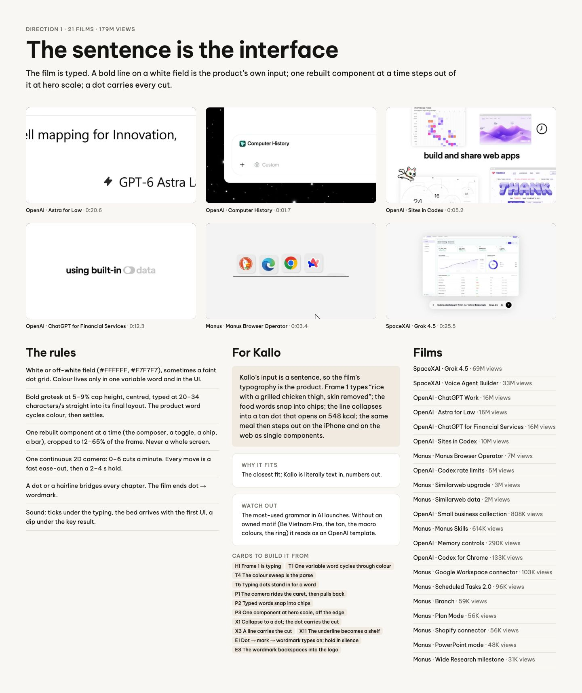
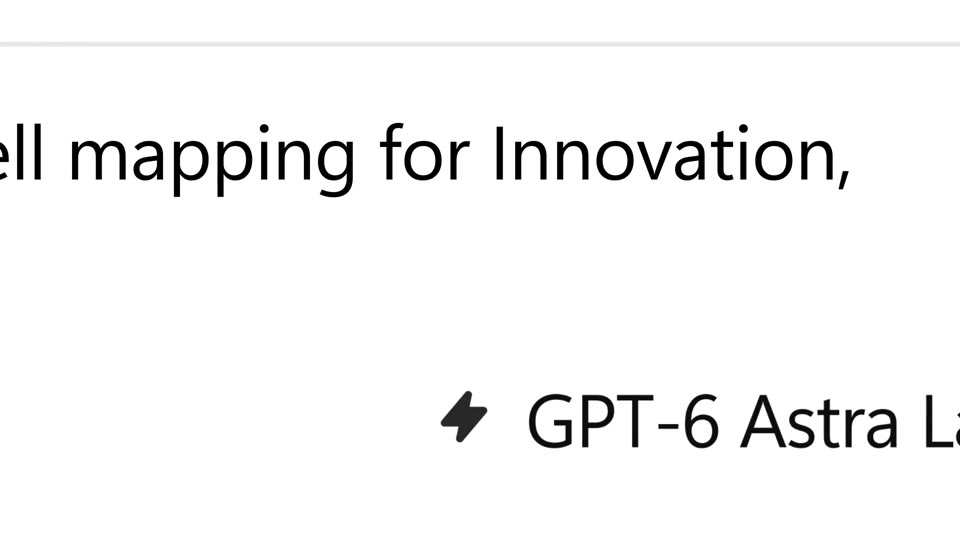
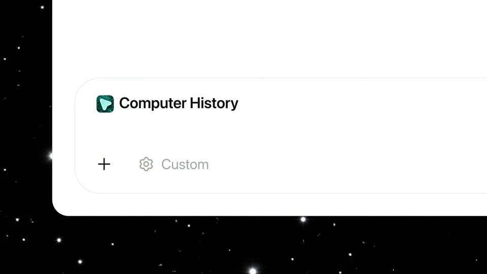
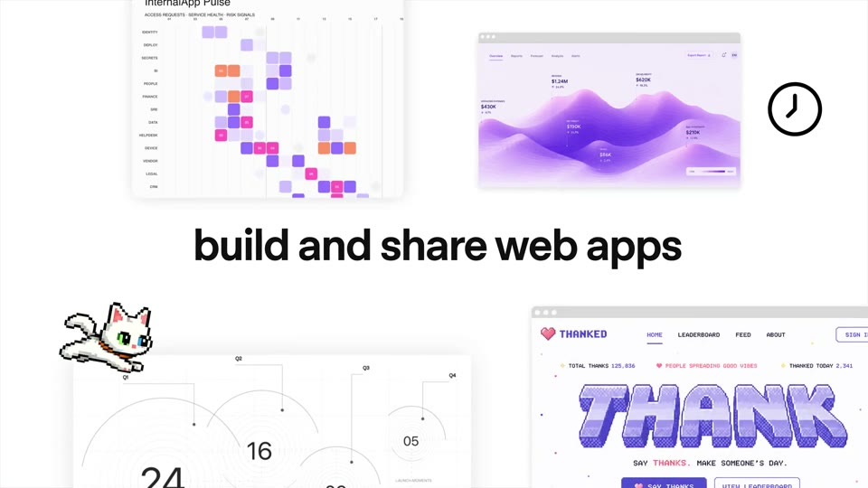
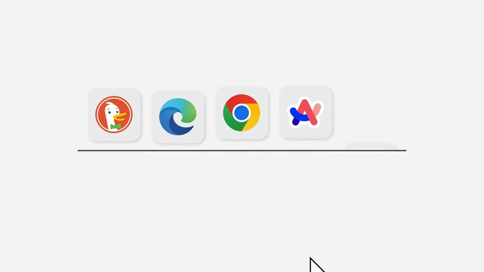

# D1 The sentence is the interface

The board as rendered: [RefDir01.jpg](RefDir01.jpg). Its text and frames follow, in order.

---

DIRECTION 1 · 21 FILMS · 179M VIEWS

## The sentence is the interface

The film is typed. A bold line on a white field is the product’s own input; one rebuilt component at a time steps out of it at hero scale; a dot carries every cut.

OpenAI · Astra for Law · 0:20.6

OpenAI · Computer History · 0:01.7

OpenAI · Sites in Codex · 0:05.2

OpenAI · ChatGPT for Financial Services · 0:12.3

Manus · Manus Browser Operator · 0:03.4

SpaceXAI · Grok 4.5 · 0:25.5

### The rules

White or off-white field (#FFFFFF, #F7F7F7), sometimes a faint dot grid. Colour lives only in one variable word and in the UI.

Bold grotesk at 5–9% cap height, centred, typed at 20–34 characters/s straight into its final layout. The product word cycles colour, then settles.

One rebuilt component at a time (the composer, a toggle, a chip, a bar), cropped to 12–65% of the frame. Never a whole screen.

One continuous 2D camera: 0–6 cuts a minute. Every move is a fast ease-out, then a 2–4 s hold.

A dot or a hairline bridges every chapter. The film ends dot → wordmark.

Sound: ticks under the typing, the bed arrives with the first UI, a dip under the key result.

### For Kallo

Kallo’s input is a sentence, so the film’s typography is the product. Frame 1 types “rice with a grilled chicken thigh, skin removed”; the food words snap into chips; the line collapses into a tan dot that opens on 548 kcal; the same meal then steps out on the iPhone and on the web as single components.

WHY IT FITS

The closest fit: Kallo is literally text in, numbers out.

WATCH OUT

The most-used grammar in AI launches. Without an owned motif (Be Vietnam Pro, the tan, the macro colours, the ring) it reads as an OpenAI template.

CARDS TO BUILD IT FROM

H1 Frame 1 is typingT1 One variable word cycles through colourT4 The colour sweep is the parseT6 Typing dots stand in for a wordP1 The camera rides the caret, then pulls backP2 Typed words snap into chipsP3 One component at hero scale, off the edgeX1 Collapse to a dot; the dot carries the cutX3 A line carries the cutX11 The underline becomes a shelfE1 Dot → mark → wordmark types on; hold in silenceE3 The wordmark backspaces into the logo

### Films

SpaceXAI · Grok 4.5 · 69M views

SpaceXAI · Voice Agent Builder · 33M views

OpenAI · ChatGPT Work · 16M views

OpenAI · Astra for Law · 16M views

OpenAI · ChatGPT for Financial Services · 16M views

OpenAI · Sites in Codex · 10M views

Manus · Manus Browser Operator · 7M views

OpenAI · Codex rate limits · 5M views

Manus · Similarweb upgrade · 3M views

Manus · Similarweb data · 2M views

OpenAI · Small business collection · 808K views

Manus · Manus Skills · 614K views

OpenAI · Memory controls · 290K views

OpenAI · Codex for Chrome · 133K views

Manus · Google Workspace connector · 103K views

Manus · Scheduled Tasks 2.0 · 96K views

Manus · Branch · 59K views

Manus · Plan Mode · 56K views

Manus · Shopify connector · 56K views

Manus · PowerPoint mode · 48K views

Manus · Wide Research milestone · 31K views
