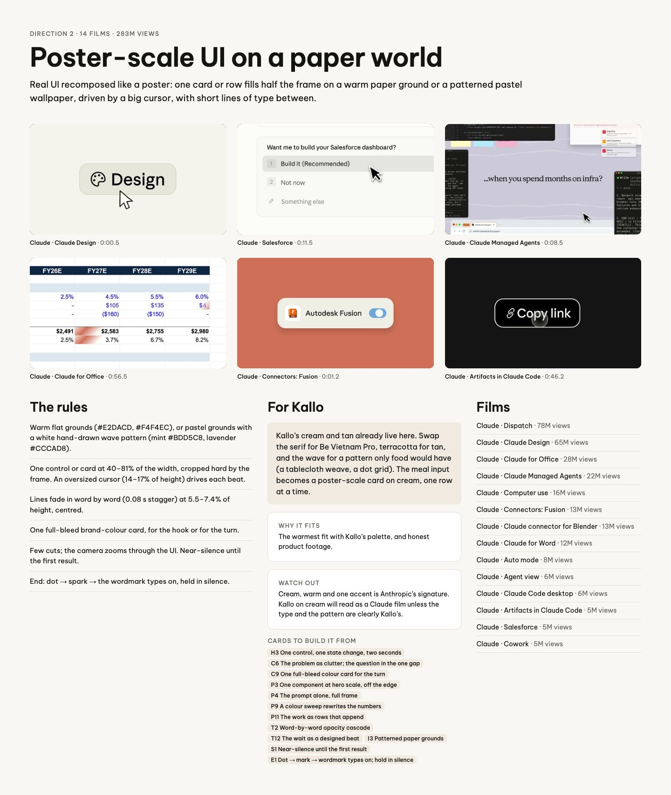
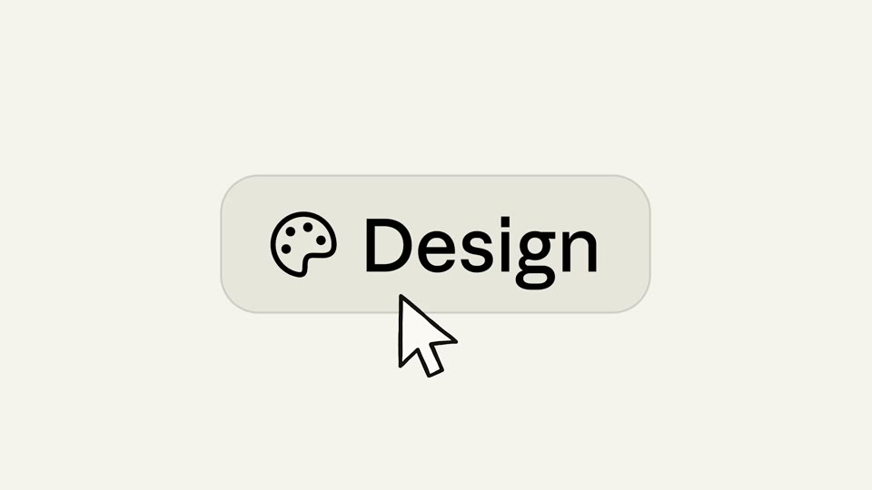
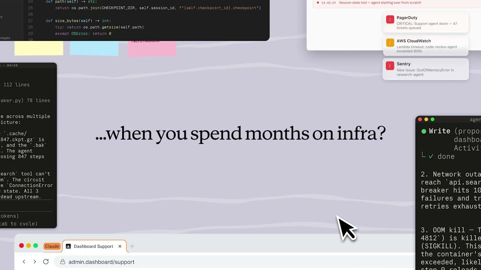
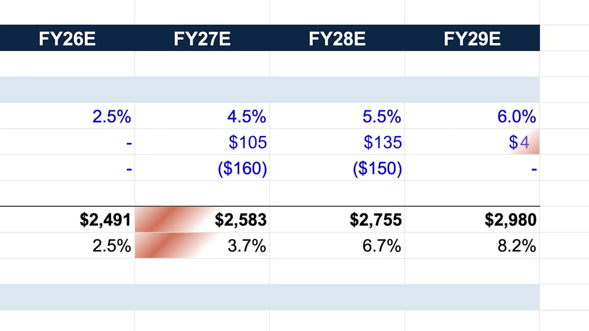
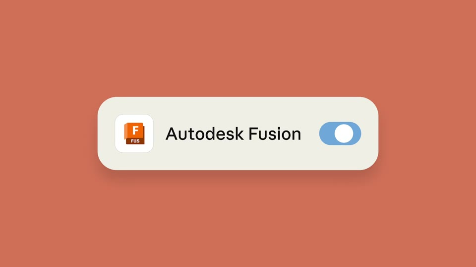
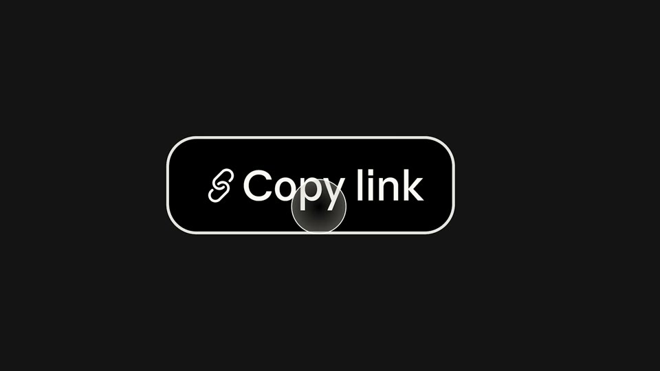

# D2 Poster-scale UI on a paper world

The board as rendered: [RefDir02.jpg](RefDir02.jpg). Its text and frames follow, in order.

---

DIRECTION 2 · 14 FILMS · 283M VIEWS

## Poster-scale UI on a paper world

Real UI recomposed like a poster: one card or row fills half the frame on a warm paper ground or a patterned pastel wallpaper, driven by a big cursor, with short lines of type between.

Claude · Claude Design · 0:00.5

Claude · Salesforce · 0:11.5

Claude · Claude Managed Agents · 0:08.5

Claude · Claude for Office · 0:56.5

Claude · Connectors: Fusion · 0:01.2

Claude · Artifacts in Claude Code · 0:46.2

### The rules

Warm flat grounds (#E2DACD, #F4F4EC), or pastel grounds with a white hand-drawn wave pattern (mint #BDD5C8, lavender #CCCAD8).

One control or card at 40–81% of the width, cropped hard by the frame. An oversized cursor (14–17% of height) drives each beat.

Lines fade in word by word (0.08 s stagger) at 5.5–7.4% of height, centred.

One full-bleed brand-colour card, for the hook or for the turn.

Few cuts; the camera zooms through the UI. Near-silence until the first result.

End: dot → spark → the wordmark types on, held in silence.

### For Kallo

Kallo’s cream and tan already live here. Swap the serif for Be Vietnam Pro, terracotta for tan, and the wave for a pattern only food would have (a tablecloth weave, a dot grid). The meal input becomes a poster-scale card on cream, one row at a time.

WHY IT FITS

The warmest fit with Kallo’s palette, and honest product footage.

WATCH OUT

Cream, warm and one accent is Anthropic’s signature. Kallo on cream will read as a Claude film unless the type and the pattern are clearly Kallo’s.

CARDS TO BUILD IT FROM

H3 One control, one state change, two secondsC6 The problem as clutter; the question in the one gapC9 One full-bleed colour card for the turnP3 One component at hero scale, off the edgeP4 The prompt alone, full frameP9 A colour sweep rewrites the numbersP11 The work as rows that appendT2 Word-by-word opacity cascadeT12 The wait as a designed beatI3 Patterned paper groundsS1 Near-silence until the first resultE1 Dot → mark → wordmark types on; hold in silence

### Films

Claude · Dispatch · 78M views

Claude · Claude Design · 65M views

Claude · Claude for Office · 28M views

Claude · Claude Managed Agents · 22M views

Claude · Computer use · 16M views

Claude · Connectors: Fusion · 13M views

Claude · Claude connector for Blender · 13M views

Claude · Claude for Word · 12M views

Claude · Auto mode · 8M views

Claude · Agent view · 6M views

Claude · Claude Code desktop · 6M views

Claude · Artifacts in Claude Code · 5M views

Claude · Salesforce · 5M views

Claude · Cowork · 5M views
