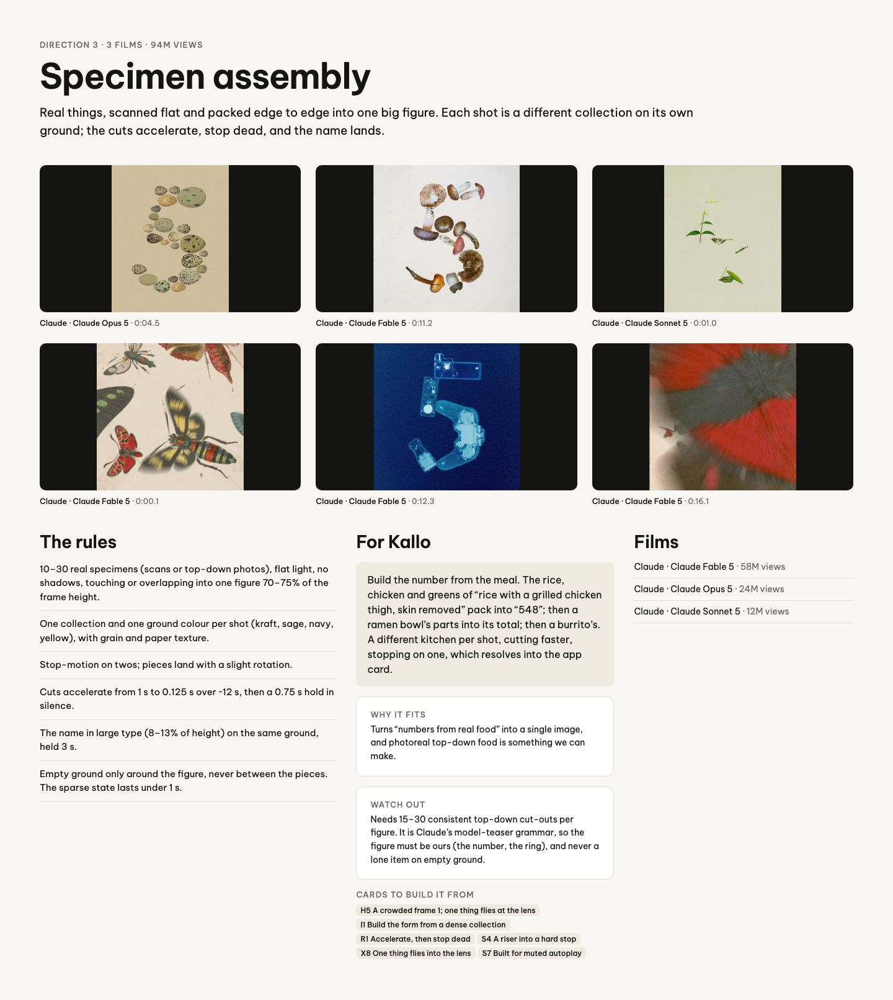
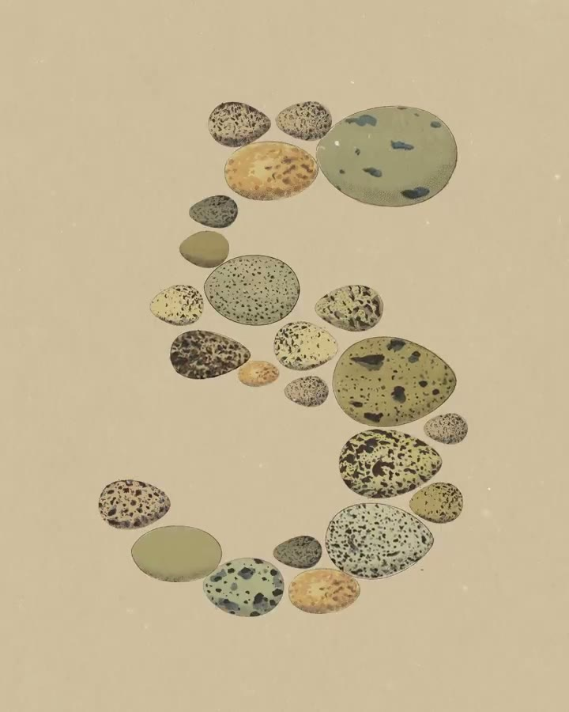
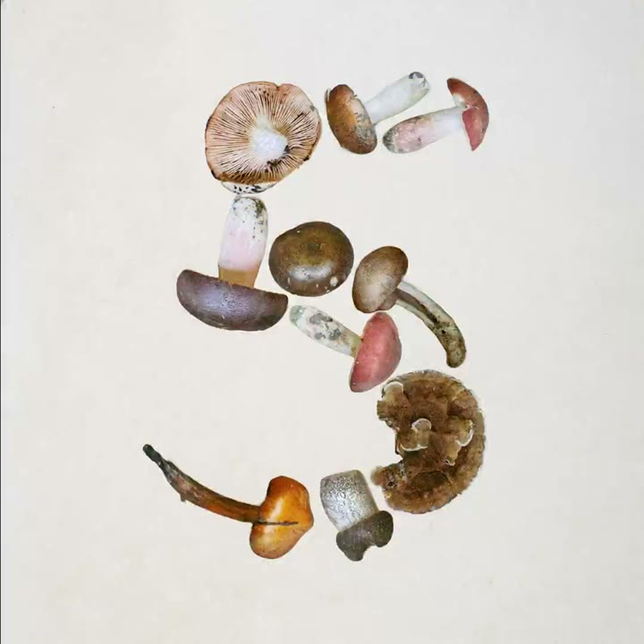
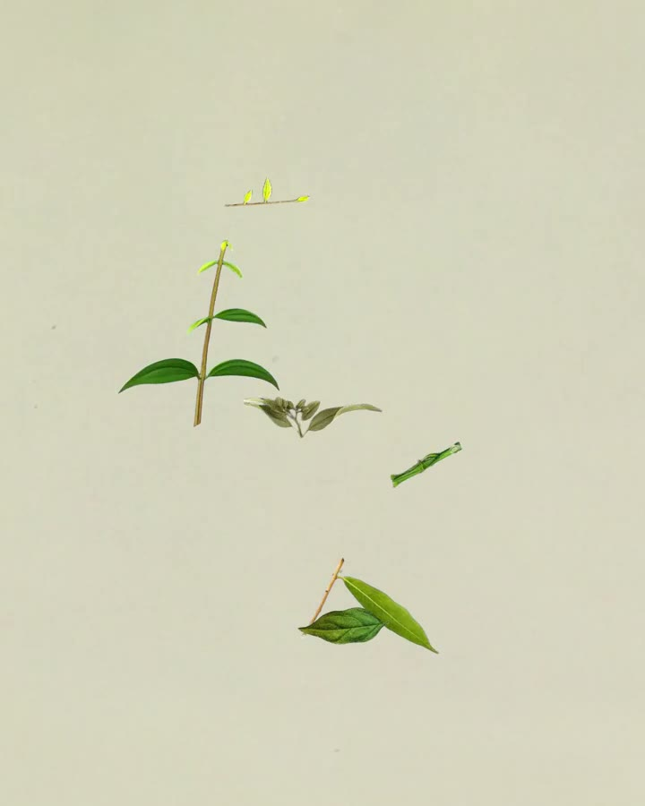
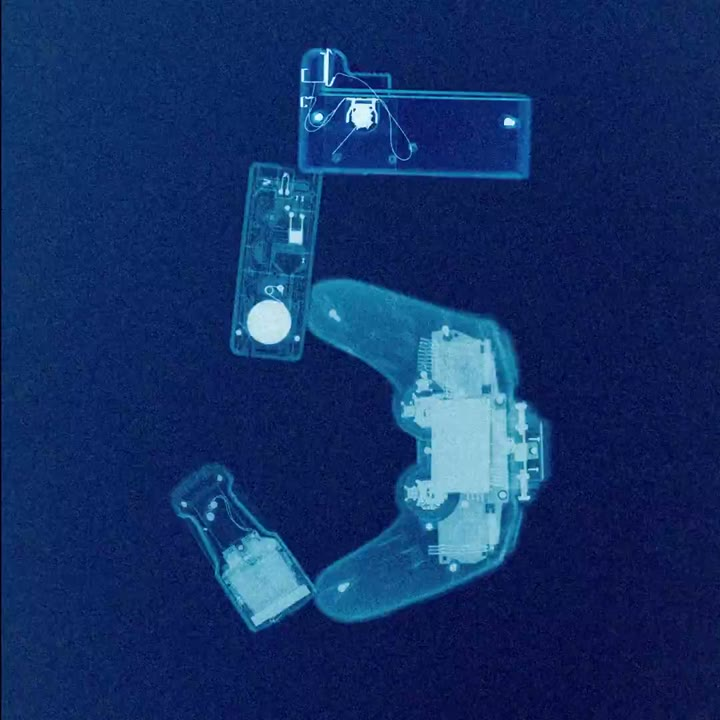
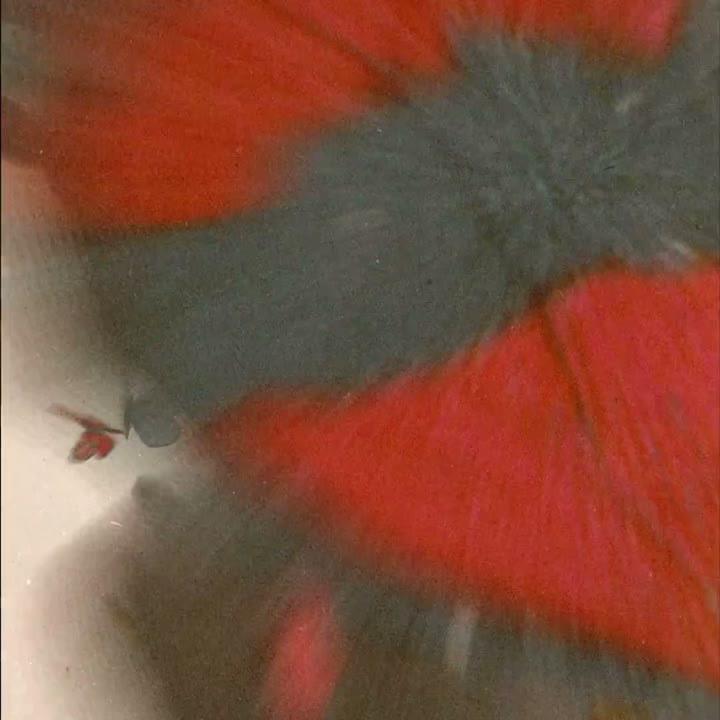

# D3 Specimen assembly

The board as rendered: [RefDir03.jpg](RefDir03.jpg). Its text and frames follow, in order.

---

DIRECTION 3 · 3 FILMS · 94M VIEWS

## Specimen assembly

Real things, scanned flat and packed edge to edge into one big figure. Each shot is a different collection on its own ground; the cuts accelerate, stop dead, and the name lands.

Claude · Claude Opus 5 · 0:04.5

Claude · Claude Fable 5 · 0:11.2

Claude · Claude Sonnet 5 · 0:01.0

Claude · Claude Fable 5 · 0:00.1

Claude · Claude Fable 5 · 0:12.3

Claude · Claude Fable 5 · 0:16.1

### The rules

10–30 real specimens (scans or top-down photos), flat light, no shadows, touching or overlapping into one figure 70–75% of the frame height.

One collection and one ground colour per shot (kraft, sage, navy, yellow), with grain and paper texture.

Stop-motion on twos; pieces land with a slight rotation.

Cuts accelerate from 1 s to 0.125 s over ~12 s, then a 0.75 s hold in silence.

The name in large type (8–13% of height) on the same ground, held 3 s.

Empty ground only around the figure, never between the pieces. The sparse state lasts under 1 s.

### For Kallo

Build the number from the meal. The rice, chicken and greens of “rice with a grilled chicken thigh, skin removed” pack into “548”; then a ramen bowl’s parts into its total; then a burrito’s. A different kitchen per shot, cutting faster, stopping on one, which resolves into the app card.

WHY IT FITS

Turns “numbers from real food” into a single image, and photoreal top-down food is something we can make.

WATCH OUT

Needs 15–30 consistent top-down cut-outs per figure. It is Claude’s model-teaser grammar, so the figure must be ours (the number, the ring), and never a lone item on empty ground.

CARDS TO BUILD IT FROM

H5 A crowded frame 1; one thing flies at the lensI1 Build the form from a dense collectionR1 Accelerate, then stop deadS4 A riser into a hard stopX8 One thing flies into the lensS7 Built for muted autoplay

### Films

Claude · Claude Fable 5 · 58M views

Claude · Claude Opus 5 · 24M views

Claude · Claude Sonnet 5 · 12M views
