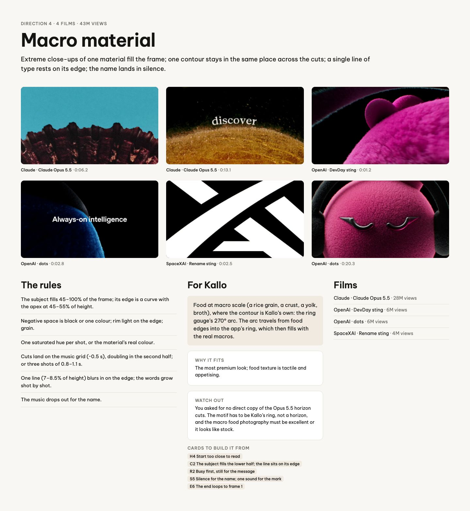
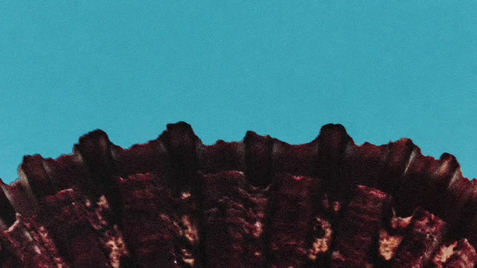
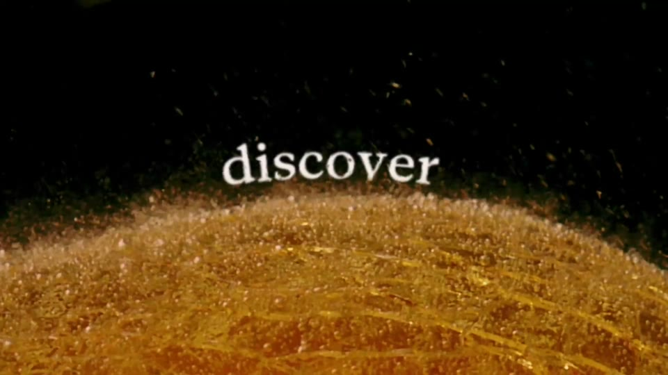
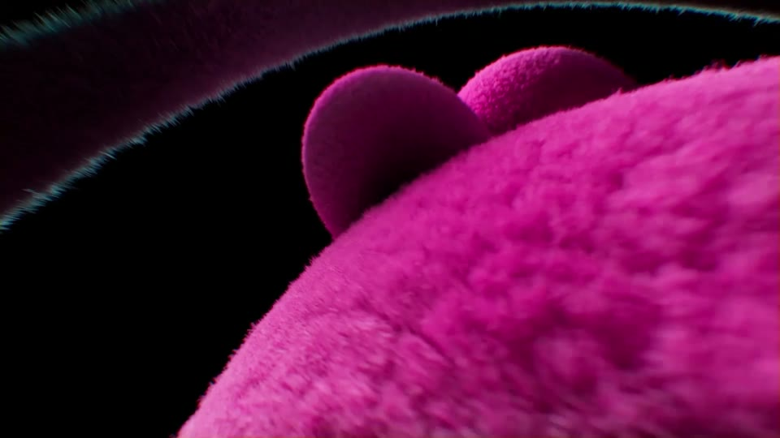
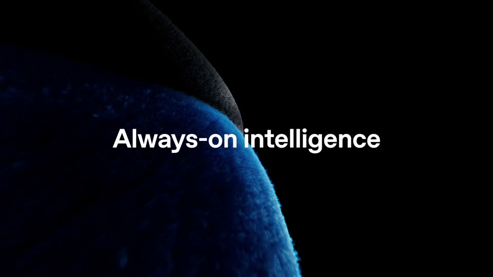
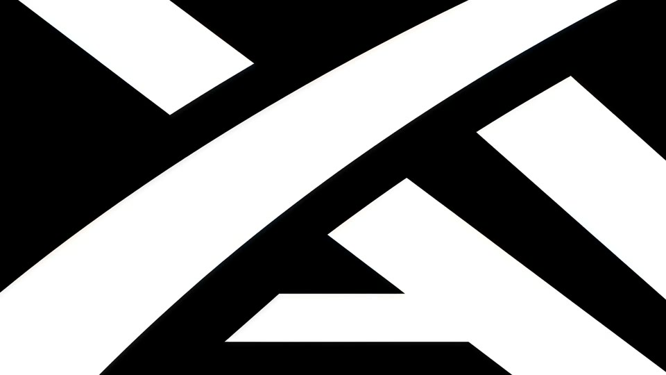
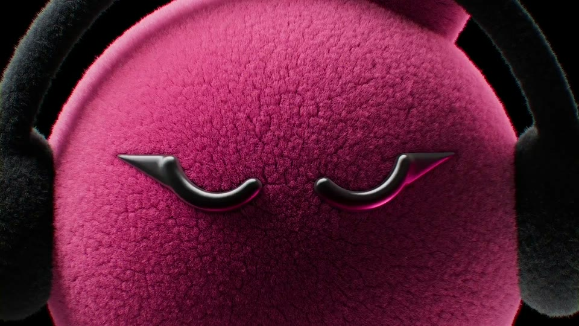

# D4 Macro material

The board as rendered: [RefDir04.jpg](RefDir04.jpg). Its text and frames follow, in order.

---

DIRECTION 4 · 4 FILMS · 43M VIEWS

## Macro material

Extreme close-ups of one material fill the frame; one contour stays in the same place across the cuts; a single line of type rests on its edge; the name lands in silence.

Claude · Claude Opus 5.5 · 0:06.2

Claude · Claude Opus 5.5 · 0:13.1

OpenAI · DevDay sting · 0:01.2

OpenAI · dots · 0:02.8

SpaceXAI · Rename sting · 0:02.5

OpenAI · dots · 0:20.3

### The rules

The subject fills 45–100% of the frame; its edge is a curve with the apex at 45–55% of height.

Negative space is black or one colour; rim light on the edge; grain.

One saturated hue per shot, or the material’s real colour.

Cuts land on the music grid (~0.5 s), doubling in the second half; or three shots of 0.8–1.1 s.

One line (7–8.5% of height) blurs in on the edge; the words grow shot by shot.

The music drops out for the name.

### For Kallo

Food at macro scale (a rice grain, a crust, a yolk, broth), where the contour is Kallo’s own: the ring gauge’s 270° arc. The arc travels from food edges into the app’s ring, which then fills with the real macros.

WHY IT FITS

The most premium look; food texture is tactile and appetising.

WATCH OUT

You asked for no direct copy of the Opus 5.5 horizon cuts. The motif has to be Kallo’s ring, not a horizon, and the macro food photography must be excellent or it looks like stock.

CARDS TO BUILD IT FROM

H4 Start too close to readC2 The subject fills the lower half; the line sits on its edgeR2 Busy first, still for the messageS5 Silence for the name; one sound for the markE6 The end loops to frame 1

### Films

Claude · Claude Opus 5.5 · 28M views

OpenAI · DevDay sting · 6M views

OpenAI · dots · 6M views

SpaceXAI · Rename sting · 4M views
