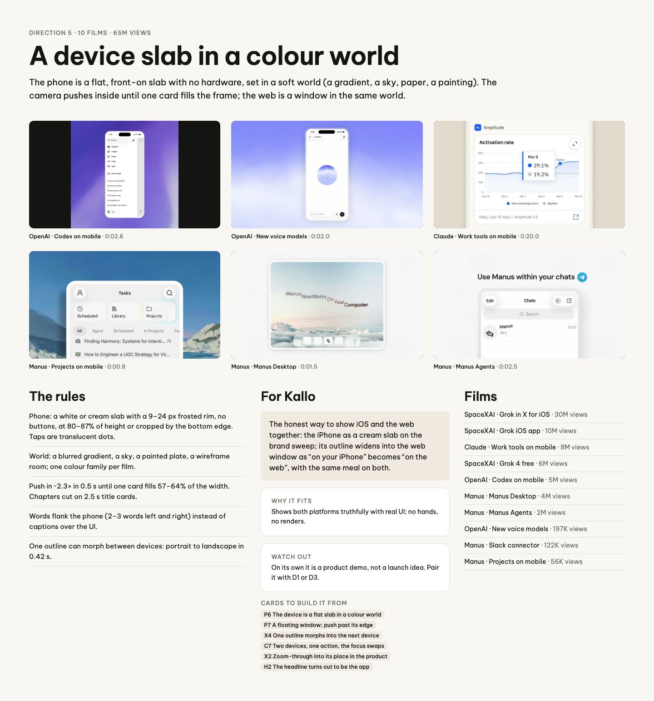
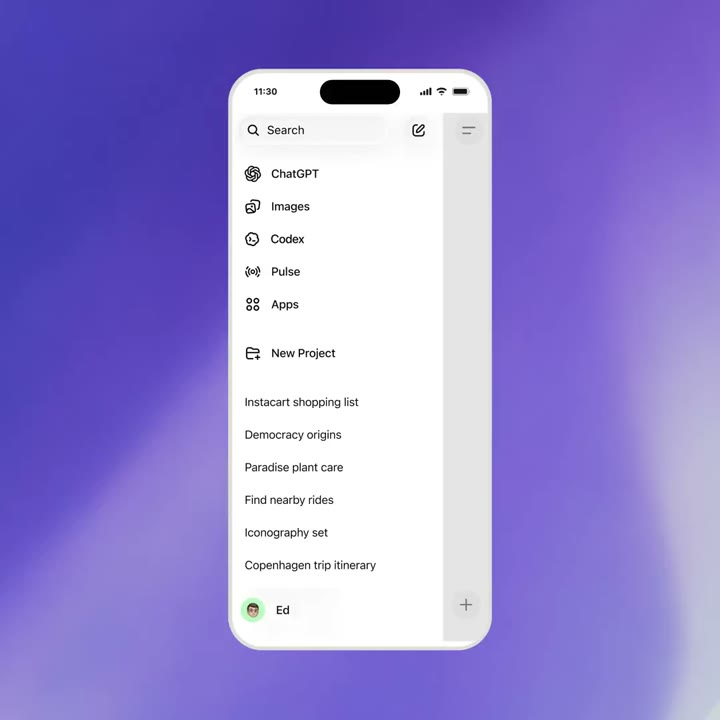
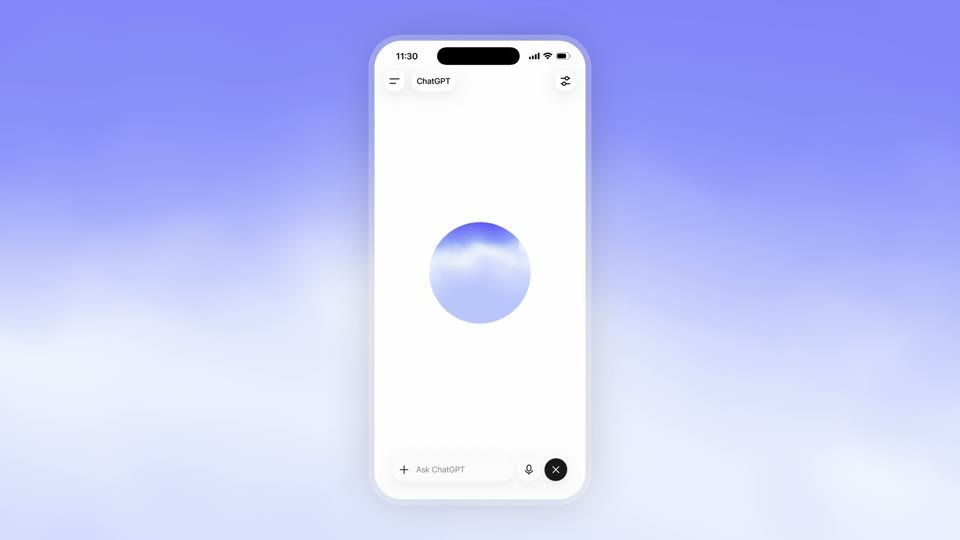
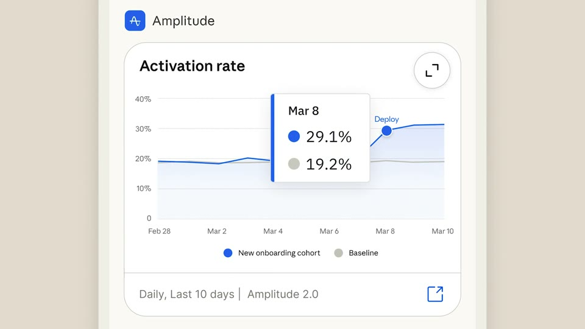
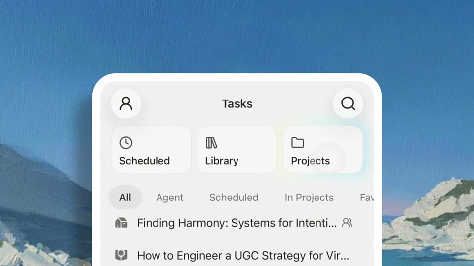
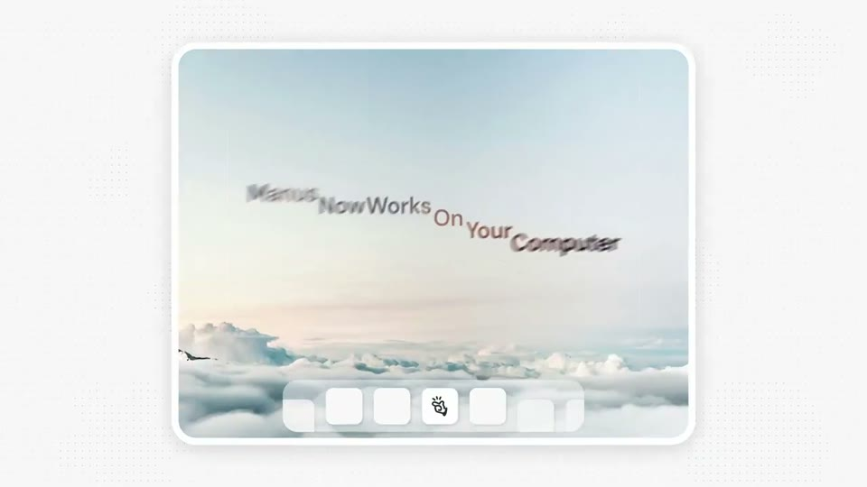
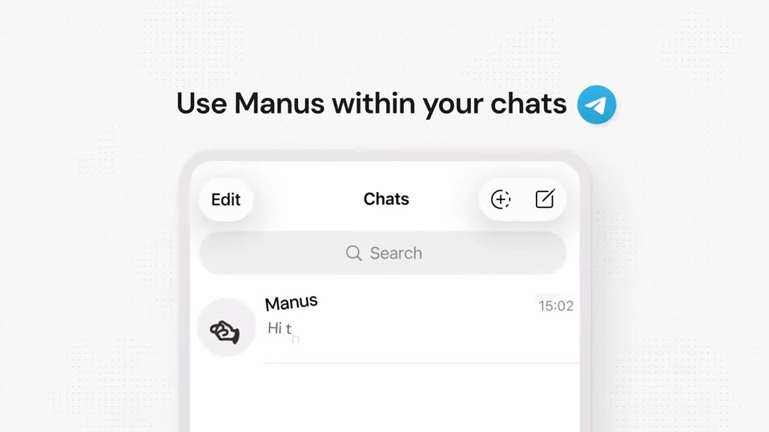

# D5 A device slab in a colour world

The board as rendered: [RefDir05.jpg](RefDir05.jpg). Its text and frames follow, in order.

---

DIRECTION 5 · 10 FILMS · 65M VIEWS

## A device slab in a colour world

The phone is a flat, front-on slab with no hardware, set in a soft world (a gradient, a sky, paper, a painting). The camera pushes inside until one card fills the frame; the web is a window in the same world.

OpenAI · Codex on mobile · 0:02.6

OpenAI · New voice models · 0:02.0

Claude · Work tools on mobile · 0:20.0

Manus · Projects on mobile · 0:00.8

Manus · Manus Desktop · 0:01.5

Manus · Manus Agents · 0:02.5

### The rules

Phone: a white or cream slab with a 9–24 px frosted rim, no buttons, at 80–87% of height or cropped by the bottom edge. Taps are translucent dots.

World: a blurred gradient, a sky, a painted plate, a wireframe room; one colour family per film.

Push in ~2.3× in 0.5 s until one card fills 57–64% of the width. Chapters cut on 2.5 s title cards.

Words flank the phone (2–3 words left and right) instead of captions over the UI.

One outline can morph between devices: portrait to landscape in 0.42 s.

### For Kallo

The honest way to show iOS and the web together: the iPhone as a cream slab on the brand sweep; its outline widens into the web window as “on your iPhone” becomes “on the web”, with the same meal on both.

WHY IT FITS

Shows both platforms truthfully with real UI; no hands, no renders.

WATCH OUT

On its own it is a product demo, not a launch idea. Pair it with D1 or D3.

CARDS TO BUILD IT FROM

P6 The device is a flat slab in a colour worldP7 A floating window; push past its edgeX4 One outline morphs into the next deviceC7 Two devices, one action, the focus swapsX2 Zoom-through into its place in the productH2 The headline turns out to be the app

### Films

SpaceXAI · Grok in X for iOS · 30M views

SpaceXAI · Grok iOS app · 10M views

Claude · Work tools on mobile · 8M views

SpaceXAI · Grok 4 free · 6M views

OpenAI · Codex on mobile · 5M views

Manus · Manus Desktop · 4M views

Manus · Manus Agents · 2M views

OpenAI · New voice models · 197K views

Manus · Slack connector · 122K views

Manus · Projects on mobile · 56K views
