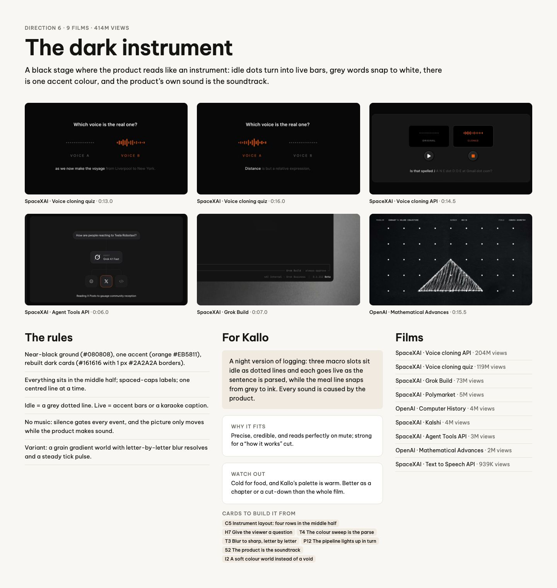
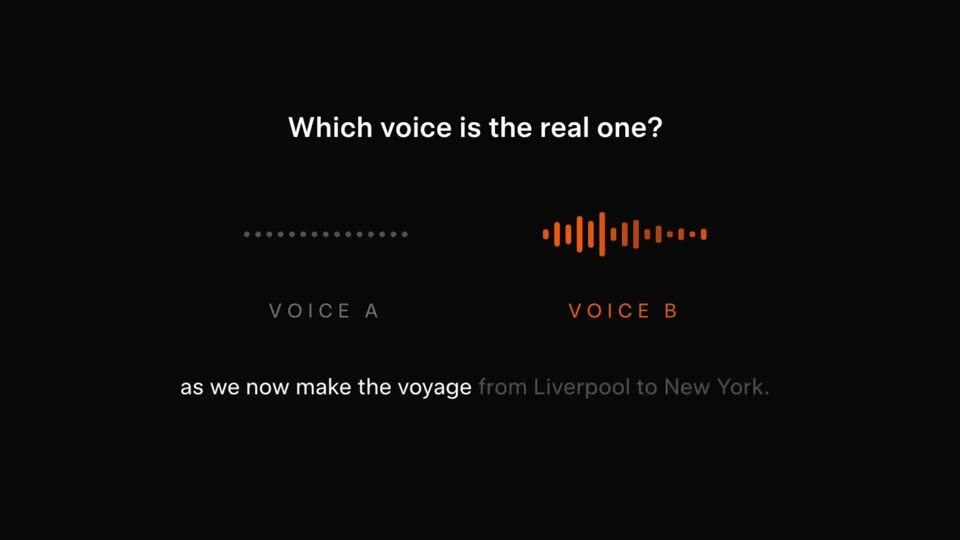
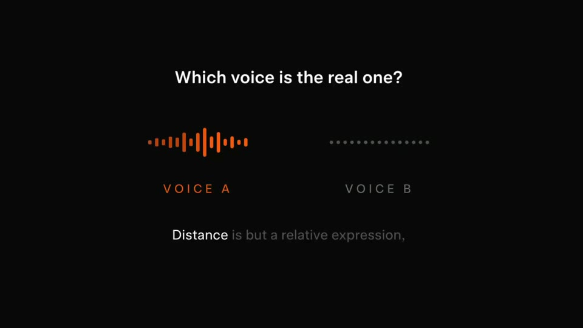
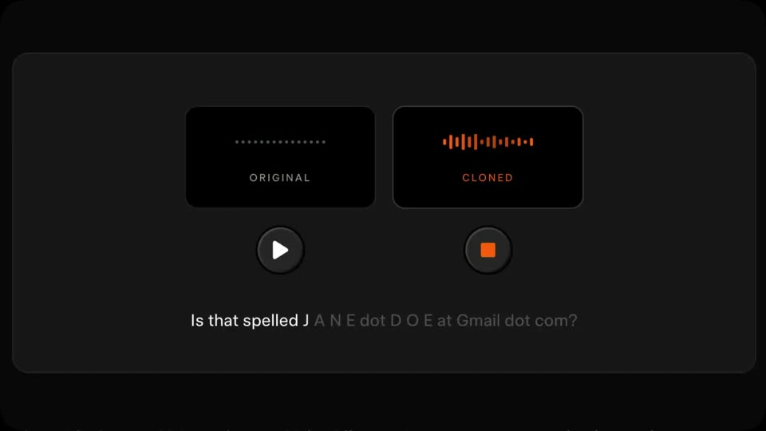
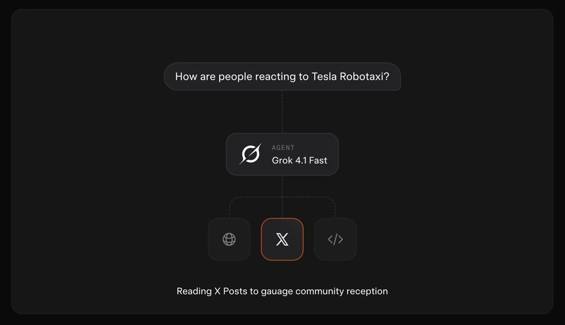
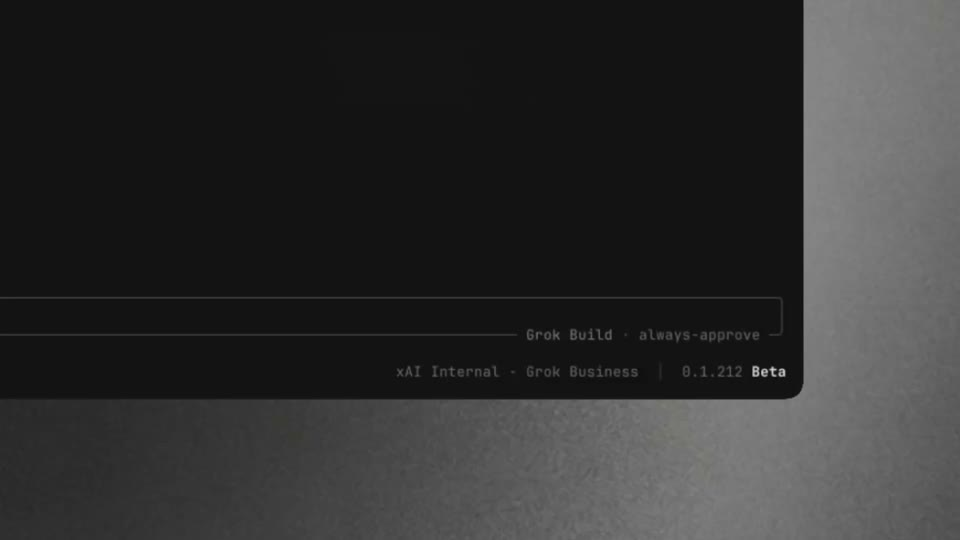
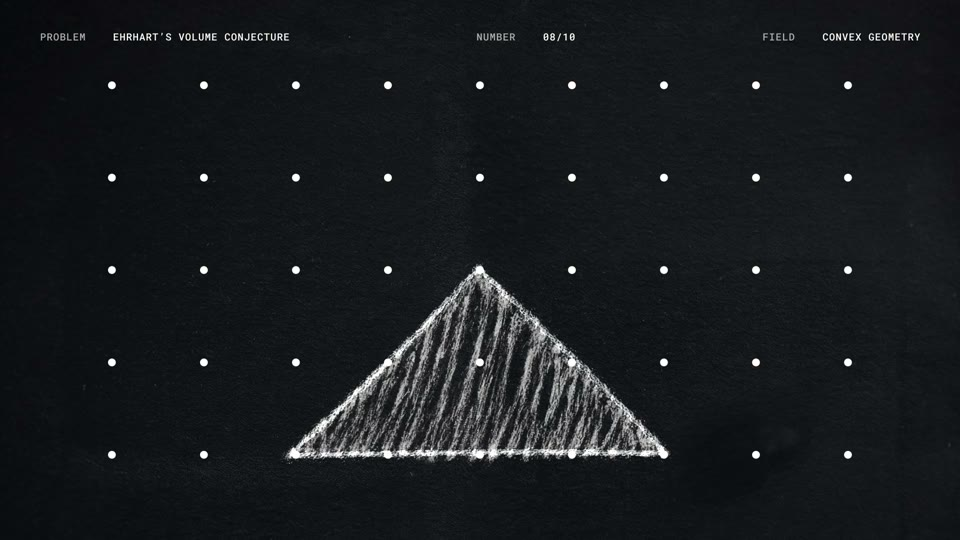

# D6 The dark instrument

The board as rendered: [RefDir06.jpg](RefDir06.jpg). Its text and frames follow, in order.

---

DIRECTION 6 · 9 FILMS · 414M VIEWS

## The dark instrument

A black stage where the product reads like an instrument: idle dots turn into live bars, grey words snap to white, there is one accent colour, and the product’s own sound is the soundtrack.

SpaceXAI · Voice cloning quiz · 0:13.0

SpaceXAI · Voice cloning quiz · 0:16.0

SpaceXAI · Voice cloning API · 0:14.5

SpaceXAI · Agent Tools API · 0:06.0

SpaceXAI · Grok Build · 0:07.0

OpenAI · Mathematical Advances · 0:15.5

### The rules

Near-black ground (#080808), one accent (orange #EB5811), rebuilt dark cards (#161616 with 1 px #2A2A2A borders).

Everything sits in the middle half; spaced-caps labels; one centred line at a time.

Idle = a grey dotted line. Live = accent bars or a karaoke caption.

No music: silence gates every event, and the picture only moves while the product makes sound.

Variant: a grain gradient world with letter-by-letter blur resolves and a steady tick pulse.

### For Kallo

A night version of logging: three macro slots sit idle as dotted lines and each goes live as the sentence is parsed, while the meal line snaps from grey to ink. Every sound is caused by the product.

WHY IT FITS

Precise, credible, and reads perfectly on mute; strong for a “how it works” cut.

WATCH OUT

Cold for food, and Kallo’s palette is warm. Better as a chapter or a cut-down than the whole film.

CARDS TO BUILD IT FROM

C5 Instrument layout: four rows in the middle halfH7 Give the viewer a questionT4 The colour sweep is the parseT3 Blur to sharp, letter by letterP12 The pipeline lights up in turnS2 The product is the soundtrackI2 A soft colour world instead of a void

### Films

SpaceXAI · Voice cloning API · 204M views

SpaceXAI · Voice cloning quiz · 119M views

SpaceXAI · Grok Build · 73M views

SpaceXAI · Polymarket · 5M views

OpenAI · Computer History · 4M views

SpaceXAI · Kalshi · 4M views

SpaceXAI · Agent Tools API · 3M views

OpenAI · Mathematical Advances · 2M views

SpaceXAI · Text to Speech API · 939K views
