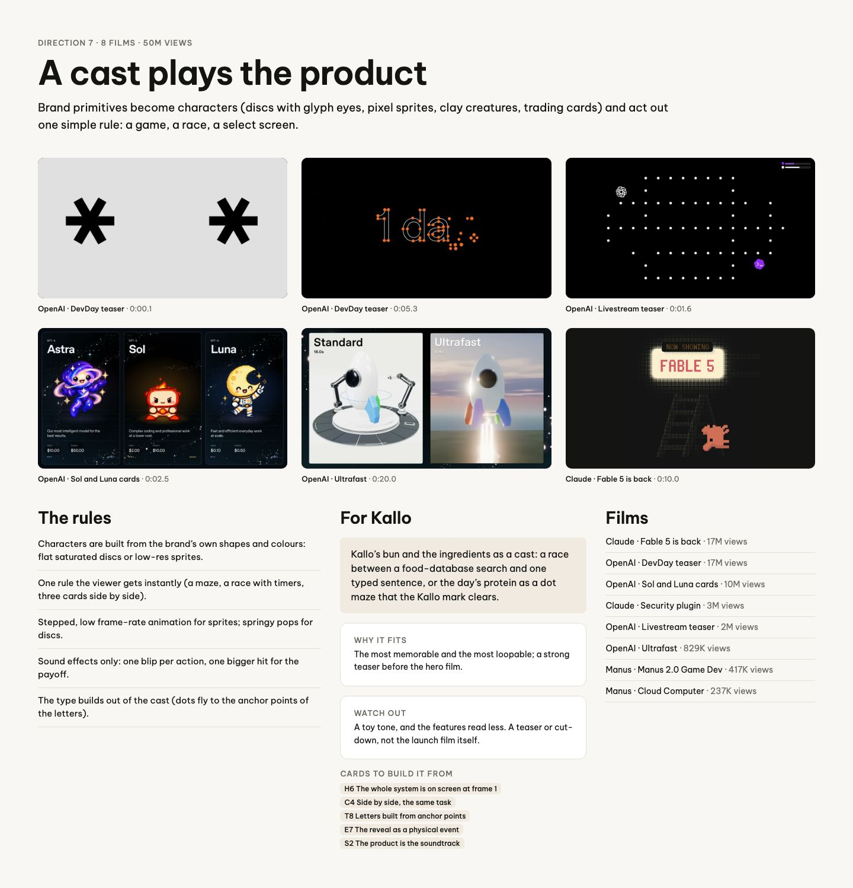
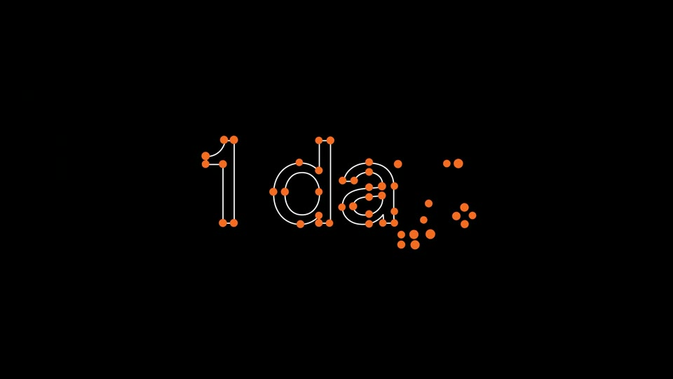
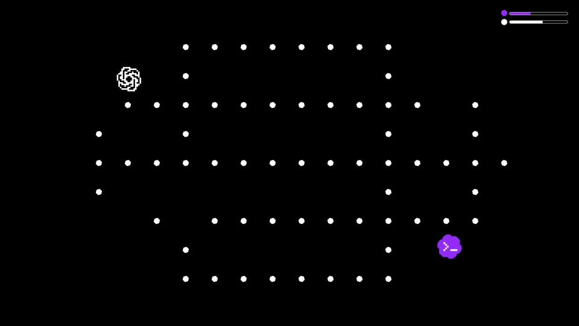
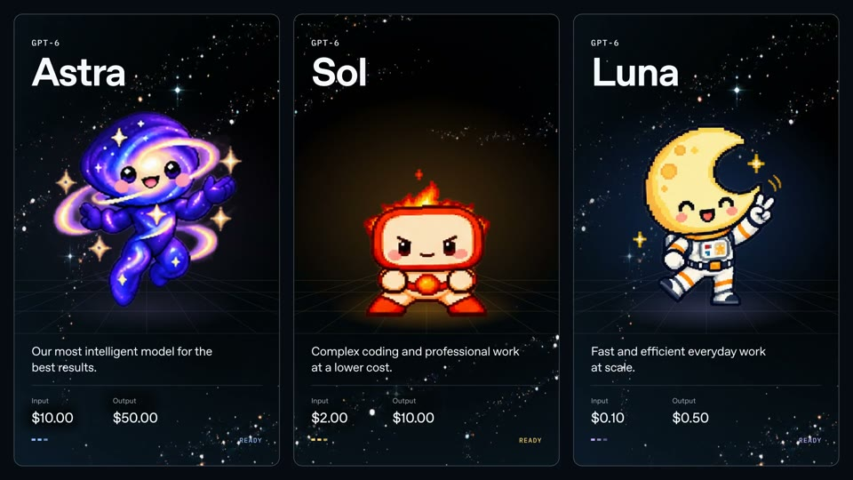
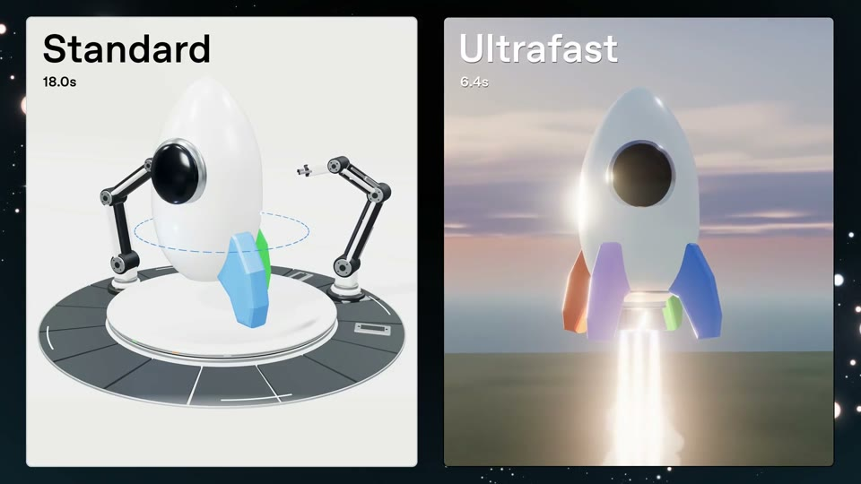
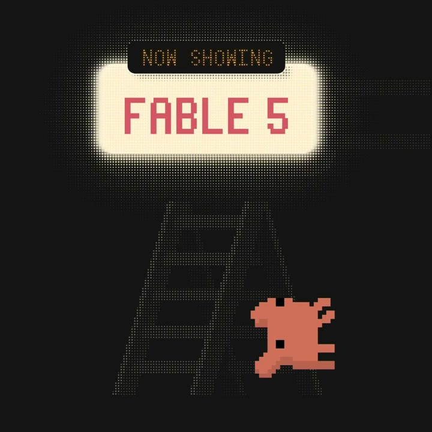

# D7 A cast plays the product

The board as rendered: [RefDir07.jpg](RefDir07.jpg). Its text and frames follow, in order.

---

DIRECTION 7 · 8 FILMS · 50M VIEWS

## A cast plays the product

Brand primitives become characters (discs with glyph eyes, pixel sprites, clay creatures, trading cards) and act out one simple rule: a game, a race, a select screen.

OpenAI · DevDay teaser · 0:00.1

OpenAI · DevDay teaser · 0:05.3

OpenAI · Livestream teaser · 0:01.6

OpenAI · Sol and Luna cards · 0:02.5

OpenAI · Ultrafast · 0:20.0

Claude · Fable 5 is back · 0:10.0

### The rules

Characters are built from the brand’s own shapes and colours: flat saturated discs or low-res sprites.

One rule the viewer gets instantly (a maze, a race with timers, three cards side by side).

Stepped, low frame-rate animation for sprites; springy pops for discs.

Sound effects only: one blip per action, one bigger hit for the payoff.

The type builds out of the cast (dots fly to the anchor points of the letters).

### For Kallo

Kallo’s bun and the ingredients as a cast: a race between a food-database search and one typed sentence, or the day’s protein as a dot maze that the Kallo mark clears.

WHY IT FITS

The most memorable and the most loopable; a strong teaser before the hero film.

WATCH OUT

A toy tone, and the features read less. A teaser or cut-down, not the launch film itself.

CARDS TO BUILD IT FROM

H6 The whole system is on screen at frame 1C4 Side by side, the same taskT8 Letters built from anchor pointsE7 The reveal as a physical eventS2 The product is the soundtrack

### Films

Claude · Fable 5 is back · 17M views

OpenAI · DevDay teaser · 17M views

OpenAI · Sol and Luna cards · 10M views

Claude · Security plugin · 3M views

OpenAI · Livestream teaser · 2M views

OpenAI · Ultrafast · 829K views

Manus · Manus 2.0 Game Dev · 417K views

Manus · Cloud Computer · 237K views
