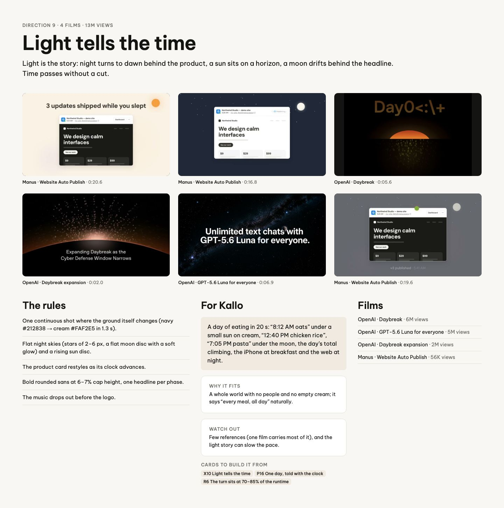
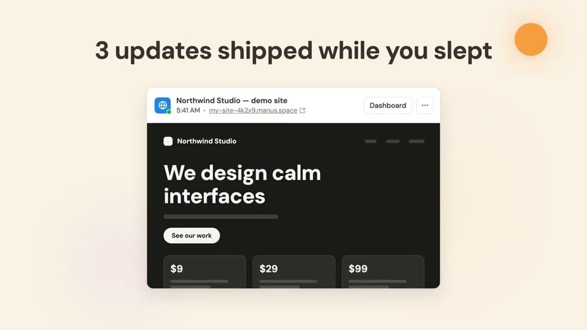
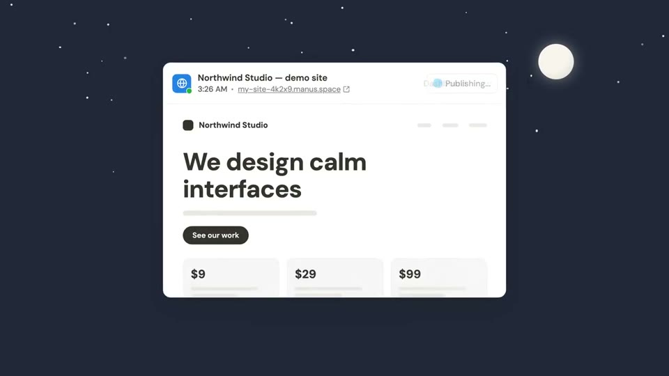
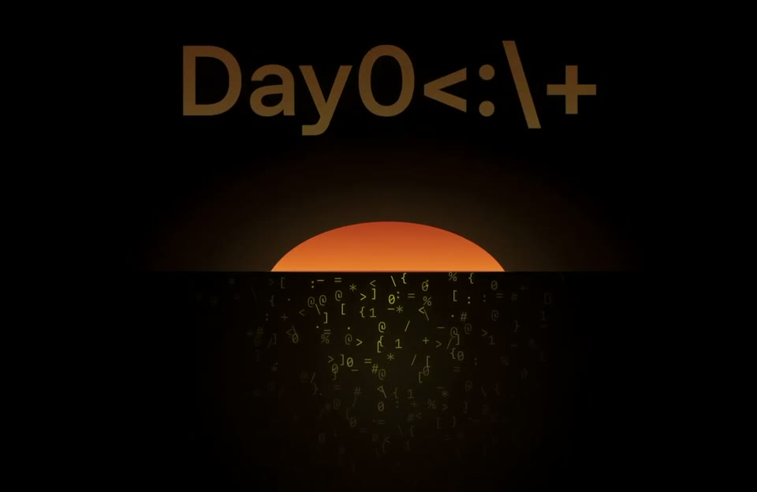
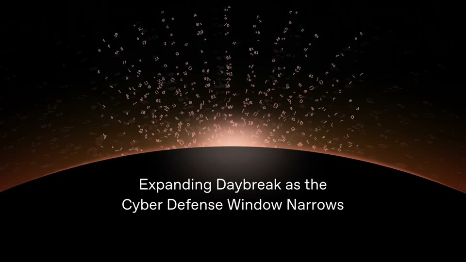
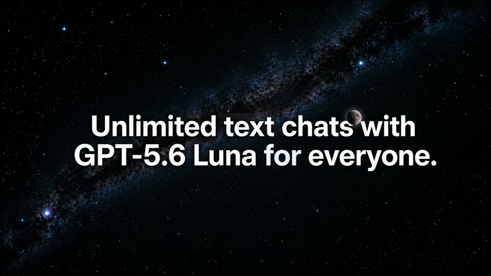
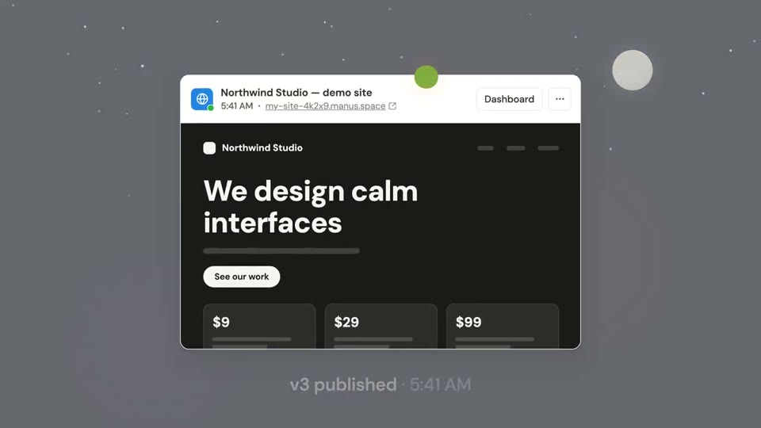

# D9 Light tells the time

The board as rendered: [RefDir09.jpg](RefDir09.jpg). Its text and frames follow, in order.

---

DIRECTION 9 · 4 FILMS · 13M VIEWS

## Light tells the time

Light is the story: night turns to dawn behind the product, a sun sits on a horizon, a moon drifts behind the headline. Time passes without a cut.

Manus · Website Auto Publish · 0:20.6

Manus · Website Auto Publish · 0:16.8

OpenAI · Daybreak · 0:05.6

OpenAI · Daybreak expansion · 0:02.0

OpenAI · GPT-5.6 Luna for everyone · 0:06.9

Manus · Website Auto Publish · 0:19.6

### The rules

One continuous shot where the ground itself changes (navy #212838 → cream #FAF2E5 in 1.3 s).

Flat night skies (stars of 2–6 px, a flat moon disc with a soft glow) and a rising sun disc.

The product card restyles as its clock advances.

Bold rounded sans at 6–7% cap height, one headline per phase.

The music drops out before the logo.

### For Kallo

A day of eating in 20 s: “8:12 AM oats” under a small sun on cream, “12:40 PM chicken rice”, “7:05 PM pasta” under the moon, the day’s total climbing, the iPhone at breakfast and the web at night.

WHY IT FITS

A whole world with no people and no empty cream; it says “every meal, all day” naturally.

WATCH OUT

Few references (one film carries most of it), and the light story can slow the pace.

CARDS TO BUILD IT FROM

X10 Light tells the timeP16 One day, told with the clockR6 The turn sits at 70–85% of the runtime

### Films

OpenAI · Daybreak · 6M views

OpenAI · GPT-5.6 Luna for everyone · 5M views

OpenAI · Daybreak expansion · 2M views

Manus · Website Auto Publish · 56K views
