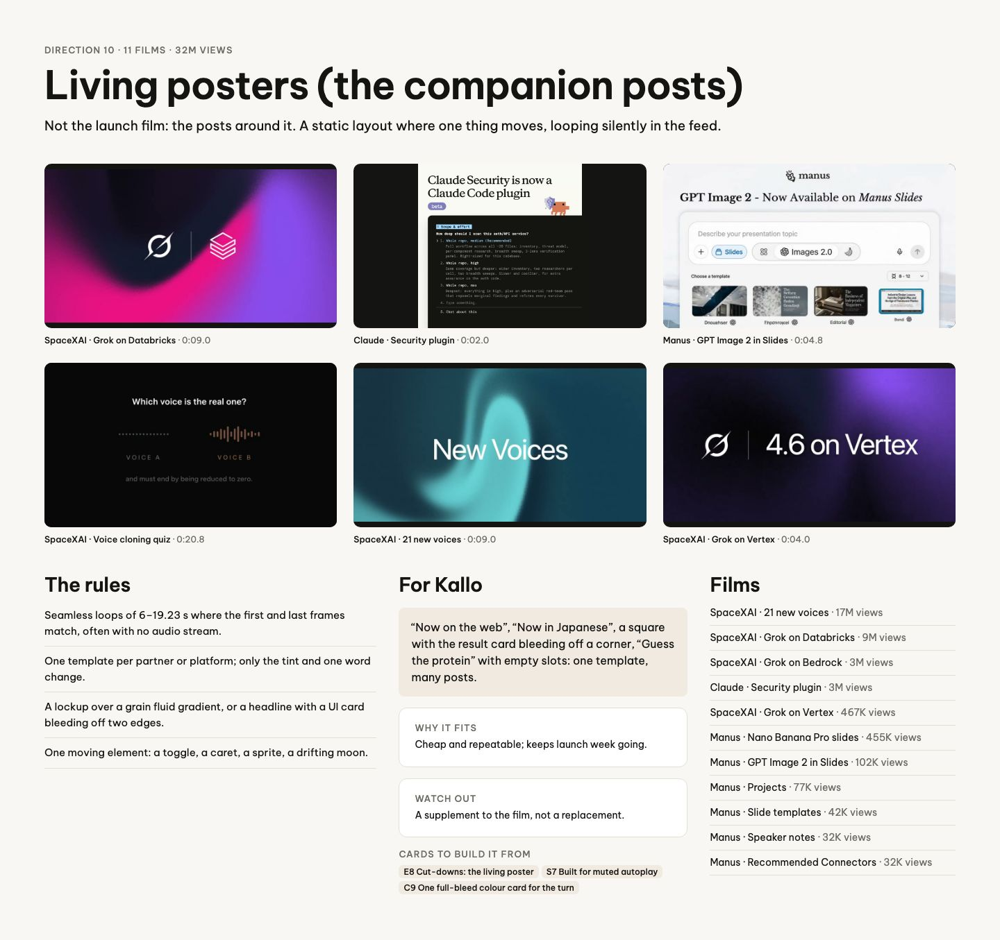
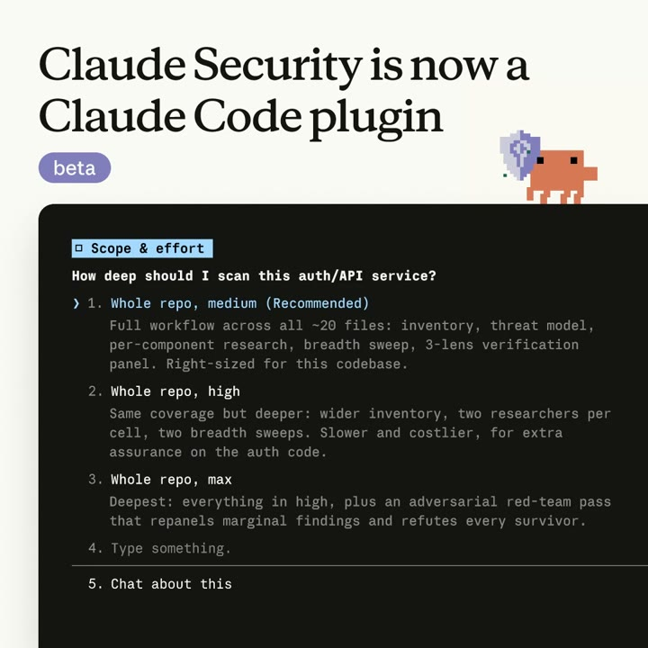
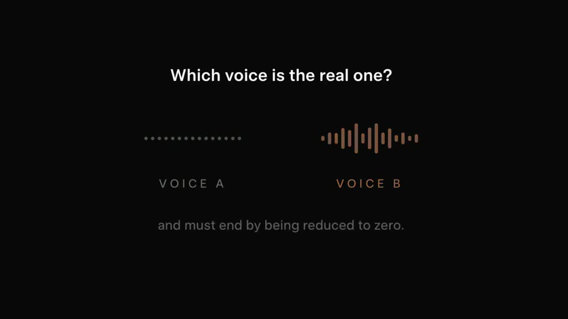
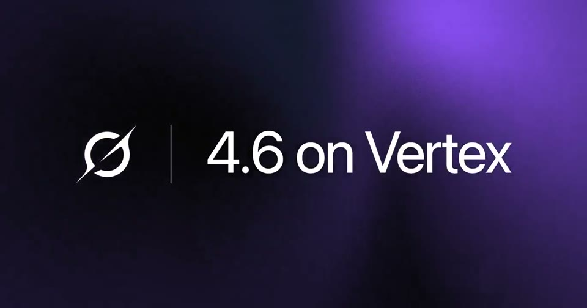

# D10 Living posters (the companion posts)

The board as rendered: [RefDir10.jpg](RefDir10.jpg). Its text and frames follow, in order.

---

DIRECTION 10 · 11 FILMS · 32M VIEWS

## Living posters (the companion posts)

Not the launch film: the posts around it. A static layout where one thing moves, looping silently in the feed.

SpaceXAI · Grok on Databricks · 0:09.0

Claude · Security plugin · 0:02.0

Manus · GPT Image 2 in Slides · 0:04.8

SpaceXAI · Voice cloning quiz · 0:20.8

SpaceXAI · 21 new voices · 0:09.0

SpaceXAI · Grok on Vertex · 0:04.0

### The rules

Seamless loops of 6–19.23 s where the first and last frames match, often with no audio stream.

One template per partner or platform; only the tint and one word change.

A lockup over a grain fluid gradient, or a headline with a UI card bleeding off two edges.

One moving element: a toggle, a caret, a sprite, a drifting moon.

### For Kallo

“Now on the web”, “Now in Japanese”, a square with the result card bleeding off a corner, “Guess the protein” with empty slots: one template, many posts.

WHY IT FITS

Cheap and repeatable; keeps launch week going.

WATCH OUT

A supplement to the film, not a replacement.

CARDS TO BUILD IT FROM

E8 Cut-downs: the living posterS7 Built for muted autoplayC9 One full-bleed colour card for the turn

### Films

SpaceXAI · 21 new voices · 17M views

SpaceXAI · Grok on Databricks · 9M views

SpaceXAI · Grok on Bedrock · 3M views

Claude · Security plugin · 3M views

SpaceXAI · Grok on Vertex · 467K views

Manus · Nano Banana Pro slides · 455K views

Manus · GPT Image 2 in Slides · 102K views

Manus · Projects · 77K views

Manus · Slide templates · 42K views

Manus · Speaker notes · 32K views

Manus · Recommended Connectors · 32K views
