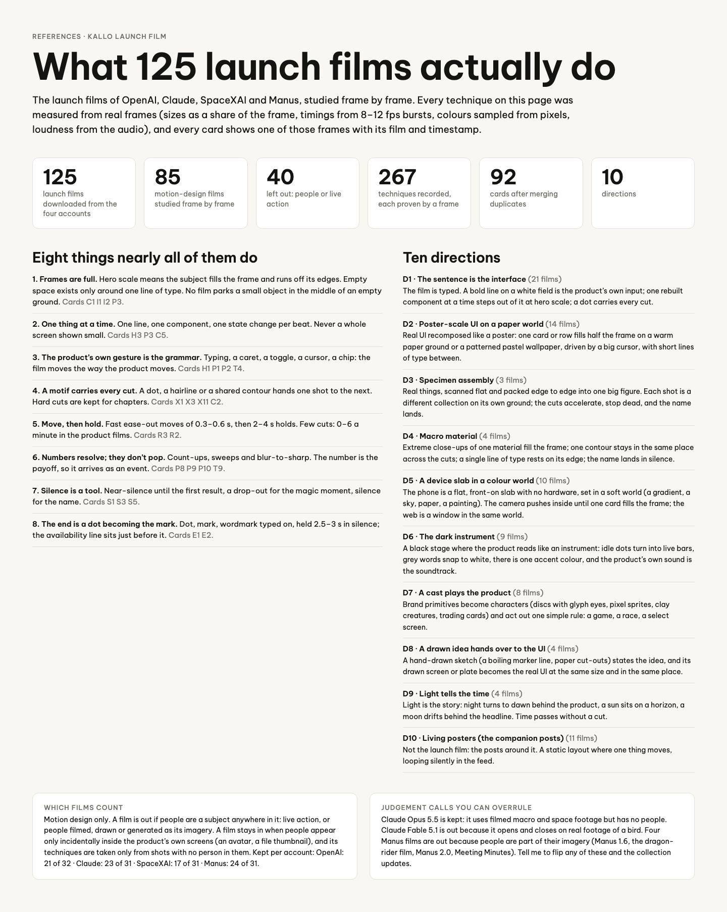

# Reference overview

The board as rendered: [RefOverview.jpg](RefOverview.jpg). Its text and frames follow, in order.

---

REFERENCES · KALLO LAUNCH FILM

## What 125 launch films actually do

The launch films of OpenAI, Claude, SpaceXAI and Manus, studied frame by frame. Every technique on this page was measured from real frames (sizes as a share of the frame, timings from 8–12 fps bursts, colours sampled from pixels, loudness from the audio), and every card shows one of those frames with its film and timestamp.

125 launch films downloaded from the four accounts

85 motion-design films studied frame by frame

40 left out: people or live action

267 techniques recorded, each proven by a frame

92 cards after merging duplicates

10 directions

### Eight things nearly all of them do

1. Frames are full. Hero scale means the subject fills the frame and runs off its edges. Empty space exists only around one line of type. No film parks a small object in the middle of an empty ground. Cards C1 I1 I2 P3.

2. One thing at a time. One line, one component, one state change per beat. Never a whole screen shown small. Cards H3 P3 C5.

3. The product’s own gesture is the grammar. Typing, a caret, a toggle, a cursor, a chip: the film moves the way the product moves. Cards H1 P1 P2 T4.

4. A motif carries every cut. A dot, a hairline or a shared contour hands one shot to the next. Hard cuts are kept for chapters. Cards X1 X3 X11 C2.

5. Move, then hold. Fast ease-out moves of 0.3–0.6 s, then 2–4 s holds. Few cuts: 0–6 a minute in the product films. Cards R3 R2.

6. Numbers resolve; they don’t pop. Count-ups, sweeps and blur-to-sharp. The number is the payoff, so it arrives as an event. Cards P8 P9 P10 T9.

7. Silence is a tool. Near-silence until the first result, a drop-out for the magic moment, silence for the name. Cards S1 S3 S5.

8. The end is a dot becoming the mark. Dot, mark, wordmark typed on, held 2.5–3 s in silence; the availability line sits just before it. Cards E1 E2.

### Ten directions

D1 · The sentence is the interface (21 films) The film is typed. A bold line on a white field is the product’s own input; one rebuilt component at a time steps out of it at hero scale; a dot carries every cut.

D2 · Poster-scale UI on a paper world (14 films) Real UI recomposed like a poster: one card or row fills half the frame on a warm paper ground or a patterned pastel wallpaper, driven by a big cursor, with short lines of type between.

D3 · Specimen assembly (3 films) Real things, scanned flat and packed edge to edge into one big figure. Each shot is a different collection on its own ground; the cuts accelerate, stop dead, and the name lands.

D4 · Macro material (4 films) Extreme close-ups of one material fill the frame; one contour stays in the same place across the cuts; a single line of type rests on its edge; the name lands in silence.

D5 · A device slab in a colour world (10 films) The phone is a flat, front-on slab with no hardware, set in a soft world (a gradient, a sky, paper, a painting). The camera pushes inside until one card fills the frame; the web is a window in the same world.

D6 · The dark instrument (9 films) A black stage where the product reads like an instrument: idle dots turn into live bars, grey words snap to white, there is one accent colour, and the product’s own sound is the soundtrack.

D7 · A cast plays the product (8 films) Brand primitives become characters (discs with glyph eyes, pixel sprites, clay creatures, trading cards) and act out one simple rule: a game, a race, a select screen.

D8 · A drawn idea hands over to the UI (4 films) A hand-drawn sketch (a boiling marker line, paper cut-outs) states the idea, and its drawn screen or plate becomes the real UI at the same size and in the same place.

D9 · Light tells the time (4 films) Light is the story: night turns to dawn behind the product, a sun sits on a horizon, a moon drifts behind the headline. Time passes without a cut.

D10 · Living posters (the companion posts) (11 films) Not the launch film: the posts around it. A static layout where one thing moves, looping silently in the feed.

WHICH FILMS COUNT

Motion design only. A film is out if people are a subject anywhere in it: live action, or people filmed, drawn or generated as its imagery. A film stays in when people appear only incidentally inside the product’s own screens (an avatar, a file thumbnail), and its techniques are taken only from shots with no person in them. Kept per account: OpenAI: 21 of 32 · Claude: 23 of 31 · SpaceXAI: 17 of 31 · Manus: 24 of 31.

JUDGEMENT CALLS YOU CAN OVERRULE

Claude Opus 5.5 is kept: it uses filmed macro and space footage but has no people. Claude Fable 5.1 is out because it opens and closes on real footage of a bird. Four Manus films are out because people are part of their imagery (Manus 1.6, the dragon-rider film, Manus 2.0, Meeting Minutes). Tell me to flip any of these and the collection updates.
